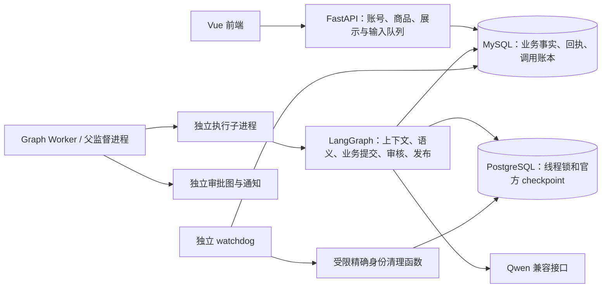

# SecondHand Agent · LangGraph

个人闲置交易协商助手。买家通过自然语言咨询、报价和修改条件；卖家设置私有授权策略、核实资料和审批；买家查看报价卡片并确认交易意向。`AGREED` 只表示意向达成，不包含支付、库存锁定或订单履约。

当前工程阶段为 **17.7 P6 清理与可交付运行**。实施、提交和测试证据见 [P6 阶段记录](docs/P6_实施与验收记录.md)，运行、恢复和归档见 [P6 手册](docs/P6_运行与复验.md)。
**公开试运行仍受 P5 门禁约束**：独立真人风险/质量证据、LangSmith 远端回收及延迟/费用业务容忍范围尚未完成。P6 的工程交付不替代这些门槛。详见 [P5 最终复验报告](docs/P5_120场景最终复验报告.md)。

## 当前运行链路



生产 API 只接收统一聊天契约，新会话固定 `negotiation-v3`。现有 v1/v2 图仍由对应图实现排空。关闭 `GRAPH_CHAT_ENABLED` 停止新建协商，不再创建旧 Runtime 会话；已有图任务继续恢复。旧 V2–V4 实现保留供历史回归和对照，生产 Compose 不启动旧 Worker，生产 API 不挂载旧聊天和旧模型任务恢复路径。

聊天请求先持久化并返回 `202`，前端轮询取得公开消息。业务授权始终由后端确定性规则核验；模型看不到私有价格阈值，也不能凭文本跳过展示、对象版本、审批或最终确认。

## 从零启动

需要 Docker Compose、Python 3.11；源码前端还需 Node.js `^22.18.0 || >=24.12.0`。在项目根目录执行：

```powershell
py -3.11 -m venv .venv
.\.venv\Scripts\python.exe -m pip install -r backend/requirements.lock
cd backend
..\.venv\Scripts\python.exe -m scripts.bootstrap_p6
cd ..
```

初始化器生成独立口令、认证签名密钥、演示密码及宿主机/容器 URL，保留已有有效配置。编辑本地 `.env` 中的 `MODEL_BASE_URL`、`MODEL_API_KEY`；模型默认 `qwen3.7-flash`。也可在初始化时指定 `--source-env <本地文件>`，仅导入模型/追踪白名单字段。配置值不打印、不提交 Git。

```powershell
docker compose up -d --build frontend
docker compose ps
```

该命令依次初始化 MySQL 与 PostgreSQL、执行 Alembic 迁移、官方 saver setup、受限角色配置及种子数据，然后启动 API、图 Worker、watchdog 与前端。容器只接收各自需要的环境变量；管理员和清理凭据不传给 API/Worker。

| 入口 | 默认地址 |
|---|---|
| 前端 | http://127.0.0.1:5174 |
| API 文档 | http://127.0.0.1:8100/docs |
| 进程存活 | http://127.0.0.1:8100/api/health |
| 完整就绪 | http://127.0.0.1:8100/api/ready |

`/api/ready` 在 Compose 中检查业务库、checkpoint 表、Worker/watchdog 最近进展及认证/模型配置；任一缺失返回 503。配置齐全不代表真实模型调用成功，真实能力用下方交付复验单独验证。所有端口仅监听本机。

Docker Hub 不可达时，仓库支持既有镜像源配置：

```powershell
$env:DOCKER_REGISTRY = "docker.m.daocloud.io"
docker compose up -d --build frontend
```

演示账号 `demo-seller`，密码见本地 `.env` 的 `DEMO_SELLER_PASSWORD`。也可分别注册卖家和买家。发布商品并维护可信资料后，买家发起协商；审批区报价由卖家处理；买家显示有效卡片后确认。卖家“恢复任务”页面处理图队首重试、安全终止及通知恢复。

## 配置与运行管理

配置模板见 [.env.example](.env.example)。MySQL 默认 `3307/secondhand_langgraph`，checkpoint 默认 `5433/secondhand_checkpoints`，与旧项目隔离。当前迁移 head 为 `a67db214f9c3`。新部署不需要 `AGENT_RUNTIME=V4` 等历史开关。

每输入冻结 10 次模型调用、180000 Token、120 秒累计模型活动预算；单次最多 45 秒，收尾窗口 15 秒。阶段验收模型调用无累计费用上限，不取消生产输入安全预算。配置每百万 Token 单价后记录估算费用；未知费用不会当作零。

默认关闭远端追踪。需要时配置 `GRAPH_LANGSMITH_TRACING=true` 和 LangSmith 凭据；全局 `LANGSMITH_TRACING` 保持 false，只有严格脱敏客户端能够导出原生追踪。无需远端账号也能从官方 checkpoint 导出节点执行历史。

```powershell
docker compose logs --tail 100 api worker watchdog
docker compose up -d --force-recreate api worker watchdog frontend
# 停止应用，保留双库和命名卷
docker compose stop frontend api worker watchdog
```

源码开发、容量限制、故障恢复、备份及回退步骤见 [P6 手册](docs/P6_运行与复验.md)。不要使用 `down -v` 清理运行数据，也不要把新版会话交给旧 Runtime。

## 验证

在 `backend/` 执行，数据库脚本只创建和删除本次临时库：

```powershell
..\.venv\Scripts\python.exe -m ruff check app evaluation tests scripts migrations
..\.venv\Scripts\python.exe -m scripts.run_p0_tests tests/p0 tests/graph --junitxml=../artifacts/p6/protocol.xml
..\.venv\Scripts\python.exe -m scripts.run_isolated_mysql_tests tests/unit tests/integration tests/test_health.py tests/test_model_contract.py --junitxml=../artifacts/p6/business.xml
```

协议测试和 P5 真实评测共享测试清理角色，必须串行运行。前端在 `frontend/` 执行 `npm ci`、`npm run build` 和 `npm audit --registry=https://registry.npmjs.org`。

完整交付复验需要有效模型配置，会在独立 Compose 项目与全新卷中验证账号、商品、聊天、审批、重启、展示确认、节点解释和备份恢复；固定测试端口 33307/55433/18100/15174，输出目录必须不存在：

```powershell
..\.venv\Scripts\python.exe -m scripts.run_p6_delivery --allow-real-model --output ../artifacts/p6/recheck
```

脚本结束后移除自己的容器和网络，保留本次卷、备份和报告供复查。真实评测入口及 P5 门禁见 [P5 运行文档](docs/P5_运行与复验.md)。GitHub Actions 分为无密钥确定性检查、真实双库协议/业务检查，以及显式手动触发的真实模型实验；本地测试结果不冒充远端 CI 已执行。

## 主要目录

- `backend/app/graphs/`：协商图与独立审批图。
- `backend/app/runtime/`：输入队列、租约、监督、清理与预算。
- `backend/app/semantic/`：意图、草案、可信事实和展示契约。
- `backend/app/services/`：确定性业务命令、通知、恢复和归档。
- `backend/app/persistence/`：官方 checkpoint、同连接线程锁、初始化权限。
- `backend/evaluation/p5/`：OpenEvals、AgentEvals、因果评估及追踪回收。
- `backend/tests/legacy_app.py`：仅用于继承系统回归的旧路由组合，不进入镜像。
- `frontend/src/`：账号、商品、统一聊天、报价卡片、审批及图恢复。

[完整重构方案](LangGraph重构完整方案.md) · [P6 记录](docs/P6_实施与验收记录.md) · [P6 运行手册](docs/P6_运行与复验.md) · [历史 V4 README](docs/V4_README_历史参考.md)
