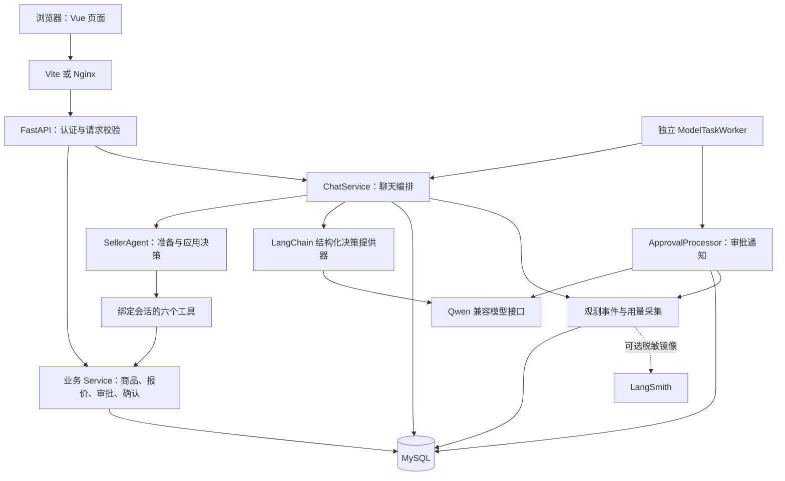
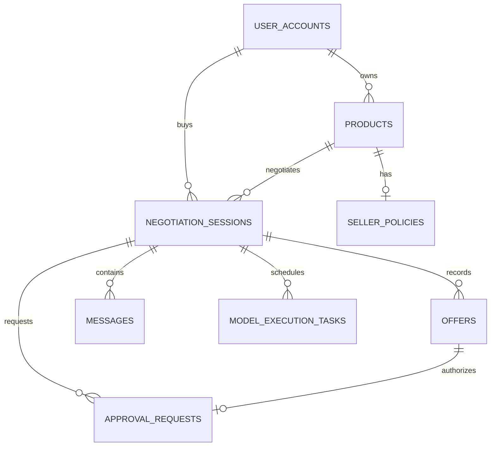
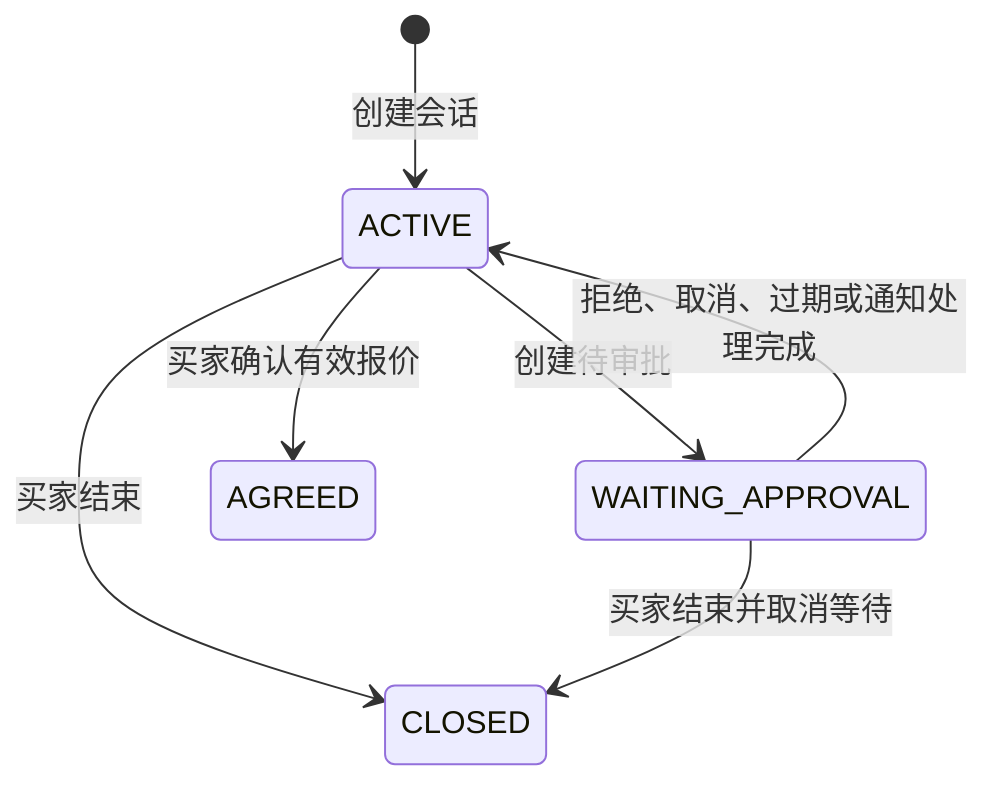
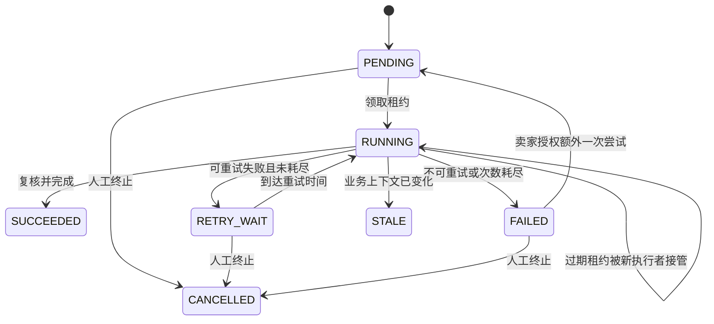

# SecondHand Agent 项目详细导读

> 阅读日期：2026-10-03。基于 Codebase Onboarding skill，对当前工作区的代码、配置、迁移、测试和已有文档进行核对。
>
> 代码基线：`0d9dcaf89edd347ab55891336d1acfe8f8633cf7`。开始阅读时，正式评测报告已有未提交修改，面试准备手册为未跟踪文件；本文没有覆盖这些已有工作。
>
> 本文用于理解项目和定位第一次改动。源码与配置是实现事实；设计方案中的后续目标、历史验收数字与本次验证结果分别标明。

阅读导航：

- [项目定位与用户流程](#1-先建立项目的整体认识)
- [架构、进程与目录地图](#5-总体架构与运行进程)
- [前端与后端接口](#7-前端如何组织业务)
- [数据模型与价格规则](#9-数据库模型系统怎样把协商变成业务事实)
- [Agent 与完整消息链路](#11-agent-层理解决策执行和回复各自做什么)
- [审批、确认和任务恢复](#13-审批闭环人工同意为什么还不等于交易意向)
- [可观测性与评测](#17-可观测性怎样把一次错误追到具体任务)
- [配置、测试和实际验证](#19-配置运行与环境模型)
- [首次改动、排障与能力边界](#22-第一次改动应该从哪里开始)
- [具体代码文件的阅读顺序](#25-推荐阅读顺序)

## 1. 先建立项目的整体认识

**SecondHand Agent 是一个以卖家规则约束大模型行为的二手交易协商系统。** 买家可以咨询商品、提交报价、等待卖家审批并确认交易意向；卖家可以管理商品、私有价格策略、审批和失败任务。

它的核心不是单纯生成一段议价回复，而是把“理解语言”“判断能否执行”“修改业务状态”“表达处理结果”分成可校验的环节：

```text
自然语言输入
  → 模型理解并提出结构化候选决策
  → 后端根据数据库中的最新事实和规则授权
  → 受约束工具执行业务动作
  → 从真实执行结果生成回复
```

有些动作完全由规则决定。例如，一份条件完整的正式买家报价已经达到自动接受阈值，后端会直接接受，无须让模型重复判断。进入人工审批区的正式报价也由后端直接创建审批。

项目的业务终点是 **交易意向确认**。会话状态 `AGREED` 表示买家确认了一份有效报价，并不表示付款、库存锁定、物流发货或实际成交。当前代码没有实现支付和订单履约。

来源：[README][readme]、[SellerAgent][seller-agent]、[报价路由][offer-routing]、[IntentService][intent-service]。

## 2. 谁在使用它，典型流程是什么

### 2.1 同一个账号可以承担两种业务身份

当前账号模型是统一的 `UserAccount`。账号没有固定的买家／卖家角色字段：发布某件商品时是该商品的卖家，协商别人商品时是买家。

因此，权限判断的重点是资源归属：

- 买家只能访问自己的协商会话。
- 卖家只能维护自己发布的商品及对应策略。
- 卖家只能处理自己商品对应的审批和恢复任务。
- 用户不能与自己发布的商品发起协商。

卖家工作台只是同一账号的另一组页面，不是另一套身份认证系统。

来源：[用户模型][user-model]、[认证依赖][dependencies]、[协商服务][negotiation-service]、[商品服务][product-service]。

### 2.2 买家路径

1. 注册或登录统一账号。
2. 浏览商品大厅、卖家主页和商品详情。
3. 针对某件商品创建或复用一个未结束的协商会话。
4. 发送商品咨询，或者通过报价表单提交结构化正式报价。
5. 报价被自动接受、触发人工审批，或者被拒绝／产生合法还价。
6. 确认当前有效报价，系统保存交易意向；也可以主动结束协商。

普通咨询和正式报价是两个不同概念。“2800 元行吗”这段文字不会自行变成可接受的正式报价；正式报价需要请求里的 `offer` 对象。

### 2.3 卖家路径

1. 发布商品，同时配置最低净收入、自动接受阈值、协商风格和最大轮次。
2. 管理商品状态，调整公开信息或私有策略。
3. 查看买家会话和历史报价。
4. 对待审批报价同意或拒绝。
5. Worker 生成并保存审批后续通知，买家通过轮询获取结果。
6. 模型任务停止自动执行时，卖家可授权额外一次任务尝试，或安全终止。

来源：[前端路由][frontend-router]、[协商页面][negotiation-view]、[卖家管理组件][seller-management]。

## 3. 已实现版本与方案文档的关系

根目录的 `SecondHand_Agent_项目完整方案_MySQL_V4_目录优化版.md` 是总体设计与演进计划，不能把文件名中的 V4 理解为所有 V4 能力已经落地。

从当前代码、迁移和交付文档可以确认：

| 阶段 | 在当前仓库中的体现 |
|---|---|
| 早期基础能力 | 商品、策略、协商、报价、消息、幂等及受约束 Agent 工具 |
| V2 | 身份认证、卖家审批、审批通知、买家最终确认 |
| V2.1 | 统一账号、商品大厅、卖家主页及统一资源授权 |
| V3 | 持久化模型任务、事务外调用、租约、迟到结果防护、有界重试、人工恢复、观测和评测 |
| V4 规划 | 单机云部署、HTTPS、备份恢复、监控告警与可选 CI/CD；本次没有找到完整的对应生产交付配置 |

当前存在本地 Docker Compose 和 Nginx 配置，证明具备容器化复现能力。仓库没有因此自动具备公网生产部署、多机高可用或完整运维流程。

最近提交主要围绕 V3 的安全、可观测性、评测和复现展开，最后一条提交更新 README。没有发现 `AGENTS.md`、`CLAUDE.md` 或专门的贡献规范；本文中的编码约定会区分 README 明文规则与代码中的观察结果。

来源：[总体方案][plan]、[V2.1 验收][v21-checklist]、[V3 交付文档][v3-delivery]、[Compose][compose]、本地 Git 历史。

## 4. 技术栈：每项技术实际承担什么职责

| 层次 | 仓库中的约束／技术 | 实际作用 |
|---|---|---|
| 后端语言 | Python `>=3.11,<3.12` | API、业务规则、Worker、评测和脚本 |
| Web 框架 | FastAPI | 路由、依赖注入、请求校验和 OpenAPI 文档 |
| 数据契约 | Pydantic、pydantic-settings | HTTP 请求响应、模型结构化输出、环境配置 |
| 模型编排 | LangChain `>=1.0,<2.0` | `create_agent`、原生结构化输出和用量回调 |
| 模型适配 | langchain-openai、Qwen 兼容接口 | 通过 `ChatOpenAI` 调用配置的千问模型 |
| 持久化 | SQLAlchemy 2.x、PyMySQL | 同步 ORM、事务、行锁和连接池 |
| 数据库 | Compose 使用 MySQL 8.4 | 业务事实、模型任务及观测事件 |
| 数据迁移 | Alembic | 版本化建表、升级和历史数据迁移 |
| 前端 | Vue 3、TypeScript、Vue Router | 页面、表单、账号状态和路由守卫 |
| 前端构建 | Vite、vue-tsc | 开发服务器、代理、类型检查和静态构建 |
| 前端运行要求 | Node.js `^22.18.0 || >=24.12.0` | 来自前端 `engines` 字段 |
| 运行与反向代理 | Uvicorn、Docker Compose、Nginx | 本地服务编排、静态页面和 `/api` 代理 |
| 验证 | Pytest、Ruff | 单元／集成回归、静态检查 |
| 可选外部观测 | LangSmith | 只镜像项目生成的脱敏事件元数据，默认关闭 |

`pyproject.toml` 和 `package.json` 声明兼容版本范围，`requirements.lock` 和 `package-lock.json` 保存固定依赖解析结果。表中的范围不等于当前安装的每一个具体包版本。

需要特别理解两点：

- 虽然 `create_agent` 的底层由框架编排，仓库没有实现自定义 LangGraph `StateGraph` 或原生 Checkpointer；业务恢复依赖 MySQL 模型任务表。
- 实际模型 Agent 配置 `tools=[]`。六个业务工具由自定义 `SellerAgent` 在候选决策通过校验后调用，模型不会直接选择数据库写工具并执行。

当前主链路没有使用 AgentScope、向量数据库、RAG 检索、Redis、Celery 或独立消息队列。不要从项目名称中的 Agent 推断这些组件存在。

来源：[后端清单][pyproject]、[前端清单][package]、[模型工厂][model-factory]、[决策提供器][decision-provider]、[模型任务服务][model-task-service]。

## 5. 总体架构与运行进程

### 5.1 模块化单体，API 与 Worker 分进程

业务代码在同一个后端包内共享，HTTP API 和后台 Worker 使用相同镜像及数据库。它们不是两个独立业务微服务。



### 5.2 进程和关键入口

| 入口 | 启动方式／职责 |
|---|---|
| 后端 HTTP | `python -m uvicorn app.main:app --reload`；`create_app()` 注册中间件和路由 |
| 独立 Worker | `python -m app.workers.model_task_worker`；交替处理聊天任务与审批通知 |
| 前端开发 | `npm run dev`；Vite 将 `/api` 转发到后端 |
| 容器前端 | Nginx 提供 Vue 静态文件，将 `/api/` 转发到 `api:8000` |
| 数据迁移 | `python -m alembic upgrade head` |
| 演示数据初始化 | `python scripts/seed_data.py` |
| 离线评测 | `python -m evaluation.cli` |
| 项目级演示 | 根目录 `scripts/run_v3_demo.ps1` |

聊天接口优先同步领取并执行自己新建的模型任务。Worker 接管待处理任务、到期重试和过期租约。前端使用 HTTP 轮询获取后续消息，当前没有 WebSocket 或 SSE 流式聊天接口。

来源：[应用入口][main]、[Worker][worker]、[Vite 配置][vite]、[Nginx 配置][nginx]、[Compose][compose]。

## 6. 目录地图：按职责阅读，而不是逐个文件背诵

```text
项目根目录
├─ README.md                         运行与使用总入口
├─ .env.example                      配置模板
├─ compose.yaml                      本地容器编排
├─ backend/
│  ├─ pyproject.toml / requirements.lock
│  ├─ app/
│  │  ├─ main.py                      FastAPI 应用入口
│  │  ├─ api/                         HTTP 接口、身份依赖、错误映射
│  │  ├─ schemas/                     HTTP 数据契约
│  │  ├─ core/                        配置、密码和身份令牌
│  │  ├─ db/                          ORM 模型、基类、数据库会话
│  │  ├─ services/                    业务规则和事务编排
│  │  ├─ agent/                       结构化决策、工具、回复安全策略
│  │  ├─ workers/                     后台任务和审批通知
│  │  └─ observability/               关联上下文、事件、Trace 镜像
│  ├─ migrations/                     Alembic 迁移链
│  ├─ evaluation/                     隔离实验、指标、报告、门禁
│  ├─ scripts/                        种子、演示、模型冒烟、观测导出
│  └─ tests/                          单元测试和 MySQL 集成测试
├─ frontend/
│  ├─ src/
│  │  ├─ main.ts / App.vue            页面启动与外壳
│  │  ├─ router/                      路由、登录守卫
│  │  ├─ state/auth.ts                统一账号状态与跨标签页同步
│  │  ├─ api/                         fetch 客户端、接口类型和调用函数
│  │  ├─ views/                       买家、卖家、登录、商品等页面
│  │  ├─ components/                  商品卡片和卖家管理组件
│  │  └─ style.css                    全局样式
│  ├─ vite.config.ts
│  ├─ nginx.conf
│  └─ Dockerfile
├─ docs/                             设计、分阶段交付、验收及效果报告
└─ scripts/run_v3_demo.ps1            本地完整演示脚本
```

HTTP 接口文件负责把请求转为领域输入，再调用 Service；规则和数据修改主要位于 `services/`。模型与自然语言相关行为位于 `agent/`。评测是单独的包，避免用对照实验直接修改真实业务数据。

几个阅读价值最高的文件：

| 文件 | 阅读时要回答的问题 |
|---|---|
| [pricing_service.py][pricing-service] | 什么条件允许自动接受、审批或必须阻断？ |
| [seller_agent.py][seller-agent] | 候选决策怎样被执行权限和回复规则约束？ |
| [chat_service.py][chat-service] | HTTP、事务、模型任务和消息幂等如何组合？ |
| [approval_service.py][approval-service] | 卖家审批授权的有效范围是什么？ |
| [approval_processor.py][approval-processor] | 审批如何通知买家，途中状态变化怎样处理？ |
| [intent_service.py][intent-service] | 哪些报价真正允许买家确认？ |
| [model_task_service.py][model-task-service] | 任务如何领取、重试、去重及防止过期执行？ |
| [evaluation/adapters.py][evaluation-adapters] | A/B/C 对照实验如何模拟业务执行？ |

## 7. 前端如何组织业务

### 7.1 页面与路由

| 页面路由 | 实现位置 | 作用 |
|---|---|---|
| `/` | `HomeView.vue` | 首页 |
| `/login`、`/register` | 对应登录／注册页面 | 统一账号认证 |
| `/buyer` | `BuyerView.vue` | 商品大厅 |
| `/buyer/negotiations` | `BuyerNegotiationsView.vue` | 当前账号的买家会话 |
| `/sellers/:sellerId` | `SellerPublicView.vue` | 卖家公开主页 |
| `/products/:productId` | `ProductDetailView.vue` | 商品详情和发起协商 |
| `/negotiations/:sessionId` | `NegotiationView.vue` | 咨询、正式报价、轮询、确认、关闭 |
| `/seller/products` 等四个工作台路径 | `SellerView.vue` → `SellerManagement.vue` | 商品、审批、会话、恢复任务 |

路由守卫先调用 `auth.initialize()` 获取 `/auth/me`。需要登录的页面在未认证时跳转登录页并保留原目标；已登录账号访问登录／注册页面时回到首页。

前端守卫帮助用户导航，后端仍会对每次业务访问重新鉴权。

### 7.2 接口客户端和账号状态

`api/client.ts` 使用浏览器 `fetch`，统一设置 `credentials: 'include'`，由浏览器携带 Cookie。非成功响应转换成带 HTTP 状态码的 `ApiError`，401 会通知账号状态模块。

`state/auth.ts` 使用 Vue 的 `ref`、`computed` 和共享模块状态，当前未使用 Pinia。跨标签页通过 `BroadcastChannel` 同步登录／退出；不可用时使用 `storage` 事件。页面重新获得焦点时还会复核当前账号，减少“界面显示旧账号、Cookie 已切换为新账号”的错配。

### 7.3 协商页面的几个关键行为

- 正式报价通过单独表单填写金额、运费承担方、运费金额和配送方式。
- 买家承担运费与卖家承担运费的净收入含义不同；卖家包邮时必须知道运费。
- 发送请求使用 `crypto.randomUUID()` 生成 `request_id`。
- 在当前页面中，同一份输入遇到 409／503 后再次提交会保留原幂等键；输入改变时生成新的键。
- 买家页面每 2 秒增量拉取 `after_id` 之后的消息，并刷新会话状态。
- 卖家工作台每 3 秒按当前工作区刷新相关状态。
- 会话进入结束状态后，买家页面停止继续发送和轮询。

这个待重试输入保存在页面内存中，不能据此声称浏览器刷新之后仍完整保存所有发送重试状态。

来源：[前端路由][frontend-router]、[API 客户端][frontend-client]、[账号状态][frontend-auth]、[协商页面][negotiation-view]、[卖家组件][seller-management]。

## 8. 后端 API 与认证边界

### 8.1 默认主要接口

以下路径使用默认 `API_PREFIX=/api`。大部分业务接口通过 `CurrentUser` 绑定当前账号；具体资源归属继续由 Service 校验。

| 接口 | 用途 | 路由文件 |
|---|---|---|
| `GET /api/health`、`GET /api/ready` | 进程健康、数据库及配置就绪状态 | [health.py][health-api] |
| `POST /api/auth/register`、`POST /api/auth/login` | 注册与登录 | [auth.py][auth-api] |
| `GET /api/auth/me`、`POST /api/auth/logout` | 查询身份与退出 | [auth.py][auth-api] |
| `GET /api/products`、`GET /api/products/{id}` | 商品大厅和详情 | [products.py][products-api] |
| `POST /api/products` | 当前账号发布商品及策略 | [products.py][products-api] |
| `/api/sellers` 及其详情／商品列表 | 公开卖家信息和商品 | [sellers.py][sellers-api] |
| `GET /api/buyer/negotiations` | 当前买家的会话列表 | [buyer_negotiations.py][buyer-api] |
| `POST /api/negotiations` | 创建或复用会话 | [negotiations.py][negotiations-api] |
| `GET /api/negotiations/{id}` | 当前会话详情 | [negotiations.py][negotiations-api] |
| `GET/POST /api/negotiations/{id}/messages` | 增量消息查询／提交消息 | [negotiations.py][negotiations-api] |
| `POST /api/negotiations/{id}/confirm`、`/close` | 确认交易意向／关闭会话 | [negotiations.py][negotiations-api] |
| `/api/seller/products`、`/{id}`、`/{id}/policy` | 商品和策略管理 | [products.py][products-api] |
| `/api/seller/approvals`、`/{id}/approve`、`/{id}/reject` | 审批查询和决定 | [seller_approvals.py][approvals-api] |
| `/api/seller/negotiations` 及详情 | 卖家查询自己商品的会话 | [seller_negotiations.py][seller-negotiations-api] |
| `/api/seller/model-tasks`、`/{id}/retry`、`/{id}/terminate` | 失败任务查询与处置 | [seller_model_tasks.py][tasks-api] |

当前商品和卖家的公开读取 GET 接口不要求 `CurrentUser`，可以匿名查询公开信息；发布、维护商品和协商等操作要求登录。前端的商品大厅、商品详情和卖家主页路由设置了 `requiresAuth`，因此前端导航限制与后端公开读取接口的认证边界并不完全相同。

### 8.2 认证实现

密码使用带随机盐的 `scrypt` 保存。身份令牌是项目自定义的 HMAC-SHA256 签名载荷，包含最小身份与有效期字段；它不是通过 JWT 库实现的三段 JWT。

登录将令牌写入 `secondhand_user_session` Cookie，使用 `HttpOnly`、`SameSite=Lax`，`Secure` 由配置控制。后端验证签名和过期时间后，还要查询账号是否存在且启用。

`AUTH_SECRET` 没有源码中的可用默认密钥；至少 32 字符并且不能含 `CHANGE_ME` 占位文本。未配置时认证相关操作返回明确的 503。

来源：[security.py][security]、[认证 API][auth-api]、[依赖注入][dependencies]、[Settings][config]。

### 8.3 输入与错误契约

聊天请求拒绝未知字段，`content` 长度为 1～4000，`request_id` 为 8～56 位字母、数字、下划线或连字符。金额限制为两位小数，面交和运费字段也有组合校验。

常见状态码包括：

| 状态码 | 理解方式 |
|---|---|
| 401 | 身份缺失、失效或账号不再有效 |
| 404 | 资源不存在，或当前账号无权访问对应资源 |
| 409 | 幂等输入冲突、会话状态冲突、请求处理中或需要人工恢复等 |
| 422 | FastAPI／Pydantic 请求字段校验失败 |
| 503 | 认证／模型配置不足，或本轮模型暂时无法完成 |

同一个 409 有多个业务原因，需要读取具体 `detail`。不能把所有 409 都当成可以无条件换幂等键重试的临时错误。

来源：[聊天 Schema][negotiation-schema]、[聊天路由错误映射][negotiations-api]、[业务异常][errors]。

## 9. 数据库模型：系统怎样把协商变成业务事实

### 9.1 九张核心 ORM 表

| 表／模型 | 保存什么 | 为什么需要 |
|---|---|---|
| `user_accounts`／`UserAccount` | 账号、展示名、密码哈希、启用状态 | 统一买卖身份和资源归属 |
| `products`／`Product` | 卖家、标题、描述、标价、上下架状态 | 模型及买家可见的商品事实 |
| `seller_policies`／`SellerPolicy` | 底线、自动阈值、风格、轮次、版本 | 私有执行规则 |
| `negotiation_sessions`／`NegotiationSession` | 买家、商品、状态、当前／确认报价、版本 | 持久化协商上下文 |
| `offers`／`Offer` | 提出方、金额、成本、附加条件、状态、过期时间 | 每份正式报价的条件快照 |
| `messages`／`Message` | 对话正文、幂等键、输入指纹、Agent 结果、正式报价引用 | 可显示历史与重放依据 |
| `approval_requests`／`ApprovalRequest` | 报价引用、策略版本、审批决定、通知状态 | 卖家对具体报价的授权事实 |
| `model_execution_tasks`／`ModelExecutionTask` | 输入快照、业务引用、租约、重试、结果和用量 | 事务外模型执行及故障恢复 |
| `observability_events`／`ObservabilityEvent` | 关联标识、动作、结果、耗时、用量及脱敏属性 | 排障与审计辅助证据 |

这里的九张表不包含 Alembic 自己的迁移版本表。

### 9.2 关系图



图省略了当前／最终报价的反向外键及任务可选的报价、审批引用。观测事件用标识串联业务过程，其主要用途是追踪。

### 9.3 防错约束不是只写在 Python 中

- 每件商品最多一份策略：`seller_policies.product_id` 唯一。
- 报价金额／成本使用 `Numeric(12,2)`，并有非负约束。
- 消息 `(session_id, request_id)` 唯一，防止重复落库。
- 任务 `(task_type, business_key)` 唯一，避免同一业务输入创建多份等价任务。
- 每份报价最多一份审批：审批 `offer_id` 唯一。
- `pending_session_id` 是数据库计算列，只在审批为 `PENDING` 时等于会话 ID，配合唯一索引限制每个会话最多一条待审批。
- 任务约束要求 `RUNNING` 必须具备完整租约，其他状态清空租约；`RETRY_WAIT` 必须具备下次尝试时间。

`Offer` 的交易条件按快照保存，新条件产生新报价记录；状态可以变化。审批绑定旧报价时，不能通过改写同一报价金额来“沿用”旧授权。

来源：[ORM 基类][db-base]、[用户][user-model]、[商品][product-model]、[策略][policy-model]、[会话][session-model]、[报价][offer-model]、[消息][message-model]、[审批][approval-model]、[任务][task-model]、[观测][observation-model]。

### 9.4 迁移链表达了项目的演进

迁移从 `20260924_0001` 连续到 `20260928_0009`：基础业务表 → 消息幂等元数据 → 身份认证 → 审批状态 → 意向确认 → 统一账号 → 模型执行任务 → 有界恢复 → 结构化观测。

本次读取确认源文件的 `revision/down_revision` 构成一条连续链。没有连接数据库执行 `alembic current`，所以 `0009` 是仓库迁移链的终点，不是本次已经确认的数据库实际版本。

来源：[迁移目录][migrations]。

## 10. 价格授权：最值得先读的一层

### 10.1 判断的是卖家净收入

```text
卖家净收入 = 买家支付金额 − 卖家承担的运费 − 卖家承担的优惠
```

买家承担运费时，该运费不从卖家收入中扣除。卖家承担运费却不知道运费金额，或者卖家承担的优惠未知时，系统拒绝计算和授权。

领域计算使用 `Decimal`，不使用二进制浮点数决定价格边界；金额必须有限、非负、最多两位小数，并能放入数据库字段。

### 10.2 三个区间与边界

设最低净收入为 `M`，自动接受阈值为 `A`，且 `A ≥ M`：

| 净收入 | 区间 | 执行权限 |
|---|---|---|
| `net ≥ A` | `AUTO_ACCEPT` | 允许自动接受；允许 Agent 发布符合条件的正式还价 |
| `M ≤ net < A` | `APPROVAL_REQUIRED` | 当前正式买家报价可以申请卖家审批 |
| `net < M` | `PROHIBITED` | 禁止接受，也不能借卖家审批绕过最低净收入 |

**示例仅用于解释规则，不代表当前数据库的配置：** 假设 `M=2700`、`A=2850`。

| 买家支付 | 运费承担与金额 | 卖家优惠 | 净收入 | 结果 |
|---:|---|---:|---:|---|
| 2850 | 买家承担 | 0 | 2850 | 自动接受边界 |
| 2850 | 卖家承担 30 | 0 | 2820 | 人工审批区 |
| 2700 | 买家承担 | 0 | 2700 | 人工审批下边界 |
| 2700 | 卖家承担 30 | 0 | 2670 | 禁止接受 |
| 2900 | 卖家承担、金额未知 | 0 | 无法计算 | 不能授权 |

同样的支付金额，因为包邮和优惠条件不同，可能进入不同区间。

### 10.3 附加条件与权限结果

当前自动授权的附加条件仅支持空对象，或只包含合法 `delivery_method` 的对象，取值为 `shipping`／`pickup`。新增赠品、保证某天发货、预留商品等未知条件，不能直接获得正式承诺权限。

`authorize_offer()` 把价格区间与条件合法性合成为 `OfferAuthorization`。工具序列化时只给 Agent 可执行布尔值及原因代码，不输出具体的 `minimum_net_price`、`auto_accept_threshold`，也不输出净收入金额。

一个容易忽略的约束是：**Agent 主动发布的还价只能位于自动授权区。** 审批区用于卖家确认当前正式买家报价；模型不能自己生成一份低于自动阈值的正式 Agent 还价，再假定它已经获准。

来源：[pricing_service.py][pricing-service]、[协商工具][negotiation-tools]、[工具序列化][tool-serialization]。

## 11. Agent 层：理解、决策、执行和回复各自做什么

### 11.1 模型输出不是任意 JSON

`NegotiationDecision` 的动作包括：

| 动作 | 语义 | 主要字段约束 |
|---|---|---|
| `INQUIRY` | 商品咨询或条件咨询 | 必须有 1～8 项 `dialogue_acts` |
| `ACCEPT` | 候选接受当前正式买家报价 | 必须有 `offer_id`，不允许混入还价字段 |
| `COUNTER` | 候选提出新还价 | 必须有价格和运费承担方，不允许引用旧 `offer_id` |
| `REJECT` | 拒绝本轮条件 | 不带报价 ID 或还价条件 |
| `REQUEST_APPROVAL` | 候选请求卖家审批 | 必须有 `offer_id`，不允许混入还价字段 |

Pydantic 校验跨字段约束。Schema 还专门简化发给千问的 Decimal 描述，运行时继续保留两位小数的精确校验。

`LangChainDecisionProvider` 用 `ProviderStrategy(..., strict=True)` 请求模型原生结构化输出。发生 `StructuredOutputValidationError` 时，补充字段规则纠错一次；这不是无限循环。

来源：[决策契约][decision]、[决策提供器][decision-provider]。

### 11.2 多个话语意图可以组合处理

`DialogueAct` 用 `kind` 表示话语作用，用 `subject` 表示业务概念。例如：

```text
“可以包邮并保证今天发货吗？”
  → REQUEST_TERM / SHIPPING_PAYER / seller
  → REQUEST_COMMITMENT / DISPATCH_DEADLINE / today
```

后端 `DialoguePolicyService` 决定每项意图可以怎样回答，组合成可信回复计划。模型识别到一个要求，不表示系统已经授权这个要求。

只有回复计划全部属于允许的低风险商品信息或寒暄时，才可能采用模型候选文案；涉及价格、底价、运费、发货或留货承诺时，后端按自己的计划生成表达。

候选文案仍会经过长度、Unicode 归一化、禁止表达和公开数字等检查。不安全时回到后端生成的安全回答。这些检查能加固已覆盖情形，但不是对任意自然语言事实正确性的数学证明。

来源：[Prompt][prompts]、[回复策略][reply-policy]、[回复策略测试][reply-tests]。

### 11.3 六个工具及其边界

| 工具 | 类型 | 后端依赖 | 核心限制 |
|---|---|---|---|
| `get_product_info` | 只读 | `ProductService` | 当前已授权会话的公开商品事实 |
| `get_negotiation_state` | 只读 | `NegotiationService` | 当前会话及非敏感策略信息 |
| `evaluate_offer` | 只读规则判断 | `NegotiationService`、价格规则 | 返回权限，不返回私有阈值 |
| `submit_counter_offer` | 写报价 | `NegotiationService` | 最新自动授权区和可验证附加条件 |
| `accept_offer` | 写报价状态 | `NegotiationService` | 当前、有效、自动授权的买家报价 |
| `request_approval` | 写审批 | `ApprovalService` | 本轮当前正式买家报价及对应策略版本 |

工具通过闭包绑定 `AgentToolContext(session_id, buyer_id, current_turn_offer_id)`。这些身份／会话字段来自后端，不交给模型填写。

工具返回统一的 `ok` 和结果／错误对象。`SellerAgent` 只有在工具成功并检查结果结构之后，才使用它生成正式回复。

来源：[工具上下文][tool-context]、[商品工具][product-tools]、[协商工具][negotiation-tools]、[审批工具][approval-tools]、[工具序列化][tool-serialization]。

### 11.4 正式回复从业务事实产生

`FormalReplyRenderer` 根据工具返回的实际报价快照表达接受、还价及审批结果，校验提出方、状态和报价 ID。

它不会直接把模型的 `reply` 或 `reason` 当成已经生效的交易事实。审批原因也由真实报价字段生成，防止模型捏造“卖家已同意”之类内容后进入卖家工作台。

审批后续模型会输出 `acknowledged_event`、候选原因和文案。后端验证它确认的事件与真实审批一致，最终通知仍由可信报价事实渲染。当前实现仍会在这一步调用模型；不能因为最终文案确定，就认为审批通知已经完全去除了模型依赖。

来源：[正式回复渲染器][reply-policy]、[审批工具][approval-tools]、[审批后续 Agent][approval-followup]。

## 12. 完整追踪：买家发送一次消息发生了什么

这是理解整个项目最有价值的一条调用链。

```text
NegotiationView.submitMessage()
  → frontend/src/api/negotiations.ts::sendMessage()
  → POST /api/negotiations/{session_id}/messages
  → CurrentUser + SendMessageRequest
  → ChatService.send_buyer_message()
  → _prepare_turn()
      ├─ 规则已确定 → 执行工具、保存回复、提交事务
      └─ 需要模型 → 保存买家消息和模型任务、提交事务
  → _execute_pending_turn()：领取租约
  → _execute_leased_turn_observed()：事务外调用 DecisionProvider
  → _finalize_model_turn()：新事务复核最新状态
  → SellerAgent.apply_prepared() → 受约束工具
  → 保存 Agent 消息与任务终态
  → HTTP 响应，或由前端轮询获取后续回复
```

### 12.1 接口入口：先绑定真实身份

路由从 Cookie 获取当前账号，将请求字段转换为 `BuyerOfferSubmission`。买家 ID 来自认证，不从请求正文或模型输出接收。

发送接口会注入已配置的决策提供器。因此，虽然部分正式报价可以完全按规则处理，当前 HTTP 发送入口仍要求模型配置可用。

### 12.2 第一个短事务：冻结输入

`_prepare_turn()` 对当前会话加行锁，随后：

1. 查找相同 `request_id` 的买家消息。
2. 对已有消息复核输入指纹；完整结果可重放，内容不同则冲突。
3. 拒绝结束会话上的新消息。
4. 同一会话存在活跃聊天模型任务时，阻止另一条新消息并发进入。
5. 提取最近最多 20 条历史消息。
6. 如果带有新正式报价，保存报价；等待审批时先取消旧待审批。
7. 保存买家消息及其 SHA-256 输入指纹。
8. 构建绑定当前会话的工具并调用 `SellerAgent.prepare_turn()`。

自动接受／审批路由在这里可以确定并完成，直接保存 Agent 回复。只有必须调用模型的分支才创建 `CHAT_DECISION` 任务，保存输入快照、版本和业务引用后提交事务。

### 12.3 第二个短事务：领取执行租约

API 尝试为该任务领取租约，使用专属的租约令牌区分不同执行者。领取失败时根据当前任务状态返回处理中、等待重试、需要人工恢复等结果，而不是再创建一个新任务。

### 12.4 事务外：执行慢且可能失败的模型请求

提供器接收商品公开事实、会话状态、本轮正式报价 ID 和近期历史。模型输出解析成 `NegotiationDecision`，同时采集可取得的 Token 用量。

这一阶段不持续持有业务写事务，避免模型网络等待长期占住数据库行锁。

### 12.5 第三个短事务：旧答案必须重新验证

`_finalize_model_turn()` 重新锁定任务／会话及相关业务事实，检查：

- 当前租约是否仍属于该执行者并有效。
- 会话版本是否与任务冻结时一致。
- 卖家策略版本是否变化。
- 当前报价是否仍是任务关联报价。
- 商品公开字段是否发生改变。
- 会话上下文与输入快照是否仍匹配。
- 等价 Agent 回复是否已经存在。

上下文变化时，旧模型决策不执行，任务标记 `STALE`，并保存说明条件已变化的安全回复。

通过复核后，重新构建绑定最新事务的工具应用候选决策。在同一外层事务内保存业务动作、Agent 回复和任务成功结果；内部 Service 通过同一数据库连接的 savepoint 参与，避免工具写入提前脱离编排事务提交。

来源：[聊天路由][negotiations-api]、[聊天服务][chat-service]、[SellerAgent][seller-agent]、[任务服务][model-task-service]。

## 13. 审批闭环：人工同意为什么还不等于交易意向

### 13.1 创建审批

审批只针对本轮当前正式买家报价创建，重新判断净收入是否位于审批区，并绑定当时的 `policy_version`。

审批截止时间由工具设置为默认 24 小时，并且不能晚于报价自身的到期时间。会话进入 `WAITING_APPROVAL`。

买家在等待时仍可咨询公开商品信息；提交新正式报价时，旧待审批被取消，系统重新评估新报价。

### 13.2 卖家处理审批

`ApprovalService` 检查商品归属、审批状态、当前报价、商品可用性、策略版本和有效期。同意／拒绝保存决定和通知幂等键，将通知状态置为 `PENDING`。

同意只是记录卖家授权，仍等待通知处理；拒绝会将报价标记拒绝并恢复会话可继续协商的状态。审批已过期或与真实状态不匹配时，不能沿用原授权。

### 13.3 Worker 处理通知

`ApprovalProcessor` 从已同意／拒绝且需要通知的审批中领取任务，使用 `APPROVAL_FOLLOWUP` 持久化快照与租约。它在事务外请求候选通知，新事务中复核事件和业务上下文后保存最终消息。

批准通知正常完成时，会将报价置为 `ACCEPTED`，等待中的会话恢复 `ACTIVE`，通知状态为 `SENT`。途中商品、策略或报价失效时发送安全失效通知，不能继续表达旧授权。

Worker 与 API 共享业务库，前端无需直接访问 Worker。Worker 停止或任务失败时，卖家可能已经审批，但买家暂时无法收到通知或确认该报价。

### 13.4 买家最终确认

`IntentService.confirm_offer()` 重新验证当前报价，并要求可证明的授权来源，具体有三种：

| `ConfirmationSource` | 必要依据 |
|---|---|
| `AGENT_COUNTER` | 当前 Agent 正式还价、仍在自动授权区、存在正式还价消息 |
| `AUTO_ACCEPTED_BUYER_OFFER` | 当前买家报价已经接受、仍可自动授权、存在正式接受消息 |
| `SELLER_APPROVED_BUYER_OFFER` | 审批已同意、通知已发送、策略版本仍匹配、存在正式批准消息 |

通过后保存 `confirmed_offer_id`、确认时间、来源及系统消息，把会话变为 `AGREED`。没有有效报价／审批事实时，仅凭一句“我同意了”不能完成确认。

来源：[审批服务][approval-service]、[审批工具][approval-tools]、[审批处理器][approval-processor]、[意向服务][intent-service]。

## 14. 四套状态要分开理解

### 14.1 会话状态



自动接受买家报价通常只改变报价状态和会话版本，会话仍是 `ACTIVE`；不是自动切换成 `AGREED`。

### 14.2 报价、审批、通知与 Agent 结果

| 类型 | 状态或代表值 | 含义 |
|---|---|---|
| 报价 | `PROPOSED / ACCEPTED / REJECTED / WITHDRAWN` | 具体报价条件是否仍可使用 |
| 审批 | `PENDING / APPROVED / REJECTED / CANCELLED / EXPIRED` | 卖家决定是否有效 |
| 审批通知 | `PENDING / SENT / FAILED / MANUAL_REQUIRED` | 结果是否已形成通知，是否需要恢复 |
| Agent 本轮结果 | `INFORMATIONAL / COUNTER_OFFERED / OFFER_ACCEPTED` 等 | 本轮执行与回复结果 |

`OFFER_ACCEPTED` 是本轮结果，`ACCEPTED` 是报价状态，`AGREED` 是买家最终确认后的会话状态。把这三者混为“成交”会导致错误的 UI 和统计。

正式买家报价增加 `round_count`；普通聊天不自动增加报价轮次，Agent 回应还价也不是每次都额外增加一轮。最大轮次限制由 `NegotiationService` 处理，包括对最后一轮当前买家报价的回应边界。

来源：[枚举定义][enums]、[协商服务][negotiation-service]、[审批服务][approval-service]、[Agent 结果][seller-agent]。

## 15. 持久化任务、幂等和恢复如何配合

### 15.1 为什么需要模型任务表

只在 HTTP 请求内调用模型，会遇到 API 重启、连接断开、模型超时或执行者崩溃后不知道“输入是否已保存、模型是否已返回、动作是否已执行”的问题。

`ModelExecutionTask` 保存不可变输入快照及哈希、会话／策略版本、相关报价／审批、尝试次数、租约和结果。Worker 因此可以恢复同一个业务任务，而不是从一条日志猜测下一步。

### 15.2 任务状态



还允许终止租约已过期的运行任务；有效租约仍在执行的任务不能被直接人工终止。

### 15.3 租约怎样防止不同执行者互相覆盖

任务领取使用数据库行锁。批量领取用 `FOR UPDATE SKIP LOCKED` 跳过其他执行者锁住的行，处理 `PENDING`、到期 `RETRY_WAIT` 和租约过期的 `RUNNING`。

领取时生成新的 `lease_token`、设置执行者和截止时间，并增加尝试次数。提交结果时要求令牌仍有效，旧执行者无法拿旧令牌覆盖接管者的结果。

租约减少业务重复执行，却不能保证外部模型服务只收到一次请求。进程失联后重新执行可能产生额外模型调用；系统重点保证正式业务结果去重和旧结果不越权写入。

### 15.4 幂等是多层设计

| 层次 | 手段 | 防止的问题 |
|---|---|---|
| 前端发送 | 同输入重试保留 `request_id` | 用户重试形成不同业务请求 |
| 买家消息 | 会话内幂等键唯一＋输入指纹 | 同键不同内容，或重复消息 |
| Agent 回复 | 派生回复键＋已有结果查询 | 重复生成正式回复 |
| 模型任务 | 类型＋业务键唯一，复核输入快照 | 为相同业务创建重复任务 |
| 审批／确认 | 请求标识、状态和事实复核 | 重复审核、旧报价确认 |

这些规则不是所有接口共享的一个通用中间件。各个业务操作有自己的重放条件，改动时应检查对应 Service 和测试。

### 15.5 有界重试

`ModelRetryPolicy` 对超时、429 限流、网络故障和结构化输出错误等做稳定分类，采用指数退避、上限和按任务／次数确定的抖动。原始异常内容不会直接作为买家回复或任务错误详情暴露。

默认配置为任务最多 3 次尝试，退避基数 2 秒、上限 300 秒、抖动比例 0.2、租约 300 秒。

需要区分三层重试：

1. 模型客户端的传输重试：默认 `MODEL_MAX_RETRIES=2`。
2. 决策提供器对字段组合错误的额外一次纠错。
3. 持久化任务级尝试：默认 `MODEL_TASK_MAX_ATTEMPTS=3`。

因此任务尝试次数不能直接当成真实 HTTP 请求次数，也不能假定一个任务最多只消耗三次模型调用。

### 15.6 人工恢复

卖家只能重试 `FAILED` 任务。每次人工授权把 `max_attempts` 增加 1，增加 `manual_retry_count` 并记录操作人、理由和时间；不会清零已有尝试记录后重新开放无限自动重试。

终止任务清理租约／重试时间并记录审计字段。聊天任务会保存安全终止消息；审批任务按当前事实转入需要人工处理的通知状态。

来源：[任务模型][task-model]、[任务服务][model-task-service]、[重试策略][retry-policy]、[人工恢复服务][recovery-service]、[Worker][worker]。

## 16. 安全边界和一致性设计

### 16.1 权限、数据和文案一起约束

| 风险 | 当前实现中的控制 |
|---|---|
| 买家伪造身份／会话 | Cookie 认证、Service 按资源归属查询、工具闭包绑定身份 |
| 买家要求忽略规则 | 输入标记为不可信数据，正式动作仍由后端复核 |
| 泄露私有价格 | 公开 DTO 和工具上下文不输出价格底线及自动阈值 |
| 模型假装审批通过 | 审批必须存在且与当前报价／策略版本匹配 |
| 模型文案越权承诺 | 正式交易回复使用可信报价渲染；咨询文案受策略限制 |
| 模型结果迟到 | 租约令牌、版本、报价引用和商品快照复核 |
| 同输入重复执行 | 消息／任务唯一约束、输入哈希和业务重放 |
| 成本字段缺失 | 不计算未知净收入，不授权未知附加条件 |
| 商品历史被删除 | 上架商品或已有协商历史的商品不允许直接删除 |

Prompt 是一层输入约束，后端规则、授权事实和数据库约束承担真正的执行边界。

### 16.2 版本号与行锁承担不同职责

行锁约束当前事务内的并发写入；`version` 和输入快照复核检测模型等待期间发生的改变。

卖家更新策略时提交 `expected_version`，数据库版本不匹配就报冲突；成功更新后版本增加。会话保存自己的版本，报价、审批和确认等动作会改变它。

二者配合，才能应对“模型调用时不能一直持锁，但回来之后又必须确定输入仍有效”的情况。

### 16.3 不能把本地安全机制解释成完整生产保障

当前源码没有提供完整的生产认证风控、线上调用额度体系、订单库存竞争和多机可用性方案。候选文案校验也不是任意语义的完整事实验证器。

任务输入快照保存业务消息和近期历史，以支持恢复。脱敏观测不等于数据库中的所有业务数据都已匿名化；后续生产部署需要明确数据保留和访问管理。

来源：[认证依赖][dependencies]、[回复策略][reply-policy]、[商品服务][product-service]、[聊天服务][chat-service]、[安全回归测试][security-regression]。

## 17. 可观测性：怎样把一次错误追到具体任务

### 17.1 三种标识不要混淆

| 标识 | 含义 |
|---|---|
| 业务正文里的 `request_id` | 消息／审批／确认重放的幂等标识 |
| HTTP `X-Request-ID` | 一次 HTTP 请求的追踪标识 |
| `X-Correlation-ID`／任务 `correlation_id` | 跨 API、任务和 Worker 串联过程 |

中间件只接受规范 UUID 作为请求／关联标识，无效值重新生成，并在响应头返回标识。用 `ContextVar` 传播最小上下文。

HTTP 完成事件主要写结构化日志；业务事件通过 `ObservabilityService` 写入本地事件表并输出 JSON 日志。日志／事件包含动作、结果、引用、尝试次数、耗时、错误分类和可取得的用量。

### 17.2 事件采用字段白名单

观测属性白名单只允许有限的状态和动作元数据；事件表不保存完整买家消息、密码、Cookie、API Key 或私有价格阈值。外部 LangSmith 镜像使用占位 `inputs/outputs` 和脱敏元数据，默认关闭。

观测落库或外部镜像失败采取尽力而为策略，记录失败但不阻断原业务。因此业务数据库里的报价／审批事实是执行依据，观测事件不是与业务写入原子一致的唯一账本。

### 17.3 用量和成本口径

LangChain 用量回调提供可取得的输入、输出和缓存输入 Token。`ModelUsageService` 连同运行时价格快照计算估算成本：

```text
估算费用 = [(输入 Token − 缓存 Token) × 普通输入单价
           + 缓存 Token × 缓存输入单价
           + 输出 Token × 输出单价] / 1,000,000
```

缺少必要用量、单价或币种时，费用保持未知。存在缓存用量而缺少缓存单价时也不能编造费用。项目中的费用是配置价格下的估算值，不是模型平台的最终账单。

排障时可以先保存响应的关联 ID，再通过 `scripts/export_observability.py` 按会话、关联 ID 或任务导出相关事件。

来源：[请求中间件][observation-middleware]、[关联上下文][observation-context]、[观测服务][observation-service]、[LangSmith 镜像][langsmith-sink]、[用量服务][usage-service]、[导出脚本][export-script]。

## 18. 评测体系：怎样证明“规则约束有作用”

### 18.1 三组对照的含义

| 组别 | 名称 | 实验中保留的能力 |
|---|---|---|
| A | `PROMPT_ONLY` | 模型候选直接由隔离评测器应用，缺少额外业务规则校验 |
| B | `RULE_ENGINE` | 模型候选经过价格规则约束，无完整人工审批工作流 |
| C | `FULL_WORKFLOW` | 使用生产一致的正式报价路由、动作约束及审批模拟 |

三组都在隔离内存适配器中运行，复用版本化合成场景与输入指纹。默认 `ScriptedEvaluationModel` 是可控模型替身，不访问真实模型，也不写业务库。

`SimulatedBuyer` 回放场景脚本。它不是一个额外在线自主买家模型；传入随机种子也不等于所有输入会随机生成。

当前默认加载 `scenarios/v2.json`，场景集版本 `2.0.0`，包含 100 个场景；默认 A/B/C 形成 300 个场景与实验组组合。

### 18.2 评测模块职责

| 文件 | 职责 |
|---|---|
| [scenarios.py][evaluation-scenarios] | 加载默认值、校验场景身份、生成内容哈希 |
| [buyer.py][evaluation-buyer] | 回放买家脚本，生成输入指纹 |
| [models.py][evaluation-models] | 模拟／真实模型及组别 Prompt |
| [adapters.py][evaluation-adapters] | 隔离应用候选、规则、审批和终态 |
| [runner.py][evaluation-runner] | 运行矩阵、预算、元数据和失败保留 |
| [metrics.py][evaluation-metrics] | 指标汇总、分子／分母、分布及 Wilson 区间 |
| [artifacts.py][evaluation-artifacts] | 写入新批次，不覆盖已有批次 |
| [reporting.py][evaluation-reporting] | 从原始事实生成可读报告和派生表 |
| [gate.py][evaluation-gate] | 可控模拟模型的确定性回归门禁 |
| [aggregate.py][evaluation-aggregate] | 校验一致性并聚合多批次结果 |

### 18.3 主要指标

评测分别统计交易意向、有效结束、系统失败、规则违规、无效正式承诺、报价路由、审批解决、输入阻断、模型调用／逻辑决策成功、用量覆盖、轮次、Token、耗时和成本。

`AGREED`、`CLOSED_VALID`、`UNRESOLVED`、`SYSTEM_FAILURE` 是不同终态。安全拒绝不一定是系统失败，未达成意向也不必然是算法错误。

比率包含明确分子和分母；分母为零时保留未知。不能用“没有正式承诺”得出“正式承诺准确率为 100%”。模型逻辑决策、提供器尝试和任务尝试也分别计数。

### 18.4 原始证据与派生报告

每批保存 `manifest.json`、`runs.jsonl`、`events.jsonl`，再生成 `summary.json`、CSV、`gate.json`、`report.md` 和报告清单等。

元数据记录 Git 提交与 dirty 状态、场景／Prompt 版本和哈希、模型配置、价格快照、随机种子及预算。多批次聚合复核这些条件，并保留所有失败样本及其可取得的用量。

产物默认写入 `backend/evaluation/results/<batch-id>/`，此目录被 Git 忽略。正式结果长期保留需要单独归档；只提交结论 Markdown 不会自动提交原始 JSONL。

### 18.5 门禁与真实链路验证承担不同任务

确定性门禁检查样本矩阵、非预期系统失败、B/C 违规、正式承诺授权、C 路由／阻断、审批解决和跨组输入一致性等。门禁失败默认退出码为 2。

真实模型批次的门禁状态为 `NOT_APPLICABLE`，会生成效果报告和复核队列。不能把一个真实模型批次退出成功理解成确定性安全门禁已经通过。

离线适配器没有真实数据库事务和 HTTP 认证，因此另有 `scripts/evaluate_live_workflow.py` 验证真实 FastAPI、MySQL 和 Worker 闭环。离线测试通过不能替代真实锁竞争、资源权限和持久化验证。

### 18.6 已有报告中的历史结果

工作区已有正式评测报告记录：在历史提交 `c82956c9641abc133592146fed5d4c19e5913b21` 上，C 组 100 个合成场景重复 3 次，规则违规 `0/300`、无效正式承诺 `0/90`、适格正式报价路由 `126/126`、模型决策成功 `193/195`，同时仍有系统失败 `2/300`。

这些数字是**已有报告的历史结论**，本次没有重新执行付费评测或逐项复算原始批次。该报告在开始阅读时已有未提交修改，也不应被当成本次新增实验。

它支持在已覆盖合成场景中评价规则与工程约束的效果；不能据此声称线上永远安全、模型准确率 100%、真实平台成交率提高或生产零故障。

来源：[评测 CLI][evaluation-cli]、[评测 Schema][evaluation-schema]、[评测适配器][evaluation-adapters]、[指标][evaluation-metrics]、[门禁][evaluation-gate]、[交付文档][v3-delivery]、[正式效果报告][formal-report]。

## 19. 配置、运行与环境模型

### 19.1 环境变量从哪里读取

`Settings` 从项目根目录 `.env` 和进程环境读取配置，并通过 `lru_cache` 缓存。根目录 `.env.example` 是模板，不含可用的实际凭据。

| 配置组 | 关键配置 | 理解重点 |
|---|---|---|
| 数据库 | `DATABASE_URL` | 源码运行连接宿主机地址 |
| 容器数据库 | `CONTAINER_DATABASE_URL` | Compose 覆盖容器内 `DATABASE_URL`，主机为 `mysql` |
| 认证 | `AUTH_SECRET`、`AUTH_COOKIE_SECURE`、`USER_SESSION_MINUTES` | 密钥强度、HTTPS Cookie、会话期限 |
| 演示 | `DEMO_SELLER_PASSWORD` | 演示卖家初始化密码 |
| 模型 | `MODEL_PROVIDER/NAME/BASE_URL/API_KEY` | 当前工厂仅支持 `qwen` |
| 模型执行 | 超时、传输重试、任务次数、退避、租约 | 多层重试与恢复边界 |
| 成本 | 输入／输出／缓存单价、币种 | 缺失时保留未知费用 |
| 外部 Trace | `OBSERVABILITY_LANGSMITH_*` | 显式启用才镜像脱敏事件 |

修改配置后需要重启相关进程；更新 `.env` 不会自动刷新已经构造的缓存提供器和数据库引擎。

### 19.2 Compose 启动顺序

```text
MySQL 健康
  → migrate 执行成功
  → seed 执行成功
  → API 与 Worker 启动
  → API 健康后启动 frontend
```

MySQL 使用命名卷 `mysql_data`。端口默认只绑定 `127.0.0.1`：数据库 3306、API 8000、前端 5173。API 的健康检查访问 `/api/health`，不会验证真实模型调用。

后端镜像基于 Python 3.11.16，安装锁定依赖后使用非 root 应用用户。前端使用 Node 24.12.0 构建，再由 Nginx 1.28.0 提供静态文件。

首次从模板复制 `.env` 后，必须替换数据库、签名密钥、演示密码等占位值，并配置模型才能运行协商与 Worker。已有 `.env` 应直接检查配置，不应再次用模板覆盖。

完整启动命令，工作目录为项目根目录：

```powershell
docker compose up -d --build api worker frontend
docker compose ps
```

上述命令会拉取／构建镜像并迁移及初始化数据库，本文没有为了导读执行它们。

### 19.3 源码入口

依赖已经安装、数据库已经迁移且环境已配置时，可分别启动：

```powershell
# 终端一，从项目根目录开始
conda activate secondhand-agent
Set-Location backend
python -m uvicorn app.main:app --reload
```

```powershell
# 终端二，从项目根目录开始
Set-Location frontend
npm run dev
```

```powershell
# 终端三，从项目根目录开始
conda activate secondhand-agent
Set-Location backend
python -m app.workers.model_task_worker
```

`secondhand-agent` 是本机已发现的 Conda 环境名，不是每台机器都自动存在的环境。其他机器可以按 README 创建 Python 3.11 虚拟环境并安装依赖。

本机默认 `python` 指向 Anaconda base 的 Python 3.9.13，不满足项目要求；已有 `D:\Anaconda\envs\secondhand-agent\python.exe` 为 Python 3.11.16。本次后端检查使用后者。当前 Node 为 24.19.0，满足前端声明。

### 19.4 健康、就绪与模型可用性

`/api/health` 表示 API 进程可以响应。`/api/ready` 执行数据库 `SELECT 1` 并报告认证／模型配置存在性；数据库不可达返回 503，配置不齐时可返回 `degraded`。

它没有实际调用模型，也不验证配置的模型确实支持所需的 Schema。`QwenChatModelFactory` 的能力声明是代码中的静态契约，真实接口兼容性需要模型冒烟或真实调用验证。

来源：[Settings][config]、[环境模板][env-example]、[Compose][compose]、[后端 Dockerfile][backend-docker]、[前端 Dockerfile][frontend-docker]、[健康接口][health-api]、[模型工厂][model-factory]、[README][readme]。

## 20. 测试地图与本次实际验证

### 20.1 测试怎么分层

| 范围 | 代表测试 | 验证重点 |
|---|---|---|
| 纯领域规则 | `tests/unit/test_pricing_service.py` | 净收入、边界、未知成本、非法金额 |
| 模型输出与回复 | `test_decision.py`、`test_decision_provider.py`、`test_reply_policy.py` | 字段组合、纠错、输入边界、文案权限 |
| 重试与观测 | `test_model_retry_policy.py`、`test_model_observability.py` | 错误分类、退避、Token 与成本、脱敏 |
| 离线评测 | `tests/unit/evaluation/` | 组别一致性、预算、失败、报告、聚合和门禁 |
| HTTP 基础 | `tests/test_health.py` | 健康／就绪、追踪头和错误信息隐藏 |
| MySQL 业务集成 | `tests/integration/` | ORM、真实 Service 事务、权限、审批、任务恢复 |
| 安全／事务回归 | V3 阶段五、六相关集成测试 | 迟到结果、越权、恢复和观测行为 |
| 迁移集成 | `test_v21_account_migration.py` | 历史账号迁移、升级和回退边界 |

测试通过假决策提供器、可控模型、FastAPI 依赖替换及 monkeypatch 隔离真实模型。MySQL 集成 fixture 使用外层事务和 savepoint，在测试结束后回滚。

### 20.2 日常轻量检查

后端，在已激活的 Python 3.11 环境、工作目录 `backend/` 中执行：

```powershell
python -m pytest
python -m ruff check app evaluation tests scripts migrations
```

只改价格规则或回复策略时，可先运行对应范围：

```powershell
python -m pytest tests/unit/test_pricing_service.py tests/unit/test_reply_policy.py
```

前端，工作目录 `frontend/`：

```powershell
npm run type-check
```

普通测试不是“所有验证都执行了”：MySQL 和迁移开关未启用时，相关用例被跳过。

### 20.3 涉及业务事务时扩大验证

已经配置并迁移的开发 MySQL 可用于集成验证：

```powershell
# 工作目录 backend/，使用 Python 3.11 环境
$env:RUN_MYSQL_INTEGRATION = "1"
python -m pytest tests/integration
Remove-Item Env:RUN_MYSQL_INTEGRATION
```

迁移回退测试还有独立的 `RUN_MYSQL_MIGRATION_TESTS=1` 和 `MIGRATION_TEST_DATABASE_URL`，只允许安全前缀 `secondhand_agent_migration_test_` 的专用空库。它会执行 downgrade，不属于普通入门检查。

完整前端构建命令为 `npm run build`，内部先做 `vue-tsc -b` 再执行 Vite 构建。依赖审计命令见 README；它们涉及网络查询，本次未执行。

离线门禁可以运行 `python -m evaluation.cli`，但会创建一个新的评测结果批次。真实模型需要显式使用 `--model qwen --allow-real-model --max-cost ...` 并配置单价与币种；冒烟和真实工作流脚本也有模型费用或数据库写入前提。

### 20.4 本次已经执行的检查

| 检查 | 本次结果 | 范围与限制 |
|---|---|---|
| 后端 `python -m pytest` | **119 passed, 118 skipped**，6.99 秒 | 显式关闭 MySQL／破坏性迁移开关和外部 Trace；未调用真实模型 |
| Ruff | **All checks passed** | `app evaluation tests scripts migrations` |
| 前端 `npm run type-check` | **通过，退出码 0** | 使用已有依赖；未运行 Vite 生产构建 |

没有为了此次导读启动容器、执行数据库迁移、连接生产服务、运行付费评测或重新审计历史实验。已有文档中的 `236 passed, 1 skipped` 是历史完整验收，不能替代上表的本次检查。

来源：[Pytest／Ruff 配置][pyproject]、[集成 fixture][integration-fixtures]、[测试替身][fakes]、[迁移测试][migration-test]、[前端 scripts][package]及本次命令输出。

## 21. 项目约定：明文规则、观察结果和未知项

### 21.1 明文规则

README 明确要求注释与项目文档使用中文，代码标识和接口字段使用英文。依赖变更同步更新锁文件并执行相关检查。

配置中固定后端 Python 3.11 范围、Ruff 检查集和前端脚本；这也是可以直接执行的项目约束。

### 21.2 多个文件中反复出现的惯例

| 观察到的惯例 | 证据／含义 |
|---|---|
| Service 通过构造器接收 `sessionmaker` | 商品、协商、审批等 Service，利于替换测试数据库连接 |
| 领域快照多用不可变 dataclass | 避免调用方直接依赖活跃 ORM 对象 |
| 请求／模型 Schema 多拒绝额外字段 | 缩小隐式字段和模型输出的解释空间 |
| 业务错误集中为 `ServiceError` 子类 | 路由和工具分别映射 HTTP／结构化错误 |
| 写操作显式 `with ... db.begin()` | 事务边界可在业务代码中定位 |
| 关键业务写入使用行锁与版本 | 报价、策略、审批、确认及任务等多处复核 |
| 金额在领域／数据库使用 Decimal | 前端接口通常用字符串表示金额，减少传输歧义 |
| 业务状态使用 StrEnum | 字符串值在数据库、接口和 UI 间明确对应 |
| 测试按单元与 MySQL 集成分组 | 默认开发检查可不依赖外部数据库 |
| API／Worker 日志和观测事件结构化 | 用稳定动作、结果和错误类别串联过程 |

### 21.3 局部实现与未知约定

- `DecisionProvider` 和 `ApprovalFollowupProvider` 是小型协议，便于替换模型；不能因此说整个项目使用统一 DI 容器。
- 事务 savepoint 绑定是聊天最终应用和测试等具体场景的实现，不是所有 Service 调用天然共享事务。
- 近期 Git 提交使用 `feat:`／`fix:`，但还有不带前缀的提交，不能认定有强制 Conventional Commits 规则。
- 没有找到自动 CI workflow、明确分支策略、PR 模板、发布标签策略或覆盖率门槛；这些约定目前未知。

来源：[README][readme]、[ORM 基类][db-base]、[业务异常][errors]、[聊天服务][chat-service]、[提供器协议][decision-provider]、[测试 fixture][integration-fixtures]、本地 Git 历史。

## 22. 第一次改动应该从哪里开始

| 我想修改…… | 起点和涉及层次 | 最相关验证 |
|---|---|---|
| 页面文案／布局 | 对应 `views/`、组件和 `style.css` | 前端类型检查；需要时浏览器目测 |
| 登录／账号行为 | `state/auth.ts`、`api/auth.py`、`auth_service.py`、`security.py` | 认证单元／API／身份隔离测试 |
| 商品公开字段 | 商品 ORM → Schema／Service → 工具序列化 → 前端类型与页面 | 商品接口测试；持久化变化新增迁移 |
| 私有价格规则 | `pricing_service.py` 及协商／审批／确认授权点 | 价格边界单元测试＋对应 MySQL 集成 |
| 协商风格或 Prompt | `prompts.py`、决策输入和提供器 | 模型契约／回复测试；离线评测 |
| 新的模型动作 | `decision.py` → 提供器 → `seller_agent.py` → 工具和 Service | 决策、工具、Agent 和事务回归 |
| 新的交易条件 | 请求 Schema、`OfferTerms`／授权白名单、工具 Schema、回复、确认、评测 | 条件校验／价格／授权回归；必要时迁移 |
| 审批行为 | `approval_service.py`、审批工具、处理器、后续 Agent、意向服务 | 审批同意／拒绝／失效、通知与确认测试 |
| 失败恢复 | 任务服务、重试策略、恢复服务、Worker 和卖家任务页面 | 任务／人工恢复／迟到结果测试 |
| HTTP 契约 | 后端 `schemas/` 和 `api/`，对应前端 `api/*.ts` | API 测试和前端类型检查 |
| 数据库字段 | `db/models/`＋新的 Alembic 迁移 | ORM 集成、迁移检查，必要时专用库升级回退 |
| 观测属性／成本 | 事件白名单、模型、用量服务、导出脚本 | 脱敏、用量、成本测试；必要时迁移 |
| 评测场景／指标 | 场景 JSON、生成脚本、Schema、适配器、指标、报告与门禁 | `tests/unit/evaluation/`＋新的离线批次 |

### 22.1 例子：新增“送手机壳”交易条件

只在 Prompt 写“可以送手机壳”不够。它目前属于未授权附加条件，应按完整链路设计：

1. 确定该事实如何由卖家提供，是否存在额外成本。
2. 定义 API 与领域字段，明确缺失值的处理。
3. 更新附加条件授权，不默认把任意文本都视为允许。
4. 更新工具输入与序列化，保持私有信息边界。
5. 正式回复从可信报价表达赠品，最终确认重新复核。
6. 更新前端类型、报价表单及显示。
7. 加入未授权赠品、成本未知、审批失效等有意义的回归场景。

如果仍用 JSON 保存条件，未必需要新数据库列；是否需要迁移取决于最终数据设计，不能机械地要求所有功能都建新表。

### 22.2 例子：让 API 更快返回

当前需要模型的聊天默认在 HTTP 内优先执行任务。改为入队后马上返回会改变 HTTP 响应契约、前端待处理显示、幂等重试和 Worker 调度，不能只把函数丢到后台。

已有持久化任务是可复用基础，但要一起设计请求接受状态、消息补取、失败展示和恢复路径。

### 22.3 哪些产物不要手改

`frontend/dist/`、`node_modules/`、Python 缓存、类型构建缓存，以及评测中派生的汇总／CSV／报告属于生成产物。结果应从源代码或不可变原始事实重新生成。

锁文件是依赖工具生成的受版本控制产物，应与清单同步更新。已执行过的历史迁移代表旧版本契约，后续数据库结构修改应新增迁移，而不是直接改旧迁移冒充新结构。

来源：[Git 忽略规则][gitignore]、[报告生成器][evaluation-reporting]、[迁移目录][migrations]和上文对应模块。

## 23. 排障时从什么位置切入

| 表现 | 优先核查 | 关键解释 |
|---|---|---|
| 注册／登录 503 | 认证配置、`auth_is_configured` | 不是账号密码错误，可能签名服务未配置 |
| 发送消息不可用 | `/ready`、模型配置、决策提供器、API 日志 | `/health` 成功不能证明模型可用 |
| 已发送但没有回复 | 原 `request_id`、任务状态、Worker、消息查询 | 输入可能已经持久化，不应盲目生成新键 |
| 卖家已批准但买家不能确认 | `followup_status`、Worker、当前报价与策略版本 | 批准、通知和最终确认是不同环节 |
| 模型突然安全失败 | `STALE`、会话／策略版本、商品状态 | 可能是旧结果被正确阻断 |
| 所有 MySQL 测试跳过 | 集成开关及环境 | 默认跳过是项目测试设计的一部分 |
| Python 导入或语法错误 | Python 路径／版本、环境依赖 | 本机 base 3.9 不满足项目要求 |
| 端口或数据库地址错误 | 源码／容器运行方式、两个数据库 URL | 容器内 `mysql` 与宿主机地址不能混用 |
| 已有商品无法删除 | 上架状态、协商历史 | 系统保护历史业务引用，应保留下架商品 |

尽量先用关联 ID 查任务和事件，再对照业务事实，避免仅从最终回复文本推断内部状态。

## 24. 当前尚未证明的能力与后续边界

以下内容要保留为未知或待建设项：

- 本次没有连接数据库，所以当前库是否已经迁移、种子数据是否存在、正在运行哪些容器均未核实。
- 没有验证当前 API Key、模型端点或模型的在线兼容性；配置字段存在与真实调用成功不同。
- 没有执行新的付费效果评测，没有重新校验历史全部原始批次哈希。
- 没有进行负载、长时间稳定性或多 Worker 高并发压力测试，不能给出吞吐量或线上可用性承诺。
- 不包含订单、支付、商品独占预订、库存锁定和物流履约；多个买家会话也不等于完整库存并发控制。
- 当前本地 Compose 不证明已经配置 HTTPS、生产发布／回滚、异机备份恢复和告警。
- HTTP 和 TypeScript 契约分开维护，没有发现 OpenAPI 自动生成前端客户端的流水线。
- 扩展新的模型服务商，需要改工厂／能力声明和验证流程；当前配置 `MODEL_PROVIDER` 的生产实现仅接受 Qwen。

这些边界有助于定义下一步工作的范围，也避免把已经完成的 V3 工程能力与 V4／订单扩展规划混在一起。

## 25. 推荐阅读顺序

本节于 2026-10-04 按后端主线重写。阅读顺序是：**接口契约 → 价格规则 → 数据模型与业务 Service → Agent 与模型 → 消息编排 → 审批和确认 → 任务恢复 → 可观测性与评测**。前后端交接只需要弄懂 HTTP 请求、身份凭据、响应和消息轮询。

各表从上往下读，路径从项目根目录开始，点击文件名即可打开源码。阅读入口尽量落实到具体类和函数；大型文件先读主路径，第二遍再补锁、异常和恢复分支。

### 25.1 后端核心代码的总阅读顺序

先浏览本文第 1、2 节，知道“咨询、报价、审批、最终确认”四个业务动作，再按下表读代码。前八步建立规则和执行机制，第九步把它们串成真实请求，最后三步读完人工授权闭环。每一步的展开说明在后续小节。

| 顺序 | 具体文件 | 第一遍只需要弄懂 |
|---|---|---|
| 1 | [backend/app/schemas/negotiation.py][negotiation-schema] → [backend/app/main.py][main] → [backend/app/api/dependencies.py][dependencies] → [backend/app/api/negotiations.py][negotiations-api] | 后端接收什么、从哪里取得买家身份、交给哪个 Service；先看 `SendMessageRequest`、`get_current_user`、`send_message` |
| 2 | [backend/app/services/pricing_service.py][pricing-service] | 什么条件可以接受、需要审批或禁止接受；看 `calculate_net_income`、`evaluate_offer`、`authorize_offer` |
| 3 | [backend/app/db/models/enums.py][enums] → [backend/app/db/models/negotiation.py][session-model] → [backend/app/db/models/offer.py][offer-model] → [backend/app/db/models/message.py][message-model] | 会话、正式报价、聊天消息分别是什么业务记录；再按 25.4 补商品和私有策略 |
| 4 | [backend/app/services/negotiation_service.py][negotiation-service] | 正式报价怎样保存、替换、接受；先看 `record_buyer_offer_in_transaction`、`submit_counter_offer`、`accept_offer`、`_authorize` |
| 5 | [backend/app/agent/decision.py][decision] → [backend/app/agent/offer_routing.py][offer-routing] | 候选决策的数据结构，以及后端怎样直接路由已经获授权的正式报价 |
| 6 | [backend/app/agent/seller_agent.py][seller-agent] | `prepare_turn` → `apply_prepared` → `_execute_decision`，理解一次 Agent 处理怎样拆成准备和执行 |
| 7 | [backend/app/agent/tools/context.py][tool-context] → [backend/app/agent/tools/__init__.py](../backend/app/agent/tools/__init__.py) → [backend/app/agent/tools/negotiation_tools.py][negotiation-tools] | 工具怎样绑定会话身份、调用业务 Service；其他工具按 25.6 补齐 |
| 8 | [backend/app/agent/reply_policy.py][reply-policy] → [backend/app/agent/decision_provider.py][decision-provider] | 可信执行结果怎样生成回复，模型怎样提供候选决策；先看 `FormalReplyRenderer`、`DecisionRequest`、`_invoke_decision` |
| 9 | [backend/app/services/chat_service.py][chat-service] | `send_buyer_message` → `_prepare_turn`，再按是否需要模型分支阅读；具体函数链见 25.5 |
| 10 | [backend/app/services/approval_service.py][approval-service] | 看 `create_request`、`approve_request`、`_review_request`，理解人工授权 |
| 11 | [backend/app/workers/approval_processor.py][approval-processor] | 看 `process_next` → `_claim_next` → `_process_leased` → `_finalize_followup`，理解审批结果怎样通知买家 |
| 12 | [backend/app/services/intent_service.py][intent-service] | 看 `confirm_offer`、`_confirmation_source`，理解什么时候才写入 `AGREED` |

第一遍读到 `confirm_offer` 就能说明完整业务闭环；第二遍再读 25.8 的任务恢复与 25.9 的观测评测。遇到陌生概念，可以先用这几个区别定位：`schemas/` 定义接口收发的数据，`db/models/` 定义数据库记录，`services/` 执行业务规则，`DecisionProvider` 调用模型，`tools/` 将受约束的业务操作提供给 `SellerAgent`，`workers/` 处理后台任务。

### 25.2 第一步：只弄清前后端怎样交接

配合第 8 节阅读。从后端看交接边界：请求体由 Schema 校验，身份由依赖解析，API 将输入交给业务 Service，再把结果转成响应。

| 顺序 | 具体文件 | 重点看什么 |
|---|---|---|
| 1 | [backend/app/schemas/negotiation.py][negotiation-schema] | `SendMessageRequest` → `BuyerOfferRequest` → `SendMessageResponse`；再看 `ConfirmNegotiationRequest`，区分发送报价与确认报价 |
| 2 | [backend/app/main.py][main] | 只看 `create_app` 如何注册路由和 `/api` 前缀；先跳过中间件细节 |
| 3 | [backend/app/api/dependencies.py][dependencies] | `get_current_user` 怎样从 Cookie 验证登录身份；`SessionFactoryDependency` 和 `get_decision_provider` 怎样提供数据库与模型依赖 |
| 4 | [backend/app/api/negotiations.py][negotiations-api] | `send_message` 怎样构造 `BuyerOfferSubmission`、调用 `ChatService` 并组装响应；`get_messages`、`confirm_negotiation` 分别负责补取消息和最终确认 |

例如，向 `POST /api/negotiations/{session_id}/messages` 发送：

```json
{
  "request_id": "reading-offer-001",
  "content": "2750 元，运费 20 元由卖家承担，可以吗？",
  "offer": {
    "price": "2750.00",
    "shipping_paid_by": "seller",
    "shipping_cost": "20.00",
    "delivery_method": "shipping"
  }
}
```

这份请求有三个关键点：`session_id` 在 URL 中；买家身份从登录 Cookie 取得，API 使用 `user.id`；`offer` 是正式报价条件，`content` 是聊天文字。去掉 `offer` 后，即使文字里有价格，也不会因此保存一份正式买家报价。

成功响应重点看 `buyer_message`、`agent_message`、`outcome`、`formal_offer_id`、`idempotent_replay`。前两个字段是已保存的消息，`outcome` 表示本轮结果，`formal_offer_id` 用于关联本轮正式业务结果涉及的报价，`idempotent_replay` 表示是否复用了已有结果。具体返回结构以 `SendMessageResponse` 为准。

后续审批通知通过 `GET /api/negotiations/{session_id}/messages?after_id=最近消息ID` 查询新增消息；会话当前状态通过 `GET /api/negotiations/{session_id}` 查询。买家最终确认时，向 `POST /api/negotiations/{session_id}/confirm` 提交 `offer_id` 和 `request_id`。因此，发送消息的响应、后续消息查询和最终确认是三个独立接口。

如果只想核对前端如何调用，浏览 [frontend/src/api/negotiations.ts](../frontend/src/api/negotiations.ts) 的请求类型与接口函数，以及 [frontend/src/api/client.ts][frontend-client] 的 `requestJson` 即可：前者定义 URL 和 JSON，后者用 `fetch` 发送、携带 Cookie，并读取错误响应中的 `detail`。

**读完自查：** 后端在哪里校验 JSON？买家 ID 从哪里来？为什么文字报价与 `offer` 对象不同？审批后续通知通过哪个接口取回？这些都能从上述后端文件中找到答案。

### 25.3 第二步：先理解价格规则，再理解模型决策

配合第 10、11 节阅读。这部分可以先不管数据库和 Web 框架。

| 顺序 | 具体文件 | 重点看什么 |
|---|---|---|
| 1 | [backend/app/services/pricing_service.py][pricing-service] | `OfferTerms` 是报价条件，`PricingPolicy` 是私有阈值；按 `calculate_net_income` → `evaluate_offer` → `authorize_offer` 阅读 |
| 2 | [backend/tests/unit/test_pricing_service.py](../backend/tests/unit/test_pricing_service.py) | 先看 `policy` fixture，再看价格边界、卖家承担运费、未知成本和未授权附加条件的用例 |
| 3 | [backend/app/agent/decision.py][decision] | `NegotiationAction`、`DialogueAct`、`NegotiationDecision.validate_action_fields`；区分咨询语义与正式业务动作 |
| 4 | [backend/app/agent/offer_routing.py][offer-routing] | `resolve_authorized_offer_decision` 将可信授权转成接受／审批；`constrain_formal_offer_decision` 限制未获直接授权的正式报价动作 |

可以使用价格单测中的阈值练习：最低净收入为 2700 元，自动接受阈值为 2850 元。买家付款 2750 元，卖家承担 20 元运费、无其他优惠时，净收入为 2730 元，处于审批区。把付款改成 2900 元或 2650 元，再沿三个价格函数手算一遍。

**读完自查：** 模型输出 `ACCEPT` 为什么不等于系统允许接受？答案要能落到 `authorize_offer` 的权限字段上；候选决策的字段校验只保证数据形式成立，业务授权还要由后端完成。

### 25.4 第三步：弄清楚消息、报价和会话分别保存什么

配合第 9、14 节阅读。第一遍只看类名、业务字段和关联，暂时跳过索引命名、ORM 类型写法及历史迁移。这里的数据库“会话”是一次连接／事务的工作上下文，业务“协商会话”是 `NegotiationSession` 记录，两者要分开理解。

| 顺序 | 具体文件 | 重点看什么 |
|---|---|---|
| 1 | [backend/app/db/models/enums.py][enums] | 先看 `NegotiationStatus`、`OfferStatus`、`ApprovalStatus`；读到后台任务时再补 `ApprovalFollowupStatus`、`ModelTaskStatus` |
| 2 | [backend/app/db/models/product.py][product-model] → [backend/app/db/models/policy.py][policy-model] | 商品公开信息与卖家私有规则分开保存；关注策略的 `version` |
| 3 | [backend/app/db/models/negotiation.py][session-model] | `buyer_id`、`current_offer_id`、`confirmed_offer_id`、`status`、`version` |
| 4 | [backend/app/db/models/offer.py][offer-model] | 一份报价的价格、成本、附加条件、提议方、状态和有效期 |
| 5 | [backend/app/db/models/message.py][message-model] | 聊天文本、`request_id`、`request_fingerprint`、`formal_offer_id`；一条文本消息怎样关联正式报价 |
| 6 | [backend/app/services/negotiation_service.py][negotiation-service] | `create_or_get_active_session` → `record_buyer_offer_in_transaction` → `submit_counter_offer`／`accept_offer`；配合 `_authorize` 看落库前的规则复核 |

**读完自查：** 为什么一条“同意了”的消息不能代替报价记录？为什么 `current_offer_id` 和 `confirmed_offer_id` 要分开？答案分别对应“表达结果”和“保存、确认具体交易条件”。

### 25.5 第四步：沿一次发送消息的真实调用链阅读

配合第 12、15 节阅读。现在从 HTTP 入口向下追踪，补齐身份、事务和编排。前面已经理解价格规则、业务记录和候选决策，这里集中读 `chat_service.py` 怎样把它们串起来；用总表快速浏览过的文件可以在此展开。

| 顺序 | 具体文件 | 重点看什么 |
|---|---|---|
| 1 | [backend/app/api/dependencies.py][dependencies] | `CurrentUser`、`get_current_user`、`SessionFactoryDependency`、`get_decision_provider`；买家 ID 来自已验证身份 |
| 2 | [backend/app/db/session.py](../backend/app/db/session.py) | 数据库连接与 `get_session_factory`；用于理解 Service 如何创建数据库会话 |
| 3 | [backend/app/api/negotiations.py][negotiations-api] | `send_message` 将 API 报价转为 `BuyerOfferSubmission`，把 `user.id` 传给 `ChatService` |
| 4 | [backend/app/services/chat_service.py][chat-service] | `send_buyer_message` → `_prepare_turn`；先找会话归属检查、已有消息、买家报价与消息的保存位置 |
| 5 | [backend/app/agent/seller_agent.py][seller-agent] | 在 `_prepare_turn` 调用的 `prepare_turn` 中，找到 `requires_model` 的来源 |
| 6 | [backend/app/services/chat_service.py][chat-service] | 根据 `requires_model` 分支继续读；最后看 `_persist_result` 如何保存正式回复 |

**路径 A：后端已能决定本轮正式报价的动作。** 自动接受区或审批区的有效正式报价走这条路径：

```text
send_message（API）
  → send_buyer_message（ChatService）
  → _prepare_turn：保存买家输入，准备可信上下文
  → prepare_turn（SellerAgent）：得到确定性决策
  → apply_prepared → 业务工具 → 业务 Service
  → _persist_result：保存回复，同一事务完成
```

**路径 B：本轮需要模型。** 普通咨询或仍需候选决策的报价走这条路径：

```text
_prepare_turn：保存输入快照和模型任务，结束准备事务
  → _execute_pending_turn：领取任务租约
  → _execute_leased_turn → _execute_leased_turn_observed
  → DecisionProvider：在业务事务外调用模型
  → _finalize_model_turn：新事务复核租约与业务事实
  → apply_prepared → 业务工具 → _persist_result
```

在 `_execute_leased_turn_observed` 中，第一遍先找模型调用和 `_finalize_model_turn`，第二遍再读异常分类与观测事件。**HTTP 聊天主链路使用 `prepare_turn` 和 `apply_prepared`，模型由 `ChatService` 调用；不能只读 `SellerAgent.handle_turn` 就认为看完了生产请求链路。**

接着读 [backend/tests/integration/test_chat_service.py](../backend/tests/integration/test_chat_service.py) 的 `test_shipping_cost_uses_net_income_and_creates_approval_request`，将请求、价格规则、审批记录和回复串起来。再读 `test_request_id_is_idempotent_and_buyer_access_is_isolated`，观察同请求重复发送时怎样处理。

**读完自查：** 哪一段持有数据库事务？模型调用时事务是否已经结束？同一个 `request_id` 重发时，从哪里找到已有结果？

### 25.6 第五步：补齐 Agent、工具与模型之间的连接

配合第 11、16 节阅读。先看执行者，再看工具，最后看模型适配。

| 顺序 | 具体文件 | 重点看什么 |
|---|---|---|
| 1 | [backend/app/agent/seller_agent.py][seller-agent] | `prepare_turn` → `apply_prepared` → `_execute_decision`；再看 `_execute_counter`、`_execute_accept`、`_execute_approval` |
| 2 | [backend/app/agent/tools/context.py][tool-context] → [backend/app/agent/tools/__init__.py](../backend/app/agent/tools/__init__.py) | `AgentToolContext` 将会话与买家身份绑定；`build_seller_tools` 组装六个工具 |
| 3 | [backend/app/agent/tools/product_tools.py][product-tools] → [backend/app/agent/tools/negotiation_tools.py][negotiation-tools] → [backend/app/agent/tools/approval_tools.py][approval-tools] | 只读三个 `build_*_tools` 里的工具函数，观察怎样用绑定身份调用 Service，以及失败怎样返回 |
| 4 | [backend/app/agent/tools/schemas.py](../backend/app/agent/tools/schemas.py) → [backend/app/agent/tools/serialization.py][tool-serialization] | 工具输入校验与结果字段；重点看 `authorization_result`，私有阈值怎样被转换成可执行权限 |
| 5 | [backend/app/agent/reply_policy.py][reply-policy] | `FormalReplyRenderer` 从可信报价生成正式回复；`DialoguePolicyService.resolve` 对咨询语义和候选文本做安全处理 |
| 6 | [backend/app/agent/decision_provider.py][decision-provider] | `DecisionRequest` → `LangChainDecisionProvider.__init__` → `_messages` → `_invoke_decision`；模型如何接收上下文并输出 `NegotiationDecision` |
| 7 | [backend/app/agent/prompts.py][prompts] → [backend/app/agent/model_factory.py][model-factory] | Prompt 要求哪些字段和行为；`QwenChatModelFactory.create` 如何根据配置创建模型 |

再回到 `ChatService._build_agent`，就能看到“身份上下文、业务 Service、工具、SellerAgent”在请求中怎样组装。

**读完自查：** 六个业务工具在哪里被调用？模型配置中的 `tools=[]` 为什么仍然能有工具执行？模型输出的 `reply` 会直接用于正式接受回复吗？对照 [backend/tests/integration/test_seller_agent.py](../backend/tests/integration/test_seller_agent.py) 的 `test_legal_counter_reply_comes_from_persisted_offer_not_model_text` 和 `test_auto_authorized_offer_is_accepted_without_model_decision` 检查理解。

### 25.7 第六步：读完卖家审批与买家最终确认

配合第 13、14 节阅读。这一步沿“创建审批 → 卖家处理 → 通知买家 → 买家确认”的顺序走。

| 顺序 | 具体文件 | 重点看什么 |
|---|---|---|
| 1 | [backend/app/db/models/approval.py][approval-model] | `offer_id`、`policy_version`、`status`、`followup_status`；审批决定和通知状态分别记录 |
| 2 | [backend/app/agent/tools/approval_tools.py][approval-tools] → [backend/app/services/approval_service.py][approval-service] | `request_approval_tool` → `create_request`；审批怎样绑定具体报价并进入等待状态 |
| 3 | [backend/app/schemas/approval.py](../backend/app/schemas/approval.py) → [backend/app/api/seller_approvals.py][approvals-api] | `SellerApprovalDecisionRequest` 定义处理审批的输入；`approve_seller_approval`／`reject_seller_approval` 将卖家身份、审批 ID 和幂等键交给 Service |
| 4 | [backend/app/services/approval_service.py][approval-service] | `approve_request`／`reject_request` → `_review_request` → `_review_conflict`；检查商品归属、当前报价、策略版本和有效期 |
| 5 | [backend/app/workers/approval_processor.py][approval-processor] | `process_next` → `_claim_next` → `_process_leased` → `_finalize_followup`；通知任务怎样领取、执行、复核和保存 |
| 6 | [backend/app/agent/approval_followup.py][approval-followup] | `SellerApprovalFollowupAgent.draft_followup`、`apply_draft`、`render_trusted_event`；候选通知怎样受真实审批结果约束 |
| 7 | [backend/app/api/negotiations.py][negotiations-api] → [backend/app/services/intent_service.py][intent-service] | `confirm_negotiation` → `confirm_offer` → `_confirmation_source`；确认当前有效且有授权依据的报价，保存 `AGREED` |

**读完自查：** 为什么审批状态变成 `APPROVED` 后仍需要 Worker 和买家确认？如果策略或报价已经变化，旧审批还能用吗？读 [backend/tests/integration/test_v2_end_to_end.py](../backend/tests/integration/test_v2_end_to_end.py) 的 `test_complete_v2_approval_and_intent_flow` 看完整流程；再读 [backend/tests/integration/test_intent_service.py](../backend/tests/integration/test_intent_service.py) 的过期报价与策略失效用例。

### 25.8 第七步：第二遍再读可靠性与人工恢复

配合第 15、16 节阅读。主线清楚后，再追问“模型超时、进程退出、结果迟到时怎么办”。

| 顺序 | 具体文件 | 重点看什么 |
|---|---|---|
| 1 | [backend/app/db/models/enums.py][enums] → [backend/app/db/models/model_task.py][task-model] | `ModelTaskStatus` 与任务字段；输入快照、版本、`business_key`、租约、尝试次数和重试时间 |
| 2 | [backend/app/services/model_task_service.py][model-task-service] | `create_task_in_transaction` → `lease_task`／`lease_next` → `require_active_lease_in_transaction` → `complete_success_in_transaction`；再看 `defer_retry`、`fail_task`、`mark_stale_in_transaction` |
| 3 | [backend/app/services/chat_service.py][chat-service] | 回读 `_resume_existing`、`_reconcile_existing_reply`、`_stale_reason`、`_finalize_model_turn`，对应重复请求、已有回复和迟到结果 |
| 4 | [backend/app/services/model_retry_policy.py][retry-policy] | `classify` → `plan_failure` → `retry_delay_seconds`；哪些错误能重试、最多尝试几次、何时再执行 |
| 5 | [backend/app/workers/model_task_worker.py][worker] | `main`、`_build_worker`、`ModelTaskWorker.process_batch`；怎样交替处理聊天任务和审批通知、接管过期租约 |
| 6 | [backend/app/api/seller_model_tasks.py][tasks-api] → [backend/app/services/model_task_recovery_service.py][recovery-service] | 人工操作入口；`retry_failed`、`terminate` 怎样复核卖家归属和当前业务状态 |

这里的“租约”是某次任务执行的临时资格，`lease_token` 用于证明完成任务的仍是当前执行者；“幂等”是相同请求重复执行仍只产生一份业务结果；“迟到结果”是模型返回时业务事实已变化的旧决策。先把这三个概念对应到字段与函数，再读锁和异常分支。

**读完自查：** 为什么模型成功返回仍可能被标成 `STALE`？Worker 退出后谁能接手？对照 [backend/tests/integration/test_chat_service.py](../backend/tests/integration/test_chat_service.py) 的 `test_recovery_worker_takes_over_expired_lease_after_process_exit`、`test_model_call_releases_locks_and_discards_result_after_policy_change`；任务状态细节再查 [backend/tests/integration/test_model_task_service.py](../backend/tests/integration/test_model_task_service.py)。

### 25.9 第八步：最后读可观测性和评测证据

配合第 17、18、20 节阅读。先弄懂真实请求怎样被记录，再看独立评测怎样比较方案。

| 顺序 | 具体文件 | 重点看什么 |
|---|---|---|
| 1 | [backend/app/observability/middleware.py][observation-middleware] → [backend/app/observability/context.py][observation-context] | HTTP 请求怎样建立关联 ID，怎样把会话／模型任务标识传递给观测代码 |
| 2 | [backend/app/observability/service.py][observation-service] → [backend/app/services/model_usage_service.py][usage-service] | 事件如何脱敏保存；Token 怎样转为估算成本，缺少单价时怎样表达未知 |
| 3 | [backend/evaluation/schemas.py][evaluation-schema] → [backend/evaluation/scenarios/v1.json](../backend/evaluation/scenarios/v1.json) | 先看 `ExperimentGroup`、`EvaluationScenario`、`RunResult`；再挑一个咨询和一个审批场景看输入与预期 |
| 4 | [backend/evaluation/cli.py][evaluation-cli] → [backend/evaluation/runner.py][evaluation-runner] | 从 CLI 找到 `EvaluationRunner.run`，理解批次、组别与场景怎样组合 |
| 5 | [backend/evaluation/adapters.py][evaluation-adapters] | `IsolatedExperimentAdapter.run`、`_apply_prompt_only`、`_apply_guarded`、`_apply_approval`；定位 A／B／C 的差异 |
| 6 | [backend/evaluation/buyer.py][evaluation-buyer] → [backend/evaluation/models.py][evaluation-models] | 买家如何推进场景，模拟模型与真实模型如何提供决策 |
| 7 | [backend/evaluation/metrics.py][evaluation-metrics] → [backend/evaluation/gate.py][evaluation-gate] | `summarize_runs` 如何计数与定义分母；`evaluate_deterministic_gate` 判断哪些回归条件 |
| 8 | [backend/evaluation/reporting.py][evaluation-reporting] → [docs/V3_正式效果评测方案与结果.md][formal-report] | `write_derived_artifacts` 怎样把原始事实变成报告；用指标实现理解报告数字 |

评测适配器使用隔离状态模拟实验，不经过生产 HTTP／MySQL 链路。读它可以理解对照组差异；数据库事务、权限和 Worker 的实际行为仍要看应用代码及集成测试。

测试文件也按“价格单测 → Agent 集成 → 聊天集成 → 审批／确认闭环 → 任务恢复 → 评测”读。测试中的 `fixture` 是准备输入和依赖的代码，`assert` 是应当成立的结果；[backend/tests/fakes.py][fakes] 展示怎样替代真实模型。阅读这些文件无需启动服务；运行 MySQL 集成测试需要迁移完成的测试环境与 `RUN_MYSQL_INTEGRATION=1`，具体命令见第 20 节。

### 25.10 主线读懂后，再补后端支线

下面几条按需要选择，每行内部仍从左到右读。它们补齐账号、商品、配置和数据库管理，不必混进第一次聊天链路阅读。

| 想理解的后端功能 | 文件阅读顺序 | 重点 |
|---|---|---|
| 注册、登录与身份安全 | [backend/app/schemas/auth.py](../backend/app/schemas/auth.py) → [backend/app/api/auth.py][auth-api] → [backend/app/services/auth_service.py](../backend/app/services/auth_service.py) → [backend/app/core/security.py][security] → [backend/app/db/models/user.py][user-model] | `register_user`、`authenticate_user`、密码哈希／校验与身份令牌；再回读 `get_current_user` |
| 商品和卖家私有策略 | [backend/app/schemas/product.py](../backend/app/schemas/product.py) → [backend/app/api/products.py][products-api] → [backend/app/services/product_service.py][product-service] → [backend/app/db/models/product.py][product-model] → [backend/app/db/models/policy.py][policy-model] | 公开查询、卖家归属、商品上下架和策略版本；注意哪些字段可以公开 |
| 配置与数据库事务基础 | [.env.example][env-example] → [backend/app/core/config.py][config] → [backend/app/db/session.py](../backend/app/db/session.py) → [backend/app/db/base.py][db-base] | `Settings`、`get_settings`、`get_session_factory`；再对照 Service 中的 `with ... db.begin()` 理解事务边界 |
| 数据库结构怎样演进 | [backend/migrations/env.py](../backend/migrations/env.py) → [backend/migrations/versions/20260924_0001_initial_business_tables.py](../backend/migrations/versions/20260924_0001_initial_business_tables.py) → [backend/migrations/versions/20260928_0007_v3_model_execution_tasks.py](../backend/migrations/versions/20260928_0007_v3_model_execution_tasks.py) | 迁移入口、基础业务表与模型任务表；需要某个版本时，再按迁移的 `revision`／`down_revision` 追踪前后关系 |

### 25.11 遇到看不懂的文件，怎样继续

不要从大型 Service 第一行一直读到最后。每次只选一个问题，在函数旁记下四项：**输入是什么、调用了谁、修改了哪些数据、返回什么**。遇到不懂的类型，跳到定义看业务字段，再返回原函数。

例如，想弄懂“2750 元报价为什么需要卖家审批”，依次对照 `BuyerOfferRequest` → `BuyerOfferSubmission.to_terms` → `authorize_offer` → `resolve_authorized_offer_decision` → `request_approval_tool` → `ApprovalService.create_request`，再看回复和测试结果。事务包装、观测记录和恢复分支可以等第二遍再补。

每阶段的“读完自查”就是停下来的标准。能用具体字段、函数和测试回答，再进入下一步；暂时答不出来，就回到对应实现或第 9～16 节的解释，不必一次读完整个目录。

---

## 源码与文档链接

下列链接相对本文所在的 `docs/` 目录，方便将文档随仓库一起使用；命令均已在上文标明运行目录与前提。

[readme]: ../README.md
[plan]: ../SecondHand_Agent_项目完整方案_MySQL_V4_目录优化版.md
[v21-checklist]: ./V2.1_验收清单.md
[v3-delivery]: ./V3_阶段8_评测报告回归门禁与可复现交付.md
[formal-report]: ./V3_正式效果评测方案与结果.md
[pyproject]: ../backend/pyproject.toml
[package]: ../frontend/package.json
[compose]: ../compose.yaml
[env-example]: ../.env.example
[gitignore]: ../.gitignore
[main]: ../backend/app/main.py
[config]: ../backend/app/core/config.py
[security]: ../backend/app/core/security.py
[dependencies]: ../backend/app/api/dependencies.py
[auth-api]: ../backend/app/api/auth.py
[health-api]: ../backend/app/api/health.py
[products-api]: ../backend/app/api/products.py
[sellers-api]: ../backend/app/api/sellers.py
[buyer-api]: ../backend/app/api/buyer_negotiations.py
[negotiations-api]: ../backend/app/api/negotiations.py
[approvals-api]: ../backend/app/api/seller_approvals.py
[seller-negotiations-api]: ../backend/app/api/seller_negotiations.py
[tasks-api]: ../backend/app/api/seller_model_tasks.py
[negotiation-schema]: ../backend/app/schemas/negotiation.py
[errors]: ../backend/app/services/errors.py
[product-service]: ../backend/app/services/product_service.py
[negotiation-service]: ../backend/app/services/negotiation_service.py
[pricing-service]: ../backend/app/services/pricing_service.py
[chat-service]: ../backend/app/services/chat_service.py
[approval-service]: ../backend/app/services/approval_service.py
[intent-service]: ../backend/app/services/intent_service.py
[model-task-service]: ../backend/app/services/model_task_service.py
[retry-policy]: ../backend/app/services/model_retry_policy.py
[recovery-service]: ../backend/app/services/model_task_recovery_service.py
[usage-service]: ../backend/app/services/model_usage_service.py
[seller-agent]: ../backend/app/agent/seller_agent.py
[decision]: ../backend/app/agent/decision.py
[decision-provider]: ../backend/app/agent/decision_provider.py
[model-factory]: ../backend/app/agent/model_factory.py
[offer-routing]: ../backend/app/agent/offer_routing.py
[prompts]: ../backend/app/agent/prompts.py
[reply-policy]: ../backend/app/agent/reply_policy.py
[approval-followup]: ../backend/app/agent/approval_followup.py
[tool-context]: ../backend/app/agent/tools/context.py
[product-tools]: ../backend/app/agent/tools/product_tools.py
[negotiation-tools]: ../backend/app/agent/tools/negotiation_tools.py
[approval-tools]: ../backend/app/agent/tools/approval_tools.py
[tool-serialization]: ../backend/app/agent/tools/serialization.py
[worker]: ../backend/app/workers/model_task_worker.py
[approval-processor]: ../backend/app/workers/approval_processor.py
[db-base]: ../backend/app/db/base.py
[user-model]: ../backend/app/db/models/user.py
[product-model]: ../backend/app/db/models/product.py
[policy-model]: ../backend/app/db/models/policy.py
[session-model]: ../backend/app/db/models/negotiation.py
[offer-model]: ../backend/app/db/models/offer.py
[message-model]: ../backend/app/db/models/message.py
[approval-model]: ../backend/app/db/models/approval.py
[task-model]: ../backend/app/db/models/model_task.py
[observation-model]: ../backend/app/db/models/observability.py
[enums]: ../backend/app/db/models/enums.py
[migrations]: ../backend/migrations/versions/
[observation-middleware]: ../backend/app/observability/middleware.py
[observation-context]: ../backend/app/observability/context.py
[observation-service]: ../backend/app/observability/service.py
[langsmith-sink]: ../backend/app/observability/langsmith_sink.py
[export-script]: ../backend/scripts/export_observability.py
[evaluation-cli]: ../backend/evaluation/cli.py
[evaluation-schema]: ../backend/evaluation/schemas.py
[evaluation-scenarios]: ../backend/evaluation/scenarios.py
[evaluation-buyer]: ../backend/evaluation/buyer.py
[evaluation-models]: ../backend/evaluation/models.py
[evaluation-adapters]: ../backend/evaluation/adapters.py
[evaluation-runner]: ../backend/evaluation/runner.py
[evaluation-metrics]: ../backend/evaluation/metrics.py
[evaluation-artifacts]: ../backend/evaluation/artifacts.py
[evaluation-reporting]: ../backend/evaluation/reporting.py
[evaluation-gate]: ../backend/evaluation/gate.py
[evaluation-aggregate]: ../backend/evaluation/aggregate.py
[frontend-router]: ../frontend/src/router/index.ts
[frontend-client]: ../frontend/src/api/client.ts
[frontend-auth]: ../frontend/src/state/auth.ts
[negotiation-view]: ../frontend/src/views/NegotiationView.vue
[seller-management]: ../frontend/src/components/SellerManagement.vue
[vite]: ../frontend/vite.config.ts
[nginx]: ../frontend/nginx.conf
[backend-docker]: ../backend/Dockerfile
[frontend-docker]: ../frontend/Dockerfile
[reply-tests]: ../backend/tests/unit/test_reply_policy.py
[security-regression]: ../backend/tests/integration/test_v3_stage5_security_regression.py
[integration-fixtures]: ../backend/tests/integration/conftest.py
[migration-test]: ../backend/tests/integration/test_v21_account_migration.py
[fakes]: ../backend/tests/fakes.py
