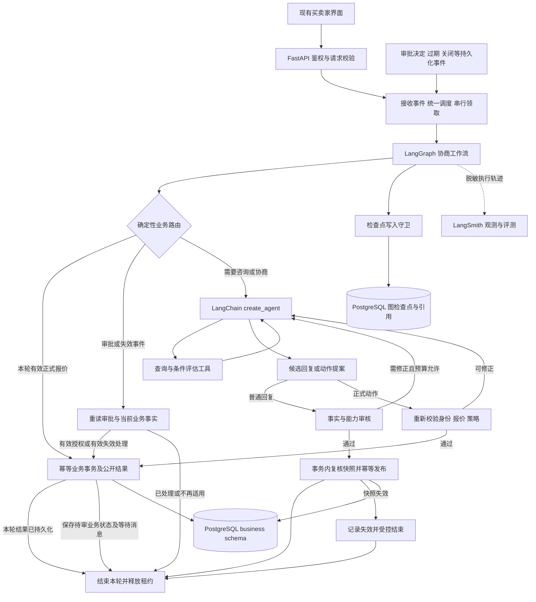

# V5 LangChain 生态重构升级方案

日期：初稿 2026-10-17；本次修订 2026-10-18（Asia/Shanghai）  
状态：设计方案，修订版 R3（直接重构＋统一 PostgreSQL）；保留代码需求审查的 9 项修订，删除改造旧运行时、混合队列与新旧版本在线并存路线，尚未实施或完成运行验证。V5 是本次升级的工作名称，不代表已经发布 `v5.0.0`。  
本次授权范围：分析、审查并修订本 Markdown 文档。本文中的代码开发、Git 提交和标签、依赖安装、数据库变更、LangSmith 上传及真实模型评测均为后续实施事项，本次没有执行。第 12 节记录审查问题、修订位置与待执行的验证。

## 1. 升级结论与固定方向

以当前项目的功能、业务规则和对外行为为验收标准，从零设计 LangChain 原生 Agent 架构。现有文件结构、手写循环和检查点格式不构成新架构约束；现有业务规格、评测数据及已发现的失败案例是必须继承的资产。

**本次目标是重构现有项目。** 在独立 Git 分支中完成新的内部实现，验收通过后整体替换现有系统；最终生产部署只包含一套 LangChain/LangGraph 运行时。旧版由 Git 标签、独立依赖环境和数据库快照封存，用于复现、对照评测及符合条件的恢复。

| 范围 | 本次处理 |
| --- | --- |
| 业务功能与对外契约 | 继承用户能力、授权规则、有效业务状态及必要接口语义，并用独立断言验收 |
| 内部实现 | 可重新设计目录、模块、数据模型、任务调度和工作流；不要求沿用旧类、表或运行协议 |
| 旧数据 | 迁移经过校验的账号、商品、策略、报价、审批、意向和会话历史；审计证据保留来源映射 |
| 旧执行状态 | 不续跑 V3/V4 的检查点、未完成工具调用或重试队列；切换前处置未结执行，原档仅供审计 |
| 评测与上线 | 新旧系统在隔离环境比较，整体切换至新系统；不建设旧运行时的 PostgreSQL 适配版或跨版本在线路由 |

业务数据迁移与恢复保障服务于系统替换，不要求新实现兼容旧代码。第 9 节明确切换前的任务处置、待审批业务迁移和切换后恢复边界。

本方案确定采用：

| 层次 | 选型与职责 |
| --- | --- |
| Agent | LangChain `create_agent` 管理模型与工具循环，官方中间件承担通用行为 |
| 工作流 | LangGraph `StateGraph` 管理规则路由、审核、审批、发布和异常终止 |
| 运行持久化 | 官方 `langgraph-checkpoint-postgres`，应用异步路径使用 `AsyncPostgresSaver` |
| 观测与评测 | LangSmith 统一管理 trace、数据集、实验、评测反馈和人工标注 |
| 业务应用 | FastAPI、Pydantic、SQLAlchemy、PostgreSQL，负责账号、商品、报价、审批和交易意向 |
| 前端 | 保持现有用户功能和 API 契约；内部实现可以调整 |
| 模型 | 首轮沿用基线使用的千问模型与接口，先验证能力，再锁定依赖和调用方式 |
| 评测基线 | 现有 V4 的 120 个场景及正式动态买家配置，增加迁移专用故障回归 |

**用户已确认统一使用 PostgreSQL。** 当前仓库仍以 MySQL 8.4 为业务库（见 [Compose](../compose.yaml)、[数据库依赖](../backend/pyproject.toml)），PostgreSQL 尚属于待实施目标。本版替换初稿的 MySQL＋PostgreSQL 双库选型：最终在线运行只维护 PostgreSQL，业务与图检查点放在同一 database 的独立 schema 中，不再设计跨数据库的执行租约握手。

| PostgreSQL 范围 | 内容与管理方式 |
| --- | --- |
| `business` schema | 账号、商品、策略、报价、审批、消息、任务、业务回执、outbox、预算账本和原始审计；由 SQLAlchemy/Alembic 管理 |
| `agent_runtime` schema | 官方 Saver 表、事务级执行守卫、任务检查点引用和会话头；官方表由 Saver 初始化/迁移，项目辅助表由项目迁移管理 |

两类连接指向同一个 PostgreSQL database；连接池、权限和 schema 可以分开，使用固定、受控的 search_path 与显式限定的项目表名。schema 隔离不是权限隔离的替代，部署时分配所需表权限，不能让客户端或模型决定 schema。官方 Saver 的业务外调用仍可能使用独立连接和事务，因此同库不自动让“报价提交＋图检查点保存”原子化；第 5 节继续使用回执和幂等恢复，但执行守卫可由两类写入在各自事务中锁定同一行。[PostgreSQL schema 官方说明](https://www.postgresql.org/docs/current/ddl-schemas.html)

旧 MySQL 仅作为迁移源、冻结基线复现及迁移前备份保留，不是 V5 常驻依赖。在隔离 PostgreSQL 上完成新系统和数据导入验证后，经过维护窗口停写、最终迁移与对账，整体切换 API、前端和 Worker。迁入的是业务事实与历史证据，新图从已验证的数据建立初始状态，不解释旧运行时检查点。细则见第 9.2—9.5 节。

LangChain 官方将 `create_agent` 定位为可配置 Agent，将 LangGraph 用于需要更精确控制的确定性与自主工作流组合。以上分层符合官方定位；具体业务节点和事务规则是本项目的设计决定。[官方概览](https://docs.langchain.com/oss/python/langchain/overview)、[工作流与 Agent](https://docs.langchain.com/oss/python/langgraph/workflows-agents)

升级完成的技术标准：生产主路径由 `create_agent` 和 LangGraph 执行；不再由自研 `while` 循环驱动模型和工具；不再维护一套与 LangGraph 平行的自研执行检查点；观测和实验对比进入 LangSmith。业务工具、授权函数、幂等记录和评测器仍按项目需求编写。

## 2. 必须保持的功能与业务契约

“完全一样”指用户能力、授权结果、合法状态转换、数据隔离和恢复语义一致；不要求模型逐字输出相同，也不要求相同内部调用顺序。新版本不能为提高意向达成率而改变买家目标、私有底价、审批规则或终态含义。

| 编号 | 必须保留的契约 | 验收证据 |
| --- | --- | --- |
| B01 | 同一账号可作为买家或卖家；支持登录、商品发布、上下架和私有策略管理；不能协商自己发布的商品 | HTTP 契约及资源归属测试 |
| B02 | 普通聊天与正式报价分离；聊天中出现金额、议价或配送咨询，不自动创建正式 offer | 聊天/报价混淆场景与数据库断言 |
| B03 | 净收入＝买家支付金额－卖家承担运费－卖家承担优惠；金额使用 Decimal；卖家承担的费用未知时不能当作零 | 边界值、未知运费及精度测试 |
| B04 | 净收入大于等于自动接受阈值时自动授权；大于等于底价且低于阈值时需卖家审批；低于底价禁止接受 | 两个阈值及相邻金额的独立断言 |
| B05 | 正式还价也必须满足授权条件；不能在审批区偷偷创建自动生效的 Agent 还价 | 已提交报价的独立审计 |
| B06 | 只自动承诺已支持的条件：空附加条件，或 `delivery_method=pickup/shipping`；其他条件不能被自然语言承诺成已获授权 | 工具参数、落库结果与公开回复检查 |
| B07 | 本轮买家实际提交且仍为会话当前报价的有效正式报价，可按规则直接接受或进入审批；普通聊天不能获得处理历史报价的权限 | 区分 current_turn_offer_id 与 current_offer_id；确定性路由及无额外模型调用证据 |
| B08 | 审批绑定具体报价、会话与策略版本，支持同意、拒绝、过期及失效；待审批期间允许咨询，新正式报价取消旧待审申请；申请审批不等于批准 | 审批事件矩阵、新报价与卖家决定竞争测试 |
| B09 | 买家只能确认当前、有效且具有授权依据的报价；`AGREED` 只表示交易意向 | 确认、过期、重复确认和关闭测试 |
| B10 | 商品事实咨询、多轮议价、条件变更、长对话和历史检索继续可用 | 现有场景集及长历史专项 |
| B11 | 私有价格阈值不进入卖家模型上下文；模拟买家的私有目标不进入卖家输入 | 实际模型请求检查 |
| B12 | 普通回复发布前审核，并在发布事务内复核审核依据是否仍有效；正式业务回复来自已提交事实；不能承诺联系卖家、拍照、支付或履约等未实现能力 | 审核回路、审核后商品/状态变化、人工复核和公开消息断言 |
| B13 | 具备有界调用、上下文控制、来源记忆、任务列表、失败人工重试和终止；新系统内较早任务重试定位原输入，不覆盖后续会话记忆，不重置轮次预算 | 第 5.5 节状态矩阵、预算、记忆、故障注入测试 |
| B14 | 同一请求不会重复创建报价、审批或公开回复；失效 Worker 不能写检查点或业务；较早任务不能推进较新的会话状态；旧部署不能接入新系统队列 | 同库统一守卫、回执重放、部署与迁移边界验证 |

待审批、关闭、商品下架等状态下各 API 的允许行为，在 P0 从现行接口与测试提取成明确状态转换表。状态表作为产品契约冻结，不能在重构时自行放宽。已有错误行为不作为兼容目标；修复项必须单列，并增加回归用例。

以下已由现有代码和测试确认，不再作为实施时可自由选择的行为：

| 场景 | 必须保持的行为 |
| --- | --- |
| WAITING_APPROVAL 收到普通咨询 | 允许生成咨询回复；不自动取消审批，不把历史报价当作本轮提交 |
| WAITING_APPROVAL 收到新的正式报价 | 在同一业务事务中取消旧待审申请、撤回其报价并记录新报价；按新报价重新授权 |
| 卖家批准审批 | 记录授权并安排通知；审批批准、买家通知、买家最终确认是不同步骤 |
| 重复请求 | 同请求同参数返回既有结果；同请求异参数冲突，不重复扣预算或产生动作 |
| 已发布结果后的内部维护失败 | 不撤销公开回复；记录未完成范围并允许后续补齐 |
| 人工重试/终止 | 保持原接口的归属校验、允许状态、计数与公开结果；细则见第 5.5 节 |

依据：[审批期间咨询与替换报价测试](../backend/tests/integration/test_chat_service.py)、[本轮报价授权](../backend/app/agent/seller_agent.py)、[任务恢复服务](../backend/app/services/model_task_recovery_service.py)。P0 继续补齐商品删除限制、HTTP 错误码、关闭、确认和通知状态等完整接口矩阵。

第一版不增加支付、库存锁定、订单履约、真实卖家联系、多 Agent 协作或跨会话学习。业务功能范围保持一致。

## 3. 目标执行架构



图表达职责与主要分支；失败、预算停止、关闭等终止边在实现时必须显式建模。图中的两个存储节点是同一 PostgreSQL database 的不同管理范围。正式动作与其公开结果在同一业务事务中持久化；网络投递可以通过 outbox 重试。待审批是业务状态，本轮图不无限暂停，下一条买家消息或审批事件均可触发新的执行。正式报价文案由提交结果确定，不能再让模型决定报价事实。

### 3.1 父工作流与 Agent 子图

父工作流负责接收事件、规则路由、审核、业务提交、审批事件处理和发布。主协商子图通过 `create_agent` 创建，负责获取信息、比较条件并提出结束结果。采用官方“节点内调用子图并映射输入/输出”的方式；固定节点名，不依赖动态调用顺序确定子图身份。

确定使用 **父图拥有跨轮会话视图，子 Agent 按调用隔离** 的模式。子图采用 `checkpointer=None` 的 per-invocation 持久化：在一次调用内继承父图 Saver 以支持恢复，跨调用的消息、摘要和记忆由父图显式传入。子图使用框架分配的独立命名空间，不配置第二份跨轮 `checkpointer=True` 记忆。调用结束后的状态映射见第 4.1 节。[官方子图通信与持久化](https://docs.langchain.com/oss/python/langgraph/use-subgraphs)

不得在图节点中重新编写一套“模型调用→手动执行工具→再次调用模型”的循环。审核失败后的返回、参数修正和预算结束通过图边或官方中间件完成。全部回路共享当前业务轮次预算。

### 3.2 模型工具与正式动作

| 工具类别 | 建议职责 | 副作用 |
| --- | --- | --- |
| `get_product_info` | 获取当前商品公开事实 | 无业务写入 |
| `get_negotiation_state` | 获取当前会话、当前报价和公开状态 | 无业务写入 |
| `search_conversation_history` | 检索当前会话原始历史，返回来源 ID | 无业务写入 |
| `evaluate_offer` | 评估候选条件，返回是否可执行及非敏感原因 | 无业务写入，不返回私有阈值 |
| `propose_counter_offer` | 提交正式还价提案 | 只更新图内候选状态 |
| `propose_accept_offer` | 提交接受本轮正式买家报价的提案 | 只更新图内候选状态 |
| `propose_approval` | 为本轮正式买家报价提交卖家审批提案 | 只更新图内候选状态 |
| `finish_turn` | 提交普通回复、澄清或拒绝及可选记忆增量 | 只更新图内候选状态 |

正式写入统一由父图业务提交节点执行。工具命名可以与旧版不同，但“查询、授权、还价、接受、审批、确认”的外部语义必须一致。将提案与提交分开，便于把最终授权和事务结果放在明确的确定性步骤中。

终止提案工具采用官方 `Command` 更新状态，并使用经 P1 验证的 `return_direct` 结束子 Agent。子 Agent 的返回者是父图，不直接是买家；内部 `ToolMessage` 不直接展示给前端。每个工具调用必须有匹配的工具结果消息。[官方工具、上下文与返回机制](https://docs.langchain.com/oss/python/langchain/tools)

一期模型侧关闭并行工具调用；同时在工具执行前检查整个调用批次。只接受单个终止提案，拒绝终止提案与其他调用混合的批次，返回完整错误回执后再修正。不能只依赖模型的 `parallel_tool_calls` 参数，也不能假定混合批次中的 `return_direct` 会终止 Agent。

用户、会话、事件类型、原请求标识和授权范围通过 `ToolRuntime` 的调用上下文传入，不让模型填写身份字段。必须区分：

| 标识 | 来源与权限含义 |
| --- | --- |
| `current_offer_id` | 从业务库读取的会话当前报价，只代表当前事实，不能单独授予接受/申请审批权限 |
| `current_turn_offer_id` | 当前买家请求实际提交的正式报价；普通聊天为 null；请求重放沿用原请求绑定值 |
| `approval_id` 与 `approval_offer_id` | 审批事件的服务端关联引用，由审批处理节点查库复核，不进入普通聊天的授权范围 |

确定性路由、提案工具和最终提交同时要求：接受/申请审批的目标等于非空 `current_turn_offer_id`，且仍是当前有效报价、属于本会话并满足授权规则。无本轮报价时不得根据旧 `current_offer_id` 自动接受或申请审批。正式还价仍可在议价中提出，但其条件必须重新授权，响应的买家报价引用也必须来自本轮上下文。

审批通知走专用领域入口，验证审批对象、原报价、决定、版本与有效期；不能通过伪造一个新的 `current_turn_offer_id` 复用聊天授权。所有入口最终仍校验资源归属。

### 3.3 结构化输出与千问适配

默认采用“两种独立请求形态”：协商 Agent 请求使用工具；结束整理、回复审核、记忆抽取等请求使用无业务工具的结构化输出。结构化整理只能产生提案，不能绕过正式提交节点。

P1 对实际千问接口验证 `ProviderStrategy`、模型级结构化输出、工具参数解析和截断行为。若原生 JSON Schema 不满足契约，验证并选择 `ToolStrategy`；只保留一个已验证的主策略和一个明确的受控失败路径，不暗中降级为任意文本解析。

不以“支持工具调用”和“支持 JSON Schema”分别成功，推断它们同时开启也成功。官方对同时配置工具与结构化输出有独立能力要求。[官方结构化输出](https://docs.langchain.com/oss/python/langchain/structured-output)

## 4. 状态、上下文、记忆与预算

### 4.1 状态归属

| 数据 | 唯一负责方 | 其他位置的用途 |
| --- | --- | --- |
| 商品、账号、私有策略、报价、审批、意向终态 | PostgreSQL 业务表 | 图状态只保存引用、版本与必要公开快照 |
| 图执行位置、本轮工作集、候选动作、审核反馈 | LangGraph 父/子图检查点 | 任务不再保存另一份可独立推进的执行状态 |
| 已确认的会话视图、摘要与来源记忆 | 被会话头引用的父图检查点 | 子 Agent 仅持有本次调用的工作副本 |
| 请求接收、排队、任务状态与事件投递 | PostgreSQL 任务/事件记录 | 保存原输入、冻结配置及发布/schema 标识，不负责下一节点是什么 |
| 图写入资格、任务恢复引用、已确认会话头 | PostgreSQL 执行守卫与引用索引 | 只存 epoch、租约与官方检查点引用，不存重复的图状态或自研节点进度 |
| 业务提交资格 | 与图写入共用同一 PostgreSQL 执行守卫 | 业务事务锁定同一行并校验任务、epoch 与租约，不镜像第二套资格 |
| 正式动作和公开回复的幂等回执 | PostgreSQL 业务表 | 图恢复时据此确认外部动作是否已提交 |
| Token/费用预留与实际调用回执 | 持久化预算/调用账本 | 图状态保存账本引用；LangSmith 展示用量及成本 |
| 原始公开对话和内部执行归档 | 本地追加式审计记录 | 历史检索、来源校验和问题复核，不作为第二个流程引擎 |
| trace、评分和实验分析 | LangSmith | 不作为交易结果或恢复状态的唯一来源 |

短期记忆属于同一协商 thread；第一版不引入跨会话 Store，避免把不同交易的偏好和报价混在一起。官方区分线程级 checkpointer 与跨线程 Store。[官方持久化职责](https://docs.langchain.com/oss/python/langgraph/persistence)

每个协商使用稳定的服务端 `thread_id`，归属新系统独立的运行命名空间；每条买家输入使用稳定 `turn_id`，审批通知等事件另有 `event_id`，每次尝试另有 `attempt_id` 和执行 `epoch`。恢复引用包含 `thread_id/checkpoint_ns/checkpoint_id` 及任务、图 schema 版本；内部引用不直接接受客户端传入。图 schema 和发布版本用于追踪与拒绝不支持的状态，不用于在 V3/V4/V5 之间选择执行引擎。

同一 thread 中严格区分两类引用：**任务恢复引用**指向该任务最后一个有效的父图检查点；**已确认会话头**指向允许后续新事件继承的会话视图及其 `context_revision`。新任务从会话头建立本轮状态，失败重试从自己的任务引用恢复。业务路径禁止省略引用后直接读取“最新检查点”，避免失败分支或较早任务重试成为会话的新历史。引用只选择官方检查点，不复制其内容或计算下一执行节点。此处及第 5 节的任务恢复均指新系统内部任务；旧版本执行记录的归档边界见第 9 节。

父子图的状态协议固定为：

| 状态 | 输入与合并规则 |
| --- | --- |
| `conversation_view` | 父图持有已确认的历史、摘要、来源记忆和覆盖水位；新轮次补齐归档中尚未投影的公开事件 |
| `turn_working_messages` | 新任务由会话视图＋本轮输入初始化；子调用接收完整工作集；子图返回后由父图校验并替换该工作集，不能把完整输出再次追加 |
| 消息 ID 与压缩操作 | 新消息按稳定 ID 合并；摘要删除/替换须显式传递并验证覆盖范围，保留工具配对；子图中的摘要变化必须带回父图 |
| `candidate` / `review_feedback` | 候选属于当前 turn 和修正序号；新轮次清空；审核拒绝先归档原因、清除候选，再按图边调用子 Agent；仅同一候选与事实快照可复用审核结果 |
| `memory_delta` / 来源水位 | 子图提出增量，父图独立验证来源、时序与类型后合并；失败不推进对应覆盖水位 |
| 预算、身份、业务事实 | 预算查共享账本，身份取可信 context，业务状态查 PostgreSQL 业务表；子图返回值不能覆盖这些权威来源 |

仅成功轮次的合法内部证据可参与后续会话工作集；失败、取消、过期分支的未发布候选和未完成工具对保留在审计归档中，不自动成为下一轮上下文。被审核拒绝的文字不得投影成 Agent 已经公开说过的话。更新会话头使用预期 `context_revision` 比较交换；较早任务完成时若会话头已前进，不覆盖新摘要或新记忆，只将合法公开结果归档，供后续按 ID 补齐。首次输入建立、子图返回、正式动作回执、轮次完成分别设置明确的持久化边界，见第 5 节。

### 4.2 历史与摘要

1. 外部请求向父图提交增量输入，使用稳定消息 ID 去重。父图向 per-invocation 子 Agent 映射完整的本轮工作集；这不等于把整个历史再次追加到父图。
2. 当前输入、近期完整交互以及待配对的工具调用与结果必须保留；摘要不能拆坏工具消息协议。
3. 以官方 `SummarizationMiddleware` 承担通用压缩。来源 ID、覆盖范围和当前输入保护通过自定义状态与中间件适配；这些项目约束不能假定内置摘要已全部保证。
4. 摘要是可重建的工作视图，原始历史不删除。历史查询从追加式归档读取，并返回来源 ID。
5. 每次实际模型请求都计算总输入预算，包含系统提示词、工具 schema、结构化输出 schema、事实、记忆与输出预留；不能只按聊天文本长度判断。
6. 若压缩后固定内容仍超限，返回有记录的受控停止，不截断当前问题或不完整工具对。

内置摘要能力及自定义扩展分别依据[官方内置中间件](https://docs.langchain.com/oss/python/langchain/middleware/built-in)和[自定义中间件](https://docs.langchain.com/oss/python/langchain/middleware/custom)。具体来源规则为项目验收要求。

### 4.3 协商记忆

沿用现有语义类别：买家明确陈述、待回答问题、已尝试方案、低置信度假设和计划。每条记录包含来源 ID、证据时间/序号、状态和置信度。

买家明确陈述必须引用买家原文；假设不能升级成事实；旧证据不能覆盖更新后的偏好。正式报价和审批结果始终读取业务库。更新失败要记录且允许后续补齐，不能把失败范围标记为已处理，也不能撤销已经成功发布的回复。

历史检索沿用当前业务需要的会话内检索能力，不为框架使用率额外引入向量数据库或 RAG。

### 4.4 回复审核与发布

普通回复经过“结构校验→事实依据与能力审核→必要修正→发布”。模型审核输出为结构化结果，包含通过与否、原因和证据来源；确定性校验再次检查来源是否存在、是否属于当前会话及是否公开可用。

审核回执绑定候选文本哈希、来源集合、商品公开事实指纹及会话/报价/策略版本。普通回复的 PostgreSQL 发布事务先做身份与执行资格检查、查找已有发布回执；没有回执时，锁定相关业务记录并比较上述依据，随后一次提交公开消息与发布回执。无商品版本号时，比较标题、描述、标价、上下架状态等完整公开快照；不能只比较会话版本。

审核后若商品修改、会话关闭、策略更新或当前报价变化，原审核不再授权发布。第一版采用受控失效结束：不发布旧候选，不自动在同一任务中刷新事实继续推理；按现有 `BUSINESS_STATE_CHANGED`/`STALE` 语义生成不包含过期事实的确定性安全结果。新的有效输入另起一轮。回执重放仍按第 5.2 节返回已经提交的原结果，不因当前状态变化否认历史提交。

初始方案最多允许 2 次审核后修正，且所有调用仍受总预算约束；P0 将该值写入新旧对照协议并登记与旧版的差异。审核仍失败时只发布明确的受控兜底，不发送被拒绝的原文。正式接受、还价、审批通知使用已提交业务事实生成文案。

第一版保留消息轮询。可向开发观测界面输出内部进度，但买家不能收到尚未审核的模型 token、工具参数或候选承诺。在线 LangSmith 评分不承担同步发布授权。

### 4.5 统一预算与重试

使用 `ModelCallLimitMiddleware`、`ToolCallLimitMiddleware` 和 `ModelRetryMiddleware` 承担各自通用能力；总预算由统一模型调用适配层和预算账本约束。主 Agent、审核、摘要、记忆、结束整理及实际重试都必须进入该层。

首轮对照以 P0 封存的有效基线配置为准。仓库可参考值为主循环 6 步、总模型调用 10 次、维护调用 2 次、工具调用 8 次、活动执行时间 120 秒、累计 Token 180000；这些是配置参考，不能冒充当前环境的实际有效值。输出预留、价格与思考模式也必须从基线清单冻结。

- 官方单次 invoke 限额不能替代跨审核回路、跨恢复尝试的业务轮次总额。父图回到子 Agent 时不重置总预算。
- SDK 隐藏重试关闭，只配置一层可观测的短暂错误重试；开始实施时将重试次数、错误分类、退避和总限额一起冻结。
- 每次 RPC 前持久化预留；收到用量后记录实际数值。超时且用量未知时保留未知标记及保守预留，不记为零。
- 审批等待期没有持续运行的图，不计入模型活动执行时间。审批通知是独立事件预算；同一输入的自动或人工恢复不能借新 attempt 刷新预算。
- 输入估算必须针对实际千问用量校准；成本来源记录币种、单价版本和缓存折扣规则。
- 图递归上限仅作最终防护，不能代替上述业务预算。

## 5. 持久化、事务、审批与恢复

### 5.1 检查点方案

开发单元测试可以使用内存 Saver；进程重启和正式运行统一使用 PostgreSQL Saver。涉及业务副作用的流程采用 `durability="sync"`，先持久化当前图步骤再继续。它提高图状态耐久性，但不会自动把 SQLAlchemy 业务事务与官方 Saver 的事务合并；两者即使位于同一 database，也保留提交与图保存之间的故障窗口。[官方检查点与耐久模式](https://docs.langchain.com/oss/python/langgraph/checkpointers)

会话内图执行串行；前台执行入口、聊天 Worker、审批通知 Worker 和人工恢复统一经过同一协调器。商品修改、卖家审批决定等独立业务请求仍可通过各自事务改变业务状态，运行中的图必须在发布时识别变化。不能通过长期占用数据库锁来禁止用户操作。

**选定方案：业务事务与官方 Saver 共用同库的一条执行守卫记录。** 守卫保存 session/thread、当前任务、单调递增 `epoch`、租约截止时间和 `ACTIVE/IDLE` 状态。任务表的租约展示字段与守卫在同一事务中更新，不构成独立授权源。守卫是并发适配层，不是第二套 Agent 循环或检查点协议；官方 Saver 本身不会自动校验项目守卫。[官方 AsyncPostgresSaver 实现](https://raw.githubusercontent.com/langchain-ai/langgraph/main/libs/checkpoint-postgres/langgraph/checkpoint/postgres/aio.py)

执行资格的建立与接管遵守以下协议：

1. 领取事务先锁定会话守卫，再锁定任务，检查任务类别、当前实现支持的图 schema、状态、重试时间与有效租约。已有合法执行者时不得接管；新会话守卫用唯一约束安全创建。不支持的 schema 保持未执行并告警，不猜测格式或转交旧引擎。
2. 在同一个 PostgreSQL 事务中增加 epoch、设置任务/执行者/租约和 ACTIVE 状态，并更新任务为 RUNNING。事务成功后才启动图；回滚则资格和任务状态都不改变，不存在两库握手中间态。
3. 每次业务提交、模型用量/成功回执保存、checkpoint 与 pending writes 写入，都在自己的短事务中锁定同一守卫并检查当前任务、epoch、租约及允许状态。先拿到锁且通过检查的事务允许完成；接管者等待该事务结束后再切换 epoch，之后旧执行者的写入一律拒绝。
4. 续租、释放和人工终止也锁定同一守卫，以当前 epoch 比较交换；过期租约不能被迟到续租复活，失效 Worker 不能清除新租约。模型 RPC 不持有这些行锁。所有执行路径遵循固定的守卫→业务行锁顺序，独立业务请求遵循一致的业务锁顺序。请求录入事务先提交，再领取图执行资格，禁止持有业务行锁时反向领取守卫。

`aput` 和 `aput_writes` 必须分别在**同一 PostgreSQL 连接、同一事务**中锁定守卫、检查 `ACTIVE`/任务/代际/有效期，再调用官方 Saver 完成写入。根检查点写入与对应任务恢复引用更新一并提交；子图检查点不覆盖父图恢复引用。不能“先查租约、提交查询事务，再无条件调用 Saver”，也不能在守卫检查后换一条池连接写入。中间写入、根/子检查点、会话头推进均受保护；失效响应最多记录隔离的迟到诊断，不进入消息工作集、记忆或可复用成功回执。

轮次完成时，先确保正式结果/公开消息回执存在，再保存完成检查点，最后在同库事务中按预期 `context_revision` 幂等推进会话头及对账任务状态。较早任务的完成检查点可以保存，但比较交换失败时不得替换较新的会话头。若在任意两步之间崩溃，从原任务引用和业务回执补齐，不靠 Saver 的“最新 checkpoint”推测权威分支。

P1 必须验证所选 Saver 版本在受控连接、事务和 pipeline 模式下的行为，以及父/子图是否全部经过守卫；未验证通过不得进入正式迁移。若 SDK 升级破坏事务绑定，暂停升级并修订适配，不改写官方检查点序列化。清理/删除检查点只能在停止相关执行后由维护流程进行，不能绕过守卫影响在途任务。

以上是基于 PostgreSQL 行锁的项目并发设计，仍需故障验证，不能表述为 LangGraph 自动保证业务 exactly-once。开源 LangGraph 也不自动提供 Agent Server 的 double-texting 调度策略，项目需继续实现请求互斥与任务领取。[PostgreSQL 行锁说明](https://www.postgresql.org/docs/current/explicit-locking.html)、[官方并发请求能力边界](https://docs.langchain.com/langsmith/double-texting)

### 5.2 正式写操作的原子边界

正式动作由稳定的 `operation_id` 标识，绑定会话、原 turn/event 和提案序号；参数规范化哈希作为独立回执字段，用于检测同键异参，不能把参数变化隐藏成另一个幂等键。不能仅使用模型随机产生的 tool call ID。提案在进入提交节点前由图检查点持久化，恢复和人工重试沿用原操作标识。每个原始 turn/event 另有唯一终结结果约束，防止换一个提案序号就提交第二个正式结果。

一次 PostgreSQL 业务事务完成：

1. 校验身份、资源归属、任务/事件关联及当前执行租约与 fencing；这些资格检查不能因命中回执而跳过。API 对已完成请求的只读重放完成身份与归属检查即可，不为查询历史结果启动图。
2. 按稳定操作键查询并锁定幂等回执；同键同参数返回已提交结果，同键异参数拒绝。检查该 turn/event 是否已有其他终结结果，禁止再次提交。
3. **仅当没有成功回执时**，锁定会话、商品、报价、策略和相关审批，检查预期版本、当前状态、有效期及本轮授权范围，然后执行动作。
4. 保存唯一动作回执、确定性公开消息、投递 outbox 及必要的审计关联；它们与动作属于同一事务，不能在图的另一个节点才补写唯一公开结果。
5. 一并提交，再将结果返回图。已提交回执不会因该动作自身增加版本、关闭会话或改变报价状态而变成“未成功”；重放不重复执行授权或副作用。

普通回复发布使用同样的回执优先顺序，再执行第 4.4 节的快照验证。审批决定、通知、买家确认和关闭各有稳定请求/事件键与回执；重放不能重新生成通知或重复增加版本。业务异常分类须区分“已成功结果的重放”“未执行动作的版本冲突”和“同键异参”。

失败场景及处理必须覆盖：

| 故障窗口 | 预期恢复行为 |
| --- | --- |
| 业务事务提交前崩溃 | 事务回滚，恢复后可重试同一操作 |
| 业务事务已提交、图检查点未成功保存 | 重跑节点读取原回执，禁止重复写报价或消息 |
| 图已保存提交结果、进程崩溃 | 从图检查点继续，保持同一公开回复标识 |
| 审批决定早于申请轮次图完成 | 决定保存为业务事实及 outbox 事件；先对账申请轮次，随后串行执行独立通知事件，不等待 interrupt |
| Worker 租约过期但旧模型响应返回 | 同一守卫拒绝旧代际；禁止 checkpoint、pending writes、会话头、业务与消息写入 |
| 领取/接管事务中途崩溃 | 守卫与任务更新一起回滚或一起提交；提交后未启动的任务由租约恢复处理 |
| 完成检查点已保存、会话头或任务状态未对账 | 按完成回执补齐；会话头只能比较交换或确认此前已推进，不能覆盖更高修订 |
| 普通回复审核后事实变化 | 无发布回执时拒绝旧候选，持久化受控失效结果；有发布回执时返回原结果 |
| PostgreSQL 暂不可用 | 暂停业务与检查点推进，恢复后对账；不退回无持久化运行或自动改写旧 MySQL |
| LangSmith 暂不可用 | 业务按自身事务继续；本地记录上传状态并补传 |

持久化 outbox 负责可靠唤醒和事件投递，消费按事件 ID 幂等。它保存业务事件，不再复制一套图执行步骤。该方案保证业务副作用不会因重放重复提交，不宣称远程模型调用天然 exactly-once。

### 5.3 模型调用恢复

通过模型包装/回调层保存实际请求、配置哈希、逻辑调用 ID、响应和用量回执。完整成功回执在图步骤未保存时可被复用，前提是请求与冻结配置一致。只有请求发出而没有完整响应的调用，按未知结果记录，新的尝试单独计费计数。

这样保留当前项目“已收到的成功响应可以对账复用”的能力，同时把流程恢复交给 LangGraph。模型响应回执是外部调用记录，不是另一套执行检查点。

### 5.4 人工审批

第一版采用**持久化审批对象＋独立业务事件**，不对整个协商 thread 使用 `interrupt`，也不叠加 `HumanInTheLoopMiddleware` 审批通道。申请审批及等待消息事务提交后，本轮图完成并释放租约；卖家可以稍后决定，买家可以继续咨询或提交新正式报价。这是对现有业务的实现选择，不是 LangGraph 不支持人工审批。[官方 Interrupts 机制](https://docs.langchain.com/oss/python/langgraph/interrupts)

事件流程固定为：创建审批及等待消息→完成申请轮次→卖家在原界面决定→业务事务保存决定、通知状态及 outbox→通知事件获得执行资格→重读审批及当前事实→提交有效通知或失效处理→完成事件。事件载荷只提供服务端事件/审批引用和关联版本，不能把客户端“approved”布尔值直接当授权。

| 输入事件 | 事务与工作流行为 | 对会话的影响 |
| --- | --- | --- |
| 待审批期间普通聊天 | 新聊天任务，`current_turn_offer_id=null`，保留待审对象；通过审核后发布咨询回复 | 不取消旧审批，不接受历史报价 |
| 待审批期间新正式报价 | 锁定会话，取消仍待审的旧申请、撤回对应旧报价、记录新报价；记录取消事件 | 以新报价路由；旧审批/通知事件不能重新生效 |
| 卖家同意 | 幂等保存 APPROVED 及通知 PENDING；通知事件再次检查授权、商品、报价与有效期 | 有效通知按现有规则恢复可确认状态，仍需买家最终确认才进入 AGREED |
| 卖家拒绝 | 幂等保存 REJECTED、拒绝报价并恢复允许协商的业务状态；安排拒绝通知 | 不能由通知任务再次拒绝新报价 |
| 过期、关闭、下架、策略变更 | 按领域规则使旧审批失效并记录可重试事件；读取时发现到期也必须完成同样的幂等处理 | 不为发通知把已关闭会话恢复为 ACTIVE |
| 重复、乱序或已过时事件 | 查事件回执，再重读对应审批；无效事件记录已处理/不适用，不执行新动作 | 不重复通知，不改变新报价和新审批 |

审批创建、卖家决定、通知提交分别记录其合法版本转换。批准自身导致的版本增长应由决定回执解释，不能当作外部冲突；之后发生的新报价、策略变化等才触发重新检查/失效。新报价与卖家决定竞争同一业务行锁：先提交的一方形成事实，另一方必须依据该事实重验，不能各自按旧快照成功。

审批等待不占用活动聊天任务；通知任务只有实际运行时才竞争会话执行租约。原先对正在处理的聊天请求的互斥、HTTP 冲突响应和轮询方式保持不变。通知失败按任务重试策略处理，达到上限进入人工处置，不回滚已经保存的卖家决定。P1/P5 必须覆盖“咨询→新报价取消审批→迟到同意/通知”的完整链路。

### 5.5 人工重试、终止与任务状态

新系统生成的任务保留 `/api/seller/model-tasks` 及原有重试、终止接口与响应字段，包括尝试次数、人工重试次数、错误分类、租约时间、人工操作人与原因。只允许资源所属卖家操作，不把原始输入快照、lease token、内部 checkpoint 引用返回前端。下表约束新任务状态投影，实际图位置仍由官方检查点决定；从旧版迁入的只读任务归档按第 9.4 节展示，不混入可恢复任务列表。

| 状态或操作 | 图与业务行为 | 前端/重试规则 |
| --- | --- | --- |
| PENDING | 已保存原输入，尚未领取或人工重试已排队 | 按原规则允许终止；不重建 turn |
| RUNNING | 有有效执行租约，从原任务引用运行 | 有效租约期间拒绝人工终止；超时接管原子更新统一守卫 |
| RETRY_WAIT | 保留恢复引用、已用预算、回执与重试时间 | 到期自动重试；允许终止 |
| FAILED | 自动尝试耗尽或不可自动继续，保留原现场 | 允许所属卖家重试或终止；失败任务不被新消息隐式复活 |
| 人工 RETRY | 仅 FAILED 且无已完成聊天回复/已发送审批通知时受理；PENDING，max_attempts 与 manual_retry_count 各增加 1 | 沿用原 turn/event、输入、提示词/模型配置、操作键和预算；不把增加任务尝试次数等同增加模型预算 |
| 人工 TERMINATE | 仅 PENDING、RETRY_WAIT、FAILED 或租约已过期的 RUNNING；取消调度并持久化终止结果与事件 | 聊天幂等保存 SAFE_FAILURE；审批通知进入 MANUAL_REQUIRED；有效运行中的任务不能被强行终止 |
| SUCCEEDED | 业务结果与完成检查点可关联，任务完成 | 不再执行；重复请求读取既有结果 |
| STALE | 业务依据失效，原候选不能发布，保留失效原因与安全结果 | 不按 FAILED 自动复活；新有效输入另起一轮 |
| CANCELLED | 人工终止/取消已持久化，旧恢复事件失去执行资格 | 不再调用模型或恢复业务副作用 |

人工重试定位该任务保存的根检查点，绝不能对会话最新检查点直接执行恢复。例：T1 失败、T2 完成、卖家重试 T1，先校验 T1 原业务快照；若已失效则受控结束。仍有效时只完成 T1 缺失的结果，沿用原回复 ID；即使成功也不得覆盖 T2 的会话头、摘要和记忆。新增公开结果按归档序号供后续补齐，失败分支的内部消息不因此全部进入会话历史。

终止事务首先查询已提交结果，不能用 SAFE_FAILURE 覆盖合法回复。对尚无结果的聊天终止，使用原 reply_request_id 保存一次安全回复；未配对工具调用追加具有原 tool_call_id 的终止回执，候选标为取消。终止事实、守卫失效与清理 outbox 在 PostgreSQL 同事务提交；图侧的协议收尾由受守卫保护、禁止模型/业务新副作用的恢复收尾路径完成。收尾前任务已不可再次正常调度，下一轮只继承合法会话视图，不能导入悬空工具对。原检查点和调用归档保留供审计。

协议收尾事件获得单独的受限执行资格，明确关联被取消任务及其恢复引用；允许补齐终止工具回执和终态检查点，不允许把 CANCELLED 改回普通 RUNNING、发起模型调用或执行报价。收尾事件与普通任务领取分开识别，仍共享同一会话守卫，不能为清理绕过 fencing。

图收尾和任务状态对账不得成为新的推理轮次；终止事件重复消费不重复发消息。预算已经耗尽的任务即使人工增加一次任务尝试，也只能复用已有回执或受控停止，不能静默获得新预算。对应现有依据：[恢复 API 测试](../backend/tests/integration/test_model_task_recovery_api.py)、[V4 终止与工具配对测试](../backend/tests/integration/test_v4_runtime.py)。

## 6. LangSmith 统一观测与评测

### 6.1 观测设计

规划 `secondhand-v5-dev`、`secondhand-v5-eval`、`secondhand-v5-prod` 三个 tracing project，防止开发、实验和真实会话混淆。每轮协商为根 trace，子 run 记录 Agent、模型、工具、审核和业务节点；完整多轮会话按稳定 session/thread 标识关联。

必要关联字段：运行时版本、Git commit、依赖锁哈希、提示词/工具/图 schema 版本、session_id、turn_id/event_id、task_id、attempt_id、epoch、operation_id、checkpoint 引用、context_revision、actor、purpose、实验及场景标识。actor 至少区分卖家、模拟买家和评测裁判，purpose 至少区分主协商、审核、摘要、记忆与结束整理。审批通知拥有独立事件 trace，并关联原申请和卖家决定；内部执行引用仅在受限观测中可见。

平台负责调用链分析、实验展示和反馈。用量统计按实际模型调用去重，不将父 trace 的聚合用量再与子调用相加；分别展示卖家推理成本、买家模拟成本及裁判成本。未知用量和未知价格单列。重试与恢复复用也必须可识别。

现有 LangSmith 接入只上传脱敏元数据。新方案可以增强 trace，但生产上传前仍需明确过滤私有底价、身份凭据和敏感个人信息。受限本地审计可保存完整诊断材料；LangSmith 中记录脱敏内容或引用。合成评测数据可以保留更完整轨迹，但买家私有目标仍不得传入卖家模型。

上述观测与过滤机制参考[官方 Observability](https://docs.langchain.com/langsmith/observability)、[观测概念](https://docs.langchain.com/langsmith/observability-concepts)、[敏感输入输出处理](https://docs.langchain.com/langsmith/mask-inputs-outputs)。

### 6.2 已有资产与选定数据集

不重新编造一套评测集，也不以新场景替换旧版表现较差的场景。

| 资产 | 本次用途 |
| --- | --- |
| [v2.json](../backend/evaluation/scenarios/v2.json)，2.0.0，100 场景 | 历史业务边界与固定回归参考 |
| [v4_release.json](../backend/evaluation/scenarios/v4_release.json)，4.1.0，120 场景 | 保留原始版本，供历史复核 |
| [v4_release_compatible.json](../backend/evaluation/scenarios/v4_release_compatible.json)，4.1.1，120 场景 | 新旧运行时正式对照的主数据集 |
| [v4_release_profiles.json](../backend/evaluation/scenarios/v4_release_profiles.json) | 正式动态买家的共同配置 |
| [dynamic_buyer.py](../backend/evaluation/dynamic_buyer.py) | 保留买家目标、动作约束和动态交互语义 |
| [dynamic_metrics.py](../backend/evaluation/dynamic_metrics.py)、[dynamic_safety.py](../backend/evaluation/dynamic_safety.py) | 指标与独立事实审计的依据，适配为评测器 |
| 既有单元/集成测试与失败案例文档 | 业务契约和迁移故障回归 |

4.1.0 与 4.1.1 在当前文件中仅有两个场景对象不同：`terms_11_unknown_shipping`、`terms_12_unknown_shipping_with_term`。版本化主集合仍为 120 场景，不能把两个文件相加当作 240 个独立场景。

本次读取时的原始文件 SHA-256：

| 文件 | SHA-256 |
| --- | --- |
| `v4_release_compatible.json` | `0b7972f9b66b0b54e017b802814b10701ece2045c6499bcfa820f21112ef31e8` |
| `v4_release_profiles.json` | `60b3f0d24d381e442047aa6b11294dad850aed9254ebda9ab6d70c41a6779441` |

实际冻结时还应保存加载默认值后的规范化场景哈希，避免仅因换行差异误判语义变化；原始文件哈希与规范化哈希分别记录。

### 6.3 LangSmith 数据集与多轮目标函数

将一次完整协商 episode 作为一个实验样例的执行目标，不把 120 个场景误做成 120 个单轮问答。LangSmith 的 target function 可以执行完整工作流，因此多轮驱动器可以作为其目标函数。[官方评测 Quickstart](https://docs.langchain.com/langsmith/evaluation-quickstart)

| LangSmith 概念 | 项目映射 |
| --- | --- |
| Dataset | 冻结的 4.1.1 场景集合及版本信息 |
| Example inputs | 场景 ID、商品事实、开场、模拟环境初始化参数和买家配置；由评测驱动器分别分发 |
| Reference outputs | 预期约束和可验证业务条件，不强造唯一标准协商文案或唯一成交价格 |
| Metadata | 场景版本、类别、标签、数据/配置哈希 |
| Target function | 初始化隔离环境→买卖动态交互→返回业务终态、轨迹和用量引用 |
| Evaluators | 独立业务规则、回复质量、工具轨迹和恢复结果检查 |
| Experiment | 某一代码、模型、提示词、预算及重复试验配置的完整运行 |

完整场景可以包含卖家策略和买家目标，但这是评测驱动器的输入，不是卖家 Agent 的输入。驱动器分别建立业务规则环境、卖家公开事实和买家私有状态；通过实际模型请求证明隔离成立。

新旧 target 都运行相同买家模型、提示词、动作约束、预算和种子计划。每个 episode 使用独立业务命名空间与检查点 thread。新卖家必须运行与生产一致的图、工具和领域逻辑；评测适配器只替换存储/外部端点，不编写另一套“更容易通过”的卖家规则。新系统用真实 PostgreSQL 集成测试验证事务、授权和恢复语义；冻结旧版在独立 MySQL 环境中提供对照结果。共同业务断言比较两套系统的结果，不要求将旧运行时移植到 PostgreSQL。

第一轮最低规模为旧版 120×2、新版 120×2，共 480 次 episode；额外裁判调用单独计数。该规模是初始对照，不保证统计精度足够。需要扩样时，预先登记新增种子与重复次数，双方对整个集合一起补跑，不按失败结果挑样重试。

旧版以冻结 Git 标签、独立依赖环境和旧运行时运行；通过外部适配接收实验输入并返回结果，避免为了接入新 SDK 而改变基线行为。首轮保持业务提示词含义及模型参数一致，必要的工具协议改写单列差异；后续提示词优化另建实验。

### 6.4 评测器与指标

| 类型 | 指标或问题 | 实现要求 |
| --- | --- | --- |
| 确定性业务评测 | 越底价、越权接受、无效审批、非法条件、无效买家确认 | 基于最终持久化事实与完整动作记录核验 |
| 协商效果 | 全体意向达成率、可行场景意向达成率、有效结束率、达成时卖家净收入 | 固定分母和可行性定义 |
| 回复质量 | 回答是否切题、事实是否有来源、是否承诺未实现能力 | 确定性检查＋LLM 裁判＋人工复核 |
| 记忆与长对话 | 新条件是否覆盖旧条件、来源是否正确、是否重复问已回答问题 | 场景断言和轨迹检查 |
| 工程可靠性 | 异常终止、重复副作用、过期租约写入、恢复成功 | 故障注入与数据库断言 |
| 效率 | 卖家实际调用数、Token、估算费用、活动时延 P50/P95 | 按 actor/purpose 分账，人工等待另列 |

确定性裁判不能仅调用被测运行时的同一个授权函数再给它打分；金额公式、阈值边界和有效报价检查应依据业务规格建立独立断言。既有自然语言扫描只是有限检测器，不能用“零命中”宣称所有回复正确。

停止原因至少分别记录：正常业务完成、正常拒绝、功能/资料边界、预算受控停止、系统异常、买家模拟失败。再单独记录业务决策错误及公开声明违规；同一轮可以正常返回但业务判断有误。保留旧 `SELLER_FAILURE` 原字段作为历史数据，不覆盖旧报告，新增版本化评测口径。

P0 冻结统一的结果适配规范，旧版仅在运行外做结果转换，不改变其执行行为：

| 项目 | 新旧共同口径 |
| --- | --- |
| 主集合及配对键 | 场景规范化哈希＋scenario_id＋seed＋trial；缺失、超时、买家失败都保留在计划样本清单中 |
| 可行性分母 | 首轮沿用当前 dynamic_runner 的预判：买家最高支付金额不低于卖家最低净收入，且买家必需条件仅为支持的配送方式；在运行前计算并冻结，与运行成败无关 |
| 可行性定义的限制 | 上述历史指标不等于包含全部物流费用的可成交证明；若增加费用感知指标，双方同时重算并另起名称/版本，不替换首轮主分母 |
| 受控停止与系统失败 | 根据原始 stop_reason、错误类别和调用回执分类；不能仅凭 SAFE_FAILURE/SELLER_FAILURE 推断原因；无法分类的样例计入未解释失败，不当作正常完成 |
| 记忆失败 | 分别统计受影响 episode、turn 和更新调用，明确各自分母；不把一次 episode 失败与多次维护异常相加 |
| 成本与时延 | 卖家/买家/裁判分别统计；卖家包含审核、维护、结束整理及实际重试；活动时延含恢复执行但不含审批等待/人工排队；未知用量不能当零，无法可靠比较的批次标证据不足 |

预算停止率同时报告 episode 与卖家 turn 两个口径，并对双方使用相同分母。旧报告字段只读保留，适配版本、不可映射条目和人工修订都留痕。依据：[当前结果分类与可行性定义](../backend/evaluation/dynamic_runner.py)、[当前汇总指标](../backend/evaluation/dynamic_metrics.py)。

LangSmith 支持代码评测器、LLM 裁判、人工反馈和实验比较；具体指标定义仍由本项目提供。[官方 Evaluation](https://docs.langchain.com/langsmith/evaluation)、[评测类型](https://docs.langchain.com/langsmith/evaluation-types)

### 6.5 在线评测

先在合成数据环境验证在线规则，整体切换后接入新系统的生产会话。确定性授权仍在同步业务路径执行；在线质量评分对已记录的 run/thread 异步运行，用于发现问题和生成回归样例。

生产 LLM 裁判初始抽样率设为 10%，业务违规事件全部进入复核；比例、过滤器和预算写入部署配置。生产私有策略由本地代码裁判核验，向平台上传分数与脱敏证据，不把私有底价交给外部语义裁判。没有可评审文本的样例标为不可评测，不能当作通过。

全量复核本轮检出的违规、审核失败和预算停止，再按类别抽查至少 20 个正常 episode。人工结论只修正标注与解释，不删除原始分数。线上失败转成新的版本化回归数据，不能直接改写已经用于基准比较的数据集。

## 7. 分阶段实施与交付

所有阶段从用户明确授权实施后开始。下列 P0—P7 为先后依赖，不是已经完成的工作；每阶段以通过条件决定是否推进，不以预计工期代替验收。

| 阶段 | 工作与交付物 | 通过条件 |
| --- | --- | --- |
| P0：冻结基线 | 核对未提交文件及实际 V3/V4 配置；保存旧版标签、MySQL 快照、依赖锁与评测；冻结 API/审批/任务矩阵、指标/预算及业务数据迁移清单 | 旧版可在独立环境复现；业务等价范围与旧执行状态归档边界明确；本轮授权、人工操作、指标分母和源数据可定位 |
| P1：官方能力验证 | 隔离验证 create_agent、Qwen、父子映射、精确恢复、同库 Saver 守卫；验证新系统 PostgreSQL 驱动/schema 与关键事务；接入 LangSmith | 根与 pending writes 均受保护；摘要能往返；较早任务不覆盖较新会话；单库接管原子；锁定 PostgreSQL 稳定版本及相关依赖 |
| P2：领域契约与持久化 | 按新模型建立 PostgreSQL 业务 schema/官方 Saver schema；实现业务数据导入与对账、回执优先事务、统一守卫、发布/outbox 和单一运行时调度 | 新领域服务满足冻结的业务断言；迁入数据与来源核对通过；旧执行记录不进入可调度队列；领取中途回滚无半激活状态 |
| P3：主协商工作流 | 实现事件父图、per-invocation Agent、查询/提案工具、正式提交与回复投影；审批申请提交后结束本轮 | 本轮报价授权严格；咨询、接受、还价、拒绝、修正闭环通过；无自研模型工具循环 |
| P4：上下文与质量 | 接入父图会话视图、摘要合并、来源记忆、审核、预算与模型回执 | 压缩后继续多轮且无重复；审核后状态变化阻止旧回复；失败分支隔离、维护补齐和预算恢复通过 |
| P5：审批与故障恢复 | 实现独立审批通知/失效事件、任务状态投影、人工重试/终止、新系统内较早任务精确恢复及图协议收尾 | 待审咨询/改价、决定竞争、T1 失败后 T2 成功再重试 T1、重复终止等第 8.4 节用例全部通过；T1/T2 均属于新系统 |
| P6：LangSmith 完整评测 | 导入冻结数据集，在各自隔离环境运行新旧 target；接入独立裁判及人工标注；产出实验链接和可导出报告 | 第 8 节门禁通过，或明确标为未通过且不上线；旧版无需改造运行时或数据库 |
| P7：整体切换与收尾 | 演练维护窗口、旧执行收尾、最终业务数据迁移、新图初始化、整体切换与分阶段恢复；清除新发布物的旧运行时依赖 | 在线仅新系统与 PostgreSQL；旧部署已停写且不能重连新队列；数据、审批和任务处置对账完整；恢复不丢切换后数据；再合并并建立发布标签 |

P1 的真实模型调用属于后续实施中的兼容性验证，必须有明确批次预算；本次只编写文档，不消耗模型费用。P6 的 LangSmith 数据上传、真实买卖模型与裁判调用同样尚未执行。

### 7.1 建议代码职责布局

以下仅为后续实现的职责建议，当前没有创建这些目录或文件：

| 建议目录 | 内容 |
| --- | --- |
| `backend/app/agents/` | 唯一生产 Agent 的工厂、状态 schema、模型适配、领域工具和中间件 |
| `backend/app/workflows/negotiation/` | 父图、审核/提交/审批/结束节点、条件路由 |
| `backend/app/domain/` | 价格授权、报价、审批、确认及纯业务契约 |
| `backend/app/infrastructure/` | PostgreSQL 业务仓储、官方 Saver 的事务守卫、检查点引用索引、单一运行时任务调度、回执与 outbox |
| `backend/app/observability/` | LangSmith tracing、脱敏、关联标识及补传 |
| `backend/evaluation/langsmith/` | 数据集导入、episode target、隔离基线的外部评测适配、评测器与汇总 |
| `backend/tests/` | 按业务契约与故障场景组织测试；不依赖旧类名和旧调用次数 |

是否复用现有函数由其职责与测试决定，不要求逐文件移植。最终新发布物只保留一套执行引擎，不包含旧 Runtime、旧检查点解释器或 V3/V4/V5 路由器。离线数据导入工具与隔离评测适配器不参与生产 Agent 执行；旧代码由 Git 基线保存。

## 8. 验收门禁

下列数值是本方案提出的升级验收标准，不是官方保证，也不是已经测得的成绩。P0 在看新版本成绩前冻结；任何调整必须有新协议版本和原因，不能为通过某次结果而事后放宽。

### 8.1 必须全部满足的门禁

- B01—B14 对应业务契约测试全部通过，公开 API 的允许操作、关键字段和终态含义保持一致。
- 独立事实检查中越权提交、低于底价接受、无效审批/确认、跨账号访问和重复业务副作用均为 0。
- 故障注入矩阵全部通过；收到成功业务响应前必须能关联已提交回执。
- 正式评测样例、重复次数、失败与超时记录完整；漏样、未运行及评测器错误不得当作成功。
- 实际卖家模型请求无私有价格阈值或买家私有目标；发布流中无未经审核的普通候选回复。
- 费用和用量可解释：已知与未知分别统计；用于成本比较的批次不得把未知用量当作零。
- LangSmith 能从实验分数定位对应 episode、卖家轮次、实际模型调用和业务结果；本地业务审计不依赖平台在线。
- 第 8.4 节逐项有测试或演练证据；框架持久化可用不能替代项目并发、人工恢复与业务等价性验证。
- 新系统可独立部署、运行、恢复和评测，无旧 Runtime/MySQL 运行依赖；迁入旧执行记录只能审计，不能被领取、重试或当作新图检查点。

### 8.2 效果与效率门禁

| 指标 | 初始验收标准 |
| --- | --- |
| 可行场景交易意向达成率 | 新旧差值的按场景聚类 bootstrap 95% 区间下界不低于 -5 个百分点；样本不足则扩样或标记证据不足 |
| 系统异常终止 | 固定故障回归为 0 个未处理错误；真实评测异常率不得高于同期旧版，预算停止另列 |
| 严重公开声明违规 | 新版已确认的虚假接受、虚假审批、底价泄露或未实现能力承诺为 0；自动扫描与语义复核一起报告 |
| 预算受控停止率 | 不高于同期旧版；保护性停止和正常拒绝分别报告，不通过取消防护来降指标 |
| 卖家平均估算成本、活动时延 P95 | 各不超过同期旧版 1.20 倍；比较双方使用相同模型、价格版本和测试资源条件 |
| 记忆与长对话 | 既有条件变更及来源断言全部通过，记忆更新失败率不高于同期旧版 |

效果分析同时报告全体/可行场景分母、分类型结果、买家失败率、意向达成时的净收入和区间估计。不能只展示成功子集。买家模拟失败仍保留在全体结果中，并另做条件分析。

历史 V4 报告仅用于识别已知问题，不能直接充当此次同期对照成绩。尤其不能把“受控返回率”当作“业务正确率”，或将预算停止全部解释为系统不稳定。

### 8.3 验证命令与范围

项目当前已有验证入口为 `python -m pytest`、`python -m ruff check app evaluation tests scripts migrations`、`python -m scripts.run_isolated_mysql_tests`，前端为 `npm run type-check` 和 `npm run build`。旧版按冻结环境运行原入口；新分支根据最终目录更新检查入口，并增加 PostgreSQL 与父子图恢复的隔离集成验证，不要求为保留旧测试内部结构而保留旧实现。

其中 MySQL 脚本只用于冻结旧版与迁移源验证；V5 正式门禁改用后续新增的隔离 PostgreSQL 入口，覆盖业务表、Saver、守卫、并发和恢复。新的入口在实现时落地，不能声称当前已有 PostgreSQL 测试脚本。业务契约测试应迁移为数据库中立断言，保留必要的后端专用事务用例。

默认 Pytest 不等于完整数据库验证。测试配置区分旧版 MySQL、新版 PostgreSQL、外部模型和 LangSmith；正式 V5 不依赖启动 MySQL。真实模型评测需要独立批次和费用预算。本文没有执行这些命令。

### 8.4 审查修订对应的强制回归矩阵

以下是后续实施必须执行的断言，本次修订没有运行这些测试。纯授权/映射可使用确定性替身；租约、事务提交与 Saver 行为必须使用隔离 PostgreSQL 和独立进程验证。数据库迁移专项才同时需要源 MySQL 与目标 PostgreSQL，不能用内存适配证明迁移正确。

| 编号 | 场景 | 必须观察到的结果 | 最迟验收阶段 |
| --- | --- | --- | --- |
| F01 | 申请审批→普通咨询→新报价→旧审批迟到决定/通知 | 咨询可完成；旧待审申请取消；旧事件不改变新报价 | P5 |
| F02 | 卖家决定与新报价并发；批准后尚未通知 | 行锁决定合法顺序；批准不等于意向；过时通知无副作用 | P5 |
| F03 | PostgreSQL 业务动作已提交且版本增加，图保存前崩溃 | 重放返回原回执；报价、消息、版本变更均只发生一次 | P2 |
| F04 | 同 operation_id 异参数；更换提案 ID 重试已完成 turn | 明确冲突/既有结果；不能产生第二个终结动作 | P2 |
| F05 | A 租约失效，B 接管，A 迟到写根/子 checkpoint 与 pending writes | A 写入被拒；B 的恢复引用、工具结果和会话头不被污染 | P1/P5 |
| F06 | 在领取事务提交前后、续租与释放时崩溃或竞争 | 守卫/任务同事务回滚或提交；旧代际不能复活/释放新租约；无双执行者 | P1/P5 |
| F07 | 旧部署尝试连接新队列；导入包含旧执行记录；新队列出现不支持的 schema | 旧部署被隔离；旧记录仅归档不可领取；未知 schema 不执行并告警；生产只有新运行时 | P2/P7 |
| F08 | 普通咨询带历史 current_offer_id，或模型伪造其他 offer_id | current_turn_offer_id 仍为 null；不能接受旧报价或申请旧报价审批 | P3 |
| F09 | 普通回复审核通过后修改商品/下架/关闭/更新策略 | 不发布旧候选；确定性失效结果与原请求关联；已发布回执重放不误判 | P4 |
| F10 | 摘要发生后多轮继续、审核返工并重启子图 | 删除/替换传回父图；不重复消息、不丢当前输入、不拆工具对；共享预算连续 | P1/P4 |
| F11 | 新系统内 T1 失败→T2 成功→人工重试 T1 | 定位 T1 原检查点和输入；过时则失效；有效也不能覆盖 T2 记忆和会话头 | P5 |
| F12 | 人工终止时有待执行工具；重复终止/恢复事件 | 仅一次安全回复；工具回执完整；无新 RPC/业务动作；审批通知标人工处理 | P5 |
| F13 | 人工重试已用完预算或已存在公开结果 | 预算不刷新；已完成结果不重做；计数和 API 冲突语义一致 | P5 |
| F14 | 导入记忆引用内部工具证据、来源缺失或跨会话来源 | 合法证据有映射且可检索；不复制悬空/越权记忆；必要时从合法来源重建并验收；关键事实或证据缺失则阻止切换 | P7 |
| F15 | 新系统会话头推进前后崩溃，较早任务晚完成 | 状态按回执与精确引用补齐；旧修订不能覆盖新修订 | P2/P5 |
| F16 | 失败/取消分支含候选承诺或悬空工具调用 | 原档可审计，下一轮合法工作集不导入未发布承诺或悬空工具对 | P4/P5 |
| F17 | 旧版与新版结果转换、未知用量、买家失败、漏样 | 相同预注册分母；原字段不改；未知与缺失不算成功或零成本 | P6 |
| F18 | 从 MySQL 完整快照按清单导入业务、有效待审批状态与历史证据，归档旧任务/调用 | 逐对象映射、行数/内容/引用/金额/时区/状态对账通过；审批期限不重置；序列无冲突；未结执行阻止切换，归档不变成新任务 | P2/P7 |
| F19 | 独立部署新系统，在 PostgreSQL 验证权限、唯一性、锁、审批及人工恢复契约 | 业务断言与隔离旧基线对照通过；新发布物无旧 Runtime/检查点解释器依赖；只凭新系统及迁入业务数据即可工作 | P2/P7 |
| F20 | 切换前验证失败；新系统已接收写入后发生故障 | 接收新写入前可恢复完整旧环境；接收后保全 PostgreSQL 数据并修复/一致恢复，不直接还原旧快照丢弃新事实 | P7 |

## 9. Git 基线、切换与回退

### 9.1 保存旧版

2026-10-17 初次核查时 `main` 为 `70b7f6a`，本地远程跟踪记录与之相同；已有 `v1.0.0` 指向早期 V1。当时工作区有 1 个已跟踪文件修改和 17 个未跟踪文件，均为本方案文档创建前的数量。这是历史核查记录，不代表本次修订后的实时状态；当时没有实时刷新远端。

5 份未跟踪提示词 `.md` 与已跟踪 `.txt` 内容相同，运行读取 `.txt`。P0 逐项确认旧版资料，不盲目 `git add .`。先提交需要保留的内容，再创建附注标签 `baseline/v4-before-langchain`；升级分支使用 `codex/langchain-migration`。

以下为未来操作顺序示意，要求已核对暂存内容、完成基线提交，并确认名称尚未占用：

```powershell
git tag -a baseline/v4-before-langchain -m "V4 baseline before LangChain migration"
git push origin main
git push origin baseline/v4-before-langchain
git switch -c codex/langchain-migration
```

附注标签固定旧版快照，重构分支承接开发。已发布基线标签不移动；如果后续明确需要旧版补丁，另开维护分支并建立新标签，不把维护旧版作为本次重构的前置工作。普通 push 默认不推送所有标签。[Git 官方标签说明](https://git-scm.com/book/en/v2/Git-Basics-Tagging)

需要另外备份当前 MySQL、运行配置和被忽略的 `backend/evaluation/results/` 原始产物；密钥不提交 Git。数据库切换后统一备份 PostgreSQL 的 business/agent_runtime schema、检查点与引用索引，并演练恢复。旧 MySQL 快照留作迁移源证据，不能替代切换后的 PostgreSQL 备份。Git 标签只保存已提交文件，不能恢复数据库与运行现场。

基线封存同时记录实际启用的 V3/V4 配置与部署范围，不能把源码默认值或某次 V4 评测配置当作当前部署事实。旧版继续使用其冻结的 MySQL 与依赖环境进行独立复现；不为本次重构给旧版添加 PostgreSQL 支持、升级 Agent SDK 或改造调度协议。外部评测适配不得改变旧版业务行为。

### 9.2 独立重构与整体切换

1. 在重构分支完成唯一的新运行时和配套应用。开发与验收使用隔离 PostgreSQL、数据副本和队列；旧基线使用独立 MySQL、依赖、端口及凭据。两套系统可以同时用于测试，但不得共用在线任务队列或写同一份生产业务数据。
2. P0—P6 通过且 P7 演练完成后，进入维护窗口，阻止新的外部业务请求和非收尾任务领取。按既有授权完成在途工作，并逐项对账报价、审批、公开消息、通知和 outbox。可重试的未结失败必须完成恢复或按合法人工流程终止；不得把进程退出、没有 RUNNING 或复制失败记录视为已收尾。无法合法处置时停止切换，保留旧环境继续处理。
3. **区分等待人的业务状态与等待执行的运行状态。** 有效 WAITING_APPROVAL 可以作为业务数据迁入，前提是报价、策略/会话版本、授权主体、原有效期及来源完整，且相关旧执行任务已结束；新系统后续按卖家的新决定创建自己的事件。已决定但尚未完成的通知、恢复事件和其他待执行动作必须在旧环境完成或按明确业务流程处置，不从旧检查点续跑，不自动重发未完成请求。
4. 停止旧 API/Worker 的全部写入，禁用自动重启和后台领取；核对在途调用及已提交副作用，取得最终一致性快照。按第 9.4、9.5 节导入业务数据与证据，建立新图初始会话视图。目标仍处于维护屏障，不接收真实新业务。
5. 对账和最终核验全部通过后，整体切换前端、API、Worker 与数据库配置，只有新系统接收业务请求。旧部署不持有目标队列/数据库的执行凭据；旧 MySQL 留作只读基线和备份。切换后已有业务会话与新建会话统一由新实现处理，不按会话分配 V3/V4/V5。
6. 上线核验覆盖登录、商品、原有会话、待审批、正式报价和新系统任务恢复，并登记首次新业务写入的边界。任何故障按第 9.3 节处理。旧版归档保留，生产镜像、启动入口和配置只包含新运行时。

维护窗口长度由数据规模、在途任务处理和演练耗时决定。没有通过收尾或数据核验就延后切换，不为绕过门禁临时增加旧运行时兼容层。此路线接受一次受控维护窗口，不承诺新旧引擎在线并存的零停机迁移。

### 9.3 切换失败与上线后恢复

触发条件包括已确认的业务越权、重复副作用、恢复损坏或达到预先设置的质量/错误阈值。先暂停受影响的写入与任务领取，保存业务回执、检查点、审计和数据库现场，再按所处阶段处理：

| 阶段 | 处理方式 |
| --- | --- |
| 新系统尚未接收真实新业务写入 | 停止新部署并确认无在途写入，核验旧代码、依赖、配置与最终 MySQL 快照一致后恢复完整旧环境；任一时刻只有一套系统接收业务 |
| 新系统已接收真实新业务写入 | 保全 PostgreSQL 新事实，优先修复新系统并按其回执/检查点恢复；数据库故障使用匹配的 PostgreSQL 备份及恢复日志，并对账已确认结果，不能以旧快照覆盖新事实 |
| 上线后确需整体回到旧系统 | 另行制定停写、逆向数据映射与完整对账方案，证明切换后的合法业务不会丢失后再执行；不属于本次默认恢复能力 |

旧版 Git 标签能恢复代码，不能把新图检查点变成旧检查点，也不能让旧二进制读取新数据模型。默认恢复路线不维护 PostgreSQL 版旧 Runtime，不把新会话转交 V4。新版本内部需要回到某个已验证构建时，也必须确认其数据/schema 和检查点格式可读；不能只改版本号继续执行。

恢复不撤销已合法提交的报价、审批和意向，不删除故障证据或重置预算。修复后通过对应回归和对账再恢复服务。P7 分别演练“新写入前恢复旧环境”与“新写入后保全数据、修复新系统”，明确可接受的数据恢复点和无法自动恢复时的人工处置范围。

### 9.4 业务会话、历史证据与新图初始化

导入对象是业务会话及其历史，运行中的 Agent 不迁移。正式导入须满足第 9.2 节收尾条件和停写屏障；新实现不读取旧 runtime_checkpoint 来决定下一执行节点。

| 数据类别 | 迁移规则 |
| --- | --- |
| 账号、商品、策略、报价、审批、意向 | 保留身份、归属、授权依据、合法状态、关联版本和原有效期；有效待审批允许继续等待卖家的新决定，不重置期限或自动批准 |
| 会话与公开消息 | 保留业务 ID、消息顺序、请求标识和已发布结果；为新图建立会话视图，关闭/终态会话不因导入重新开启 |
| 已提交动作的幂等证据 | 按可验证业务事实映射请求指纹、结果与唯一约束；重放旧请求只返回既有结果或明确冲突，不重复创建报价、审批、回复或意向 |
| 记忆与内部证据 | 校验来源后迁移，或从合法原始资料重建摘要/记忆；原审计与引用映射可独立读取，不依赖旧 Agent |
| 旧任务、调用记录、预算与检查点 | 原输入、配置、计数、预算、调用载荷和旧检查点按原状归档；保留收尾结果与理由，仅供历史查询，不导入可执行队列、Saver 或模型缓存 |

1. 冻结源数据版本、公开历史及内部归档高水位，生成迁移批次 ID、对象映射和内容哈希。来源标识包含旧运行版本/session_id/stream_seq，避免不同来源同号冲突。
2. 保存公开历史与迁入记忆所需的合法 `BUYER_INPUT`、`TOOL_RESULT`、`RUNTIME_EVENT`。BUYER_STATEMENT 必须能回到买家原文，ATTEMPTED_OPTION 必须有真实执行证据；校验同会话、类型、时间顺序和哈希。失败/取消分支不能提升为成功事实，内部证据不能直接变成公开消息。
3. 默认从已校验来源重建摘要工作集。派生记忆来源缺失或越权时，不复制该记忆；记录排除原因并从合法来源重建、重新验收。关键业务事实或必要审计证据无法验证时阻止整体切换，不通过让部分会话继续运行旧引擎绕过。历史查询继续校验归属和可见性，敏感字段不进入模型或买家输出。
4. 按新 schema 建立初始会话视图与官方检查点，只带入已发布历史、已验证事实及合法记忆，不带入旧 pending tool calls、旧节点位置或候选承诺。保存明确的初始检查点引用和导入回执；原业务 ID 与新 thread_id 通过映射关联。后续新请求或审批决定按新系统创建任务与预算，不能把旧未完成轮次改名后重新执行。
5. 复核源水位未变、业务/来源映射完整，按导入回执对账检查点和会话头；初始检查点成功后才标记该对象导入完成。全批次通过前保持维护屏障，不能读取任意“最新检查点”或放行部分会话。同批次同对象同哈希重放返回原结果，哈希变化则冲突；中断后可对账重入，不重复追加历史。
6. 保存对象数、差异、排除项、重建项、归档位置及业务可达性报告。历史任务在界面/API 中明确标识为归档，保留其真实状态和处置记录，不伪造成功；旧任务不再提供新系统重试入口。新系统生成的失败任务仍按第 5.5 节支持人工重试与终止。

上述旧执行记录归档是本次系统切换的边界，P0 必须冻结其接口/展示说明；不代表取消新系统的任务恢复功能。来源映射是离线导入与证据读取能力，不是常驻旧运行引擎。原档在保留期内必须可读取，清理前检查引用，不能以“已经有摘要”为由删除证据。[当前记忆来源规则](../backend/app/agent/negotiation_memory.py)

### 9.5 MySQL 到 PostgreSQL 的业务数据迁移

与第 9.4 节配合，采用**维护窗口停写、完整源快照、按业务映射导入、校验后整体切换**。目标数据模型按新系统设计，不要求保留旧表结构、执行 JSON 格式或完整旧 Alembic 链；源全量快照用于备份和对账，不代表所有旧表都要成为新系统的可执行表。不建设长期双写或默认依赖 CDC。本次不操作任何数据库。

**目标结构与语义验证：**

| 项目 | 必须完成的设计与核对 |
| --- | --- |
| 版本与连接 | 锁定受维护的 PostgreSQL 稳定主版本、精确部署镜像与 psycopg/SQLAlchemy/Saver 版本；禁止用预览版或漂移的 latest 作为验收环境 |
| DDL 与迁移 | 按新模型建立业务 schema 和迁移基线，旧结构只用于解释来源；官方 Saver 表用其 setup/迁移入口初始化，排除在业务 Alembic 自动变更范围之外，由单一部署迁移任务执行，避免每个 Worker 并发初始化 |
| 金额与字段 | Decimal 映射到精确 NUMERIC，保持精度与舍入；枚举、布尔、JSON/JSONB、null 与缺省值逐项核对；旧调用与检查点保留独立原档哈希，不转成新图执行状态 |
| 账号与唯一性 | 保留用户 ID、密码哈希、归属关系及必要登录语义；检查用户名大小写/排序规则与唯一约束，不因数据库默认规则变化允许重复身份 |
| ID 与引用 | 保留外部业务主键、消息 request_id/fingerprint 和报价/审批关系；内部 ID 可重建但须有确定映射，来源序号不能串会话；导入后校准序列并验证幂等重放 |
| 时间 | 逐列明确旧时间的实际时区与含义，再规范化；不能把无时区旧值直接贴 UTC 标签；报价/审批到期不延长；旧租约/重试时间仅归档，不生成新调度 |
| 事务语义 | 在新 PostgreSQL 实测行锁、skip_locked、唯一键竞争、空值约束、死锁重试、会话关闭及审批竞争；旧 InnoDB 行为不能直接当作 PostgreSQL 保证 |
| 任务与检查点 | 新运行只使用官方 Saver 与新任务模型；旧执行先完成合法收尾再归档；初始图状态从业务历史构造，不移植旧执行器或恢复旧 JSON 检查点 |
| 部署与备份 | 新 Compose/API/Worker/迁移任务统一指向目标 database；schema 权限与 search_path 固定；备份覆盖业务、检查点、来源档和引用索引，归档在对象存储/文件时一并纳入恢复清单 |

PostgreSQL 方言与数据类型适配参考 [SQLAlchemy 官方文档](https://docs.sqlalchemy.org/en/20/dialects/postgresql.html)。表中业务语义需要项目验证，不能由 ORM 自动保证。

**实施顺序：**

1. 用独立源快照演练新模型导入和恢复，产出逐对象映射、行数/规范化字段哈希、金额汇总、主外键、审批状态与来源可达性报告。源表拆分/合并时按映射解释数量变化，不能只比较总行数。以相同业务断言比较隔离旧基线与新系统，旧版始终使用自己的 MySQL 环境。
2. 按第 9.2 节完成旧任务和通知的合法收尾，再停止全部源写入并取得最终一致性快照。逐任务核对已发布回复和业务副作用；保留实际预算与状态，不统一清零或隐式重做。尚有未结执行、未确认副作用或无法验证的必要数据时，暂缓切换。
3. 在维护屏障下导入 PostgreSQL 业务数据、原始证据及归档，初始化新图。按演练清单对账并保留批次标识；缺行、字段无法解析、引用错误和约束冲突必须有明确处理结果，不能静默跳过。
4. 最终目标做只读核验；会产生业务写入、模型调用或外部通知的验收放在隔离副本，纯数据库写入探测可用可回滚事务。验证原有有效待审批在新系统中的后续行为、已提交结果重放、账户权限、历史检索及新记录 ID，确认无重复副作用和期限变化。
5. 全部通过后按第 9.2 节整体启用新系统，登记切换点、源快照、导入报告和目标发布标识；禁用旧部署自动重启及写入凭据。新旧系统不共用队列，不保留在线旧 MySQL 依赖。
6. 接收真实新业务写入前，失败可按第 9.3 节恢复完整旧环境；接收后保全 PostgreSQL 的新数据，执行新系统修复/恢复。旧快照和原始证据按保留期保存，不能替代新系统持续备份。

完成定义：新系统的在线运行、重启恢复和默认完整测试均不需要 MySQL 或旧 Runtime；MySQL 仅用于隔离旧基线/迁移源工具。业务数据迁移报告、旧执行收尾清单、新发布物与恢复演练记录是 P7 上线的必要交付物。

## 10. 风险处理与完成定义

| 风险 | 本方案处理 |
| --- | --- |
| 官方文档 API 比本地依赖更新 | P1 验证实际安装版本，显式锁定 LangChain、LangGraph、Saver、LangSmith 和模型 SDK；不照搬最新示例中的可选参数 |
| Qwen 不支持特定工具/JSON 组合 | 默认分离请求形态；以真实兼容性矩阵决定唯一结构化策略 |
| 混合工具批次使终止失效 | 执行前校验完整批次，终止提案必须单独出现 |
| 父子图与任务记录重复保存执行状态 | 父图拥有会话视图，子图 per-invocation；任务与会话头分别引用官方检查点，不复制执行状态 |
| 同库业务事务与 Saver 仍分步提交 | 稳定操作 ID、事务回执、outbox 与重放对账；统一守卫保护两类写入，不宣称自动共用事务 |
| MySQL 迁移改变金额/时间/唯一性或丢失业务证据 | 停写快照、按业务映射导入与逐对象对账；用新 PostgreSQL 实现验证业务契约；接收新写入后不直接回旧快照 |
| 审批等待阻断聊天或旧事件影响新报价 | 申请后结束本轮；独立事件处理；审批/新报价竞争由业务锁与版本检查裁决 |
| 租约已失效的 Worker 污染图状态 | Saver 的 checkpoint 与 pending writes 均在事务内检查执行守卫；显式恢复引用避免读取错误分支 |
| 普通回复通过审核但事实已变化 | 审核绑定快照，发布事务重验；失效候选不发布 |
| 人工重试覆盖较新的会话记忆 | 原任务检查点恢复，预算不重置，会话头比较交换，公开结果按 ID 补齐 |
| 旧部署误领新任务或旧执行被隐式续跑 | 独立队列/凭据、整体停旧启新；导入执行记录仅归档；新发布物不带旧引擎或旧检查点解释器 |
| 摘要或记忆损失业务事实 | 保留原始来源，业务状态查库，长历史及条件变更测试 |
| 迁移记忆丢失内部来源 | 完整来源映射与归属/类型/哈希校验；派生记忆可重建并验收，关键事实/证据缺失则阻止切换 |
| LangSmith 展示或评分正常但业务写入错误 | 独立业务事实裁判及数据库断言，线上评分不替代授权 |
| 新框架质量变好是假象 | 冻结相同场景/买家/模型配置，新旧同期运行并保留失败与未知数据 |

最终交付必须包含：

- 可独立检出的旧版基线标签、依赖/配置/数据快照与隔离复现说明。
- 唯一 LangChain/LangGraph 生产运行时、精确依赖锁与官方能力验证记录；新发布物无旧执行引擎依赖。
- 完整业务契约、统一 PostgreSQL 迁移和部署配置、旧 MySQL 数据导入与对账报告。
- 图状态、事务幂等、审批与故障恢复的测试证据。
- 复用现有场景资产的 LangSmith 数据集、实验和评测器。
- 新旧对照报告、费用明细、人工复核和未解决问题清单。
- 可执行的整体切换、旧任务收尾、业务会话初始化及分阶段恢复步骤，明确新写入前后的处理边界。

达到上述条件后，才能称为本次升级完成。框架接入成功、能完成演示对话或某一批模型评测通过，均不能单独替代整体验收。

## 11. 官方依据与项目依据

官方资料核查日期为 2026-10-17。本文引用的是机制说明，实施阶段仍需验证选定包版本；文中的业务架构、阈值和阶段安排是本项目的方案决定。

| 主题 | 官方资料 |
| --- | --- |
| Agent 与生态分工 | [LangChain Overview](https://docs.langchain.com/oss/python/langchain/overview)、[Agents](https://docs.langchain.com/oss/python/langchain/agents) |
| 工具、运行上下文和终止 | [Tools](https://docs.langchain.com/oss/python/langchain/tools) |
| 结构化结果 | [Structured output](https://docs.langchain.com/oss/python/langchain/structured-output) |
| 中间件 | [Prebuilt middleware](https://docs.langchain.com/oss/python/langchain/middleware/built-in)、[Custom middleware](https://docs.langchain.com/oss/python/langchain/middleware/custom) |
| 工作流与状态 | [Workflows and agents](https://docs.langchain.com/oss/python/langgraph/workflows-agents)、[Persistence](https://docs.langchain.com/oss/python/langgraph/persistence) |
| 父子图状态通信与生命周期 | [Subgraphs](https://docs.langchain.com/oss/python/langgraph/use-subgraphs) |
| 检查点与暂停恢复 | [Checkpointers](https://docs.langchain.com/oss/python/langgraph/checkpointers)、[Interrupts](https://docs.langchain.com/oss/python/langgraph/interrupts) |
| Saver 实现与调度边界 | [AsyncPostgresSaver](https://raw.githubusercontent.com/langchain-ai/langgraph/main/libs/checkpoint-postgres/langgraph/checkpoint/postgres/aio.py)、[Double texting](https://docs.langchain.com/langsmith/double-texting) |
| PostgreSQL schema、并发与 ORM | [Schemas](https://www.postgresql.org/docs/current/ddl-schemas.html)、[Explicit locking](https://www.postgresql.org/docs/current/explicit-locking.html)、[SQLAlchemy PostgreSQL](https://docs.sqlalchemy.org/en/20/dialects/postgresql.html) |
| 观测与脱敏 | [Observability](https://docs.langchain.com/langsmith/observability)、[Mask inputs/outputs](https://docs.langchain.com/langsmith/mask-inputs-outputs) |
| 评测与实验 | [Evaluation](https://docs.langchain.com/langsmith/evaluation)、[Evaluation quickstart](https://docs.langchain.com/langsmith/evaluation-quickstart)、[Evaluation types](https://docs.langchain.com/langsmith/evaluation-types) |
| Git 标签 | [Git Basics — Tagging](https://git-scm.com/book/en/v2/Git-Basics-Tagging) |

项目依据包括 [README](../README.md)、[价格授权规则](../backend/app/services/pricing_service.py)、[意向确认规则](../backend/app/services/intent_service.py)、[现有运行适配](../backend/app/services/agent_runtime_service.py)、[V4 集成回归](../backend/tests/integration/test_v4_runtime.py)、[真实模型评测报告](V4_最新版真实模型动态评测报告.md)及第 6 节列出的版本化评测资产。旧文件用于核实需求和失败边界，不规定新实现必须沿用其结构。

## 12. R3 审查问题与修订追踪

本节的“已修订”仅指设计已写入正文，全部代码实现与运行验证仍待后续授权。不能把本表或文档静态检查当作 F01—F20 已通过的证据。

| 审查项 | 已修订的设计决定 | 正文位置 | 后续验收 |
| --- | --- | --- | --- |
| R01 审批暂停阻断整个会话 | 申请后结束本轮，审批决定/通知为独立事件；保留咨询与新报价取消旧待审行为 | 第 2、3、5.4 节 | F01、F02 |
| R02 版本检查阻止成功回执重放 | 身份/执行资格→成功回执→仅未执行时检查版本；操作键与参数哈希分开，终结结果唯一 | 第 5.2 节 | F03、F04 |
| R03 失效 Worker 可写图检查点 | 事务级 Saver 守卫覆盖根/子 checkpoint 与 pending writes；显式恢复引用和会话头 | 第 4.1、5.1 节 | F05、F06、F15 |
| R04 新旧 Worker 领取不隔离 | R3 取消混合队列设计；整体切换与凭据隔离；旧执行仅归档，新运行拒绝不支持的 schema | 第 5.1、7、9.1—9.3 节 | F07 |
| R05 本轮报价与会话报价混用 | 两个报价 ID 明确分离；路由、提案、提交三层限定本轮权限；审批事件单独授权 | 第 2、3.2 节 | F08 |
| R06 普通回复发布依据过期 | 审核回执绑定事实快照；发布事务复核；失效受控结束 | 第 4.4、5.2 节 | F09 |
| R07 父子图状态和摘要归属不明 | 父图会话视图、子图 per-invocation；完整工作集替换、来源增量校验、分支隔离 | 第 3.1、4.1—4.3 节 | F10、F16 |
| R08 人工恢复缺少精确语义 | 新系统内的状态矩阵、原任务引用恢复、较早任务不覆盖较新会话头、终止配对、预算连续 | 第 5.5 节 | F11—F13、F15 |
| R09 旧会话记忆迁移缺失来源 | 导入公开历史及合法内部证据，确定映射；不复制悬空记忆，必要时重建验收；关键证据缺失阻止切换 | 第 9.4 节 | F14 |
| D01 用户确认统一 PostgreSQL | 同一 database 内分 schema、同库守卫；旧 MySQL 仅作隔离基线/迁移源，新系统使用新模型和官方 Saver | 第 1、5.1、7、9.3、9.5 节 | F18—F20 |
| D02 用户明确直接重构目标 | 独立分支重构、业务等价验收、整体替换；删除旧 Runtime 的 PostgreSQL 适配、在线多版本路由和旧检查点续跑要求 | 第 1、6.3、7—10 节 | F07、F18—F20；新发布物依赖检查 |

保留评测适配与分母冻结要求（第 6.4 节、F17），同步修订架构图、P0—P7、验收矩阵、数据迁移和恢复流程。最终交付是一套独立运行的新系统，业务功能与现有项目对等，内部原生使用 LangChain/LangGraph，在线数据库统一为 PostgreSQL；旧版由 Git 和独立数据快照封存。
