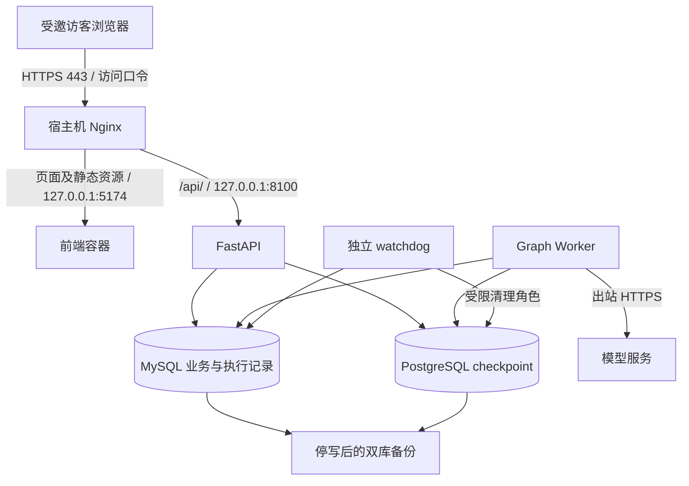

# SecondHand Agent 部署上线方案：面试演示版

> 调研/开发验收更新：2026-10-27。实际部署候选：`refactor/langgraph`，提交 `b96a2be9a65e4a5c4a72fd96d1f834dc4f2fb510`；D0～D5 已完成，候选远端 CI 通过。原调研基线 `c6dcaa42` 保留在历史记录。
> 本文是部署设计与实施手册。本次仅编写文档，尚未购买服务器、配置域名或执行云端部署。文中新增配置均为待落地模板；目标服务器的部署结果须按验收清单记录。

## 1. 结论与上线范围

当前项目可以部署成供面试官实际操作的在线演示系统。推荐首版采用 **一台云服务器 + Docker Compose + 宿主机 Nginx HTTPS 入口 + 邀请访问**，保留现有 FastAPI、前端、Worker、watchdog、MySQL 和 PostgreSQL 的分工。

首版展示以下真实能力：登录、发布演示商品、维护卖家授权、买家多轮协商、卖家审批、买家最终确认，以及异常恢复和执行记录。系统完成的是**交易意向确认**；支付、库存锁定、真实订单、物流履约均不在上线范围内。

推荐先选择“预约时间、有人值守、少量受邀用户”的演示模式。只有补上可验证的全站费用控制后，才扩展为长期无人值守的自助体验。服务器启动成功不代表已通过正式生产验收。

沿用此前已经确定的安排：

| 事项 | 本轮处理方式 |
|---|---|
| 独立、具有真实用户代表性的测试集及风险负例规模 | 暂缓；现有调优集通过情况不能替代独立泛化验证 |
| 人工复核 AI 质量评测 | 暂缓；保留 AI 评测口径和未复核限制 |
| LangSmith 云端上传完整性、远端回读 | 暂缓；不作为受限演示的运行依赖 |
| 正式时延、成本验收标准 | 暂缓；不承诺 SLA 或单位场景成本上限 |

访问密码、HTTPS、备份、限制模型滥用属于公网演示的基本运行措施，不等于重新要求完成上述四类正式验收。

## 2. 当前项目已经具备什么

以下结论来自当前代码和已有交付记录，而非通用部署假设。

| 能力 | 当前实现与部署含义 | 依据 |
|---|---|---|
| 容器交付 | 前后端均有 Dockerfile，Compose 已编排完整依赖 | `compose.yaml`、`backend/Dockerfile`、`frontend/Dockerfile` |
| 后台执行 | API 接收输入，独立 Worker 执行图，独立 watchdog 清理失效执行 | `backend/app/workers/` |
| 双库存储 | MySQL 保存业务与执行记录；PostgreSQL 保存 LangGraph checkpoint | `backend/app/runtime/`、`backend/app/persistence/` |
| 数据初始化 | MySQL 迁移、演示数据和 PostgreSQL 权限初始化均为独立任务 | `migrate`、`seed`、`checkpoint-setup` 服务 |
| 身份认证 | 应用使用 HttpOnly Cookie；支持 Secure 配置和账号权限校验 | `backend/app/api/auth.py`、`dependencies.py` |
| 服务检查 | `/api/health` 为存活检查；`/api/ready` 检查双库、服务进展和必要配置 | `backend/app/api/health.py` |
| 一致备份 | 已有停写后的双库备份脚本及恢复手册 | `backend/scripts/backup_p6.py`、[P6 运行手册](P6_运行与复验.md) |
| 本地交付验证 | D5 协议 360 通过/1 显式浏览器跳过、业务 461、独立浏览器 47 通过；真实 HTTP、生产浏览器和完整应用恢复通过，25 次模型调用。测试集有重叠，不相加 | [D5 实施与发布记录](部署前开发修复与验收记录.md) |
| GitHub CI | 候选 `b96a2be` 的 `P6 deterministic and database gates` 两项作业均成功，包含 Linux Chromium 故障回归 | [候选 CI](https://github.com/Zz9468/secondhand-agent/actions/runs/40487159960) |

P6 与各阶段“未触发远端 CI”等文字描述当时状态；当前以 D5 发布补记及上述候选 CI 为准。后续仅文档补记使用 `[skip ci]`，不改变受验应用。开发通过仍不代表公网、服务器容量或云端恢复已通过。

现有开发集包含 194 个非冒烟场景，重复三次并加 200 次开发冒烟形成主批次 782 次运行。业务检查通过不代表 194 个场景都已在新部署网站上人工走完；辅助 judge 为 580/582，质量适用聊天回合中兜底为 596/1209（49.3%）。这些结果说明还需要检查实际演示体验，不能将其包装为独立用户测试或全部回答质量通过。[P5 最终复验报告](P5_120场景最终复验报告.md)

当前有以下会影响部署选择的约束：

1. **数据库连接目标有固定校验。** `backend/app/runtime/readiness.py` 要求 MySQL 使用 `langgraph_app` / `secondhand_langgraph`，主机为 `mysql` 或本机；PostgreSQL 使用 `checkpoint_worker` / `secondhand_checkpoints`，主机为 `checkpoint` 或本机。因此不能只改连接串就接入远程托管数据库。
2. **PostgreSQL 不只是普通存储。** 初始化需要创建角色和受限清理函数，运行依赖专用连接与会话级锁。迁移到托管 PG 前必须验证权限，不能直接接在事务池代理后面。
3. **默认 Worker 串行执行。** 一个父进程同一时间监督一个执行子进程；`batch-size=20` 是扫描数量，不是 20 路模型并发。
4. **已有预算不等于金额总闸。** 当前 `negotiation-v3` 的输入配置为最多 10 次模型调用、180000 tokens、120 秒活动预算，`max_cost=None`；父监督器另有 150 秒绝对上限。旧配置字段 `AGENT_MAX_ESTIMATED_COST` 不能直接当作新版生效的全站费用开关。
5. **关闭新会话不能停止全部费用。** `GRAPH_CHAT_ENABLED=false` 仅阻止新建协商，已有会话仍可继续提交输入。
6. **评测 trace 与线上记录不同。** 评测工具会生成本地回调记录和指标文件；普通线上请求目前没有自动开启同样的 JSONL 留存。线上已有的是业务/执行账本、checkpoint 和运行日志，不能声称每次请求都已完整保存为本地 LangSmith trace。
7. **语义质量的适用范围。** P6 曾观察到的“提交报价”被拆成报价与确认、配送修改误判等缺陷，已由 D4 定向修复并经真实模型复验。D5 仍观察到非核心回复冗余；现有场景属于已见开发回归，不代表所有自然语言表达正确或独立质量泛化通过。详见开发验收记录第 4.5/4.6 节。

## 3. 方案比较与选择

| 方案 | 对当前项目的适配程度 | 本轮决定 |
|---|---|---|
| 单台云服务器 + Compose | 能直接沿用常驻 Worker、双库、本地卷和现有初始化流程 | **采用** |
| 前端静态托管 + 后端平台服务 | 需要拆分部署、跨域认证、常驻任务、持久卷和数据库权限验证 | 后续再评估 |
| 托管 MySQL / PostgreSQL | 有运维便利，但需修改目标校验并验证 PG 权限、专用连接和恢复流程 | 首版暂不采用 |
| Kubernetes / 多机高可用 | 当前演示规模不足以抵消新增运维工作 | 暂不采用 |
| 仅发布静态页面或演示视频 | 适合作为故障备用介绍，但不能执行完整协商链路 | 作为备用材料 |

这是结合本项目约束做出的工程选择。Docker 官方支持单机 Compose 部署，并建议通过附加 Compose 文件覆盖生产配置，适合本轮复用现有编排。[Docker 官方说明](https://docs.docker.com/compose/how-tos/production/)

### 3.1 服务器与地域

- **建议起点：** Ubuntu 24.04 LTS、x86_64、4 vCPU、8 GB 内存、80 GB SSD，一台带公网地址的云服务器。应用调用外部模型，不需要 GPU。这是待压测的资源建议，不是已验证容量。
- **低成本试跑：** 可以评估 2 vCPU / 4 GB，但双库、构建过程和执行子进程会竞争内存；先验证构建和演示期间没有 OOM，再决定是否长期使用。
- **并发：** 首版保留一个 Worker，按一位访客进行复杂协商的演示节奏准备。增加 Worker 前再测队列等待、内存与数据库连接数。
- **地域：** 若主要面向国内面试官、尚无已备案域名，可优先比较香港节点；已有备案条件也可使用内地节点。先验证访客到服务器、服务器到实际模型端点的可达性与耗时，再购买长期套餐。

Docker 当前官方安装文档支持 Ubuntu 24.04 LTS，安装应采用其 apt 仓库流程。[Docker Ubuntu 安装说明](https://docs.docker.com/engine/install/ubuntu/)

内地节点的网站接入需要按接入商要求办理 ICP 备案；阿里云说明其香港、海外节点不需要 ICP 备案。这一地域差异不能推导为免除其他适用要求，正式选址时核对接入商最新规定。[阿里云备案说明](https://help.aliyun.com/zh/icp-filing/basic-icp-service/user-guide/icp-filing-application-overview)

### 3.2 费用估算方式

首版不采购 GPU、负载均衡器、Kubernetes 或托管数据库。月度费用按下式登记：

```text
总费用 = 云服务器 + 公网带宽/流量 + 域名摊销 + 异地备份存储 + 模型 API 用量
```

比较实际购买页的地域、续费价、流量上限和备份费用，不把促销首月价当作长期预算。模型成本按实际供应商、模型和缓存计费规则计算；已有评测金额不能直接换算为每位访客的固定费用。

本轮尚未确定云厂商、域名、月度预算和每日模型额度，均作为实施前的配置输入，不在文档中假定已经购买或获得额度。

## 4. 目标架构与网络



云安全组仅开放 80/443；SSH 22 限制为维护者来源地址。保留 Compose 当前所有端口的 `127.0.0.1` 绑定，8100、5174、3307、5433 均不开放到公网。容器内部继续使用 `mysql:3306`、`checkpoint:5432`。

不能只依赖 UFW 阻挡已经由 Docker 发布到公网的端口；Docker 官方明确说明此类端口可能绕过 UFW 规则。因此本方案同时采用回环地址绑定和云安全组限制。[Docker 防火墙说明](https://docs.docker.com/engine/install/ubuntu/#firewall-limitations)

**外层 Nginx 将 `/api/` 直接转给 API。** 现有前端容器的 Nginx 会把 `X-Forwarded-Proto` 设为自己的 `$scheme`，经过内部 HTTP 代理后可能变成 `http`。直接分流既复用现有端口，也避免这层覆盖。浏览器统一使用一个 HTTPS 域名，不需要另开 API 域名。

## 5. 上线前需要落实的工作

| 优先级 | 工作 | 完成判据 |
|---|---|---|
| 必做 | 云端使用全新 `.env`、数据库卷和模型凭据 | 与本机开发、旧版 main 环境隔离 |
| 必做 | HTTPS、外层访问认证、应用 Cookie 安全配置 | 访客必须经过两层身份检查；浏览器无混合内容错误 |
| 必做 | 限制高成本写请求与认证请求 | 超限明确返回 429，不误伤状态轮询 |
| 必做 | 添加演示说明和体验步骤 | 明确虚拟商品、无支付履约、不输入真实个人资料 |
| 必做 | 配置日志轮转、备份位置和维护入口 | 磁盘增长可控，备份能在隔离环境恢复 |
| 必做 | 云端小规模真实模型验收 | 完成咨询、审批、确认、重启恢复等路径 |
| 长期开放前必做 | 全站模型用量/费用熔断，或经验证的供应商硬额度 | 达到额度后新收费调用确实停止 |
| 后续 | 邀请码、自动过期体验账号、在线 trace journal、部署自动化 | 单独实施和回归，不冒充当前已实现 |

“演示说明”建议放在登录页和商品页面，文字可直接使用：

> 这是 SecondHand Agent 的在线演示环境。商品与交易均为演示用途，系统仅生成交易意向，不收款、不发货。请勿填写真实手机号、地址或支付信息。对话可能因授权、模型判断或运行预算而进入澄清、审批或安全终止流程。

## 6. 首次部署步骤

以下命令均在**目标 Ubuntu 服务器的 Bash** 中执行，不是在当前 Windows PowerShell 中执行。示例域名 `demo.example.com` 必须替换为实际域名。部署账号须已具备所需 sudo 和 Docker 权限。

### 6.1 准备服务器与固定版本

按 Docker 官方 apt 安装说明安装 Docker Engine、Buildx 和 Compose 插件；安装 `git`、`python3-venv`、`nginx`、`apache2-utils`。Docker Compose 插件需要支持 `--wait`。

```bash
sudo install -d -m 0750 -o "$USER" -g "$(id -gn)" \
  /srv/secondhand /srv/secondhand/ops /srv/secondhand/backups
git clone --branch refactor/langgraph \
  https://github.com/Zz9468/secondhand-agent.git /srv/secondhand/app
cd /srv/secondhand/app
git checkout --detach b96a2be9a65e4a5c4a72fd96d1f834dc4f2fb510
git status --short
docker version
docker compose version
python3 -m venv /srv/secondhand/ops-venv
/srv/secondhand/ops-venv/bin/python -m pip install python-dotenv==1.2.3
umask 077
PYTHONPATH=backend /srv/secondhand/ops-venv/bin/python -m scripts.bootstrap_p6
chmod 600 .env
```

这里固定的是已通过 D5 本地交付与远端 CI 的实际候选。部署方案自身的后续文档提交不改变该应用版本。若新增应用、测试、依赖或构建变更，应重新验证并绑定新 SHA；不以移动的分支名替代发布记录，也不需要合并 `main` 才能上线。

本次还未产生云端发布镜像。首次部署须从上述候选构建，令 `DEPLOY_IMAGE_TAG` 等于完整 SHA，并按第 6.4/10 节记录实际前后端镜像 ID、MySQL/PG 摘要和配置/备份对应关系。D5 本地 `:local` 测试镜像及初始镜像 ID 仅在本地 evidence 中留作复验依据，不是云端回退版本；首发前不存在已验收的旧云端版本。

宿主机虚拟环境只运行配置、备份辅助脚本，应用仍使用镜像中的 Python 3.11。`python-dotenv==1.2.3` 来自当前锁文件。不要把本机整个 `.env` 或旧项目数据目录复制上来。

### 6.2 填写配置

在权限受控的编辑器中修改服务器 `.env`，不要把密钥作为 shell 命令参数粘贴或提交 Git。

| 配置 | 本轮取值/要求 |
|---|---|
| `MODEL_PROVIDER`、`MODEL_NAME`、`MODEL_BASE_URL` | 保留已经验证的模型组合；供应商端点从服务器实测可达。上线时更换模型需要重新验收 |
| `MODEL_API_KEY` | 独立演示凭据，只配置在后端 |
| 三项 `MODEL_*_PRICE_PER_MILLION`、`MODEL_COST_CURRENCY` | 按该供应商真实费率填写；未知费用不能记作零 |
| `AUTH_SECRET`、数据库口令、`DEMO_SELLER_PASSWORD` | 使用 bootstrap 新生成的值，卖家密码仅交维护者管理 |
| `AUTH_COOKIE_SECURE` | `true` |
| `CORS_ORIGINS` | JSON 数组，例如 `["https://demo.example.com"]`，不要用通配符 |
| `GRAPH_CHAT_ENABLED` | `true` |
| `GRAPH_REQUIRE_SERVICES` | Compose 已固定为 `true` |
| `GRAPH_LANGSMITH_TRACING` | 首版 `false`，保留已决定暂缓的远端观测事项 |
| `DEPLOY_IMAGE_TAG` | 添加为本次实际提交的完整 SHA，用于下面的镜像标签 |
| `EVALUATION_GIT_COMMIT`、`EVALUATION_GIT_WORKTREE_DIRTY` | 可分别填写实际 SHA、`false`，前提是代码确实干净 |

若使用阿里云百炼，API Key、接入域名和模型列表需要对应同一地域；可以使用独立业务空间、限制模型和来源 IP。若当前接入的是其他兼容服务，按实际供应商配置，不能根据模型名称认定供应商。[百炼 API Key 官方说明](https://help.aliyun.com/zh/model-studio/get-api-key)

当前 Compose 不会把 `.env` 的所有变量自动传给容器。下面显式传入 `ENVIRONMENT` 和 `USER_SESSION_MINUTES`；只在 `.env` 写 `ENVIRONMENT=production` 并不会自动改变当前容器配置，也不会自动关闭 FastAPI 文档入口。

### 6.3 添加演示环境 Compose 覆盖文件

将以下模板保存为服务器 `/srv/secondhand/ops/compose.demo.yaml`。该文件本身不包含密钥，实施后可将通用版本纳入仓库；本次方案编写尚未创建它。

```yaml
x-demo-logging: &demo-logging
  driver: local
  options:
    max-size: "10m"
    max-file: "3"

x-demo-backend: &demo-backend
  image: secondhand-agent-langgraph-backend:${DEPLOY_IMAGE_TAG:?Set DEPLOY_IMAGE_TAG}
  logging: *demo-logging

services:
  api:
    <<: *demo-backend
    environment:
      ENVIRONMENT: production
      USER_SESSION_MINUTES: "120"
  worker:
    <<: *demo-backend
    environment:
      ENVIRONMENT: production
  watchdog:
    <<: *demo-backend
  migrate:
    <<: *demo-backend
  seed:
    <<: *demo-backend
  checkpoint-setup:
    <<: *demo-backend
  frontend:
    image: secondhand-agent-langgraph-frontend:${DEPLOY_IMAGE_TAG:?Set DEPLOY_IMAGE_TAG}
    logging: *demo-logging
  mysql:
    logging: *demo-logging
  checkpoint:
    logging: *demo-logging
```

Compose 会合并基础文件中的构建、端口、卷、依赖和环境变量。watchdog 仍仅保留它原有的数据库/清理权限，不给它追加模型密钥。镜像使用提交标签，便于同时保留新旧版本；本地构建仍需另记实际镜像 ID。

这里选择带轮转的 `local` 日志驱动，避免默认 `json-file` 长期无上限增长；轮转仅作用于容器日志，不会限制数据库、备份和评测文件的大小。[Docker 日志说明](https://docs.docker.com/engine/logging/configure/)

再保存 `/srv/secondhand/ops/compose-env.sh`：

```bash
export COMPOSE_FILE=/srv/secondhand/app/compose.yaml:/srv/secondhand/ops/compose.demo.yaml
export COMPOSE_PROJECT_NAME=secondhand-demo
export COMPOSE_ENV_FILES=/srv/secondhand/app/.env
```

每次运维先执行：

```bash
cd /srv/secondhand/app
source /srv/secondhand/ops/compose-env.sh
docker compose config --quiet
```

使用 `--quiet` 检查配置，避免把包含展开后密钥的完整配置输出到日志。Linux 下 `COMPOSE_FILE` 用冒号分隔；项目名必须长期固定，否则可能意外创建另一套空数据卷。备份脚本内部调用裸 `docker compose`，继承这组环境变量才能命中正确项目。[Compose 环境变量说明](https://docs.docker.com/compose/how-tos/environment-variables/envvars/)

### 6.4 构建和启动内部服务

```bash
docker compose pull mysql checkpoint
docker compose build api frontend
install -d -m 0750 backend/evaluation/results
APP_UID=$(docker run --rm --network none --entrypoint id \
  "secondhand-agent-langgraph-backend:$(git rev-parse HEAD)" -u)
APP_GID=$(docker run --rm --network none --entrypoint id \
  "secondhand-agent-langgraph-backend:$(git rev-parse HEAD)" -g)
sudo chown "$APP_UID:$APP_GID" backend/evaluation/results
docker compose up -d --wait --wait-timeout 180 frontend
docker compose ps -a
curl --fail --silent --show-error http://127.0.0.1:8100/api/ready
```

该流程要求 `DEPLOY_IMAGE_TAG` 与 `git rev-parse HEAD` 一致。API 的评测输出目录为宿主机绑定挂载，镜像内 `app` 用户的权限不会自动覆盖宿主机权限，因此只调整这个专用输出目录的所有权。不要递归改动整个仓库权限。

`migrate`、`seed`、`checkpoint-setup` 正常完成后显示 `Exited (0)`，不应把它们当成必须常驻的服务。其余服务需运行且通过各自检查。`/api/ready` 成功仍只说明配置及基础依赖就绪，真实模型能力须在第 8 节验证。

记录本次 `git rev-parse HEAD`、前后端镜像 ID、MySQL/PG 镜像摘要、Compose 版本和迁移版本。后续发布不要顺便更新数据库大版本；本方案沿用仓库声明的版本。

### 6.5 配置 HTTPS 与邀请入口

域名 A 记录指向服务器；只有 IPv6 链路也验证通过时才添加 AAAA 记录。安装 Certbot 使用其官方流程。[Certbot 官方指南](https://certbot.eff.org/instructions?os=snap&ws=nginx)

先建立 `/var/www/letsencrypt`，让 Nginx 的临时 HTTP 站点只服务证书挑战，其余请求返回 503。此时不开放 HTTP 登录：

```nginx
server {
    listen 80;
    server_name demo.example.com;
    location ^~ /.well-known/acme-challenge/ {
        root /var/www/letsencrypt;
    }
    location / { return 503; }
}
```

检查并加载临时配置后，申请证书和创建访客入口账号：

```bash
sudo install -d -m 0755 /var/www/letsencrypt
sudo nginx -t
sudo systemctl reload nginx
sudo certbot certonly --webroot -w /var/www/letsencrypt \
  -d demo.example.com --email YOUR_EMAIL --agree-tos
sudo htpasswd -cB /etc/nginx/secondhand-demo.htpasswd interviewer
sudo chown root:www-data /etc/nginx/secondhand-demo.htpasswd
sudo chmod 640 /etc/nginx/secondhand-demo.htpasswd
```

`htpasswd` 交互输入密码；首次创建才使用 `-c`，以后添加账号省略它，以免覆盖既有账号。可以按邀请分配不同入口账号；入口口令不等于应用内的买家/卖家账号。[Nginx Basic Authentication 说明](https://nginx.org/en/docs/http/ngx_http_auth_basic_module.html)

将临时配置替换为以下完整示例。Ubuntu 默认的 `/etc/nginx/conf.d/*.conf` 包含在 `http` 块内，适合放置这里的 `map`、`limit_req_zone` 和 `server`。确认没有其他站点通过额外端口代理本应用。

```nginx
map "$request_method:$uri" $demo_auth_key {
    default "";
    ~^POST:/api/auth/(login|register)/?$ $binary_remote_addr;
}
map "$request_method:$uri" $demo_input_key {
    default "";
    ~^POST:/api/negotiations(/[0-9]+/(messages|confirm|close))?/?$ $binary_remote_addr;
}
limit_req_zone $demo_auth_key zone=demo_auth:10m rate=6r/m;
limit_req_zone $demo_input_key zone=demo_inputs:10m rate=12r/m;
log_format demo_access '$remote_addr [$time_local] "$request_method $uri $server_protocol" '
                       '$status $body_bytes_sent $request_time';

server {
    listen 80;
    server_name demo.example.com;
    location ^~ /.well-known/acme-challenge/ {
        root /var/www/letsencrypt;
    }
    location / { return 301 https://demo.example.com$request_uri; }
}

server {
    listen 443 ssl;
    server_name demo.example.com;
    ssl_certificate /etc/letsencrypt/live/demo.example.com/fullchain.pem;
    ssl_certificate_key /etc/letsencrypt/live/demo.example.com/privkey.pem;
    ssl_protocols TLSv1.2 TLSv1.3;
    server_tokens off;
    client_max_body_size 1m;
    auth_basic "SecondHand Agent Demo";
    auth_basic_user_file /etc/nginx/secondhand-demo.htpasswd;
    limit_req_status 429;
    access_log /var/log/nginx/secondhand-demo.access.log demo_access;
    error_log /var/log/nginx/secondhand-demo.error.log warn;
    add_header X-Content-Type-Options nosniff always;
    add_header Referrer-Policy same-origin always;

    location ^~ /docs { return 404; }
    location ^~ /redoc { return 404; }
    location = /openapi.json { return 404; }

    location /api/ {
        limit_req zone=demo_auth burst=3 nodelay;
        limit_req zone=demo_inputs burst=3 nodelay;
        proxy_pass http://127.0.0.1:8100;
        proxy_http_version 1.1;
        proxy_connect_timeout 5s;
        proxy_read_timeout 180s;
        proxy_set_header Host $host;
        proxy_set_header X-Forwarded-For $remote_addr;
        proxy_set_header X-Forwarded-Proto $scheme;
        proxy_set_header Authorization "";
    }

    location / {
        proxy_pass http://127.0.0.1:5174;
        proxy_http_version 1.1;
        proxy_set_header Host $host;
        proxy_set_header X-Forwarded-For $remote_addr;
        proxy_set_header X-Forwarded-Proto $scheme;
        proxy_set_header Authorization "";
    }
}
```

配置要点：

- Basic Auth 覆盖页面与整个 API，不能仅保护首页。应用原有 Cookie 认证继续生效；外层 `Authorization` 被剥离，避免把访客入口密码传入应用。
- `proxy_pass` 后不追加 `/`，保留原请求中的 `/api/` 路径。示例假设 Nginx 是唯一公网入口，直接使用客户端连接地址；未来加 CDN 或其他代理时，重新配置受信代理范围。[Nginx 代理说明](https://nginx.org/en/docs/http/ngx_http_proxy_module.html)
- 限流的 6 次/分钟、12 次/分钟和 burst 3 是演示初始建议，需要实测调整，不是已经约定的性能标准。空限流键不计数，因此 GET 轮询以及展示回执不会误套输入限额。[Nginx 限流说明](https://nginx.org/en/docs/http/ngx_http_limit_req_module.html)
- 当前前端约每 2 秒轮询，不能把全部 `/api/` 请求统一限制为低频。上述规则也不能替代账号额度、全站模型额度；卖家恢复等其他调用路径仍需纳入后续费用控制。
- 检查 Nginx 的 logrotate 覆盖新增日志。访问日志不写请求正文、Cookie、Authorization 或 URL 查询参数；维护过程也不要临时打开完整请求转储。

完成后执行 `sudo nginx -t`、`sudo systemctl reload nginx` 和 `sudo certbot renew --dry-run`。采用 `certonly --webroot` 时，还要配置 Certbot 的部署钩子，在证书实际更新后执行 `nginx -t` 与 `systemctl reload nginx`，不能只检查证书文件续期而遗漏 Nginx 重新加载。[Certbot 续期与钩子说明](https://eff-certbot.readthedocs.io/en/stable/using.html#renewing-certificates)

## 7. 演示账号、数据与费用控制

### 7.1 账号与数据

- 保留 `demo-seller` 给维护者使用；面试官使用独立买家账号。系统允许注册账号，外层邀请口令不等于应用已实现邀请码注册。
- 若需要体验卖家功能，单独创建该访客的卖家账号与演示商品，不共享维护者卖家密码或复用他人会话。
- seed 创建的商品标价为 3000，卖家底价为 2700，自动接受阈值为 2850。以数据库实际策略为准；更改规则后记录新版本。seed 并不等于已经配置完所有可信商品资料和配送规则，需要在卖家界面补齐。
- 设计自提场景，可以减少运费对净收入计算的干扰。自动接受、人工审批和拒绝场景分别准备，最终确认必须基于真实展示的有效卡片。
- 不上传本机历史评测记录、旧项目数据库或真实聊天样本。演示商品注明“虚拟演示”，不录入真实联系地址、手机号和支付信息。
- 不通过清空表、删除 checkpoint 或 `docker compose down -v` 实现日常重置；已有审计与恢复义务继续按 P6 规则保留。

### 7.2 分两阶段开放

| 模式 | 必要措施 | 当前适用性 |
|---|---|---|
| 预约、有人值守的少量演示 | 独立密钥、入口邀请、输入限流、单 Worker、实时查看账单/用量、可立即停止处理 | 首次上线采用；仍不能承诺绝不超过金额预算 |
| 长期无人值守自助体验 | 上述措施 + 持久化的用户/全站额度 + 每次模型调用前的额度检查，或经验证覆盖全部模型调用的供应商硬限额 | 应先补齐并验收，再开放 |

如果实施应用级额度，应在**真正发起模型请求之前**进行原子额度预留，覆盖重试、审查、压缩及恢复调用；返回 usage 后结算，缺失 usage 或供应商响应不确定时保守处理。仅在入口数聊天消息，或事后累加账本，不能实现可靠的并发金额上限。该功能目前属于待开发项。

控制台预算告警、账户余额、赠送额度、TPM/RPM 各有不同含义，不能未经验证就视为硬消费上限。每天允许多少模型调用、多少金额，由维护者在部署前填入运行记录；这是保护演示资源的操作值，与暂缓的正式成本验收标准分开管理。

紧急停止新收费调用时，先把 HTTPS 入口切为维护页，再停止 `api` 和 `worker`；watchdog 可继续完成已失效执行的清理。已经发送给供应商的请求可能仍产生费用。不要只设置 `GRAPH_CHAT_ENABLED=false`，也不要用删除账本或 checkpoint 的方式止损。

## 8. 上线验收清单

这是一组**部署验收**，不替代 194 场景评测，也不要求本轮重新构建独立测试集。先在云端演示数据上完成，保存提交、配置版本、时间、账号代号和结果；报告中隐藏口令与业务私密字段。

| 检查项 | 方法与通过条件 |
|---|---|
| 公网端口 | 从服务器以外验证，仅预期的 80/443 可访问；SSH 符合来源限制，8100/5174/3307/5433 不可访问 |
| HTTPS | HTTP 跳转到 HTTPS；证书域名正确；续期 dry-run 成功并配置重新加载钩子 |
| 入口保护 | 未提供邀请口令时页面/API 均不可使用；API 文档入口返回 404 |
| 应用认证 | 通过入口但未登录应用，私有接口仍拒绝访问；Cookie 有 HttpOnly、Secure 和 SameSite；退出后不能再访问私有会话 |
| 就绪 | `/api/ready` 返回 200；MySQL、checkpoint、Worker、watchdog 均正常。探测本身不调用模型 |
| 模型连通 | 用一个真实咨询完成调用，验证输出、账本 usage、模型身份及失败提示，而非仅验证密钥非空 |
| 买卖家隔离 | 两个买家不能读取彼此私有会话；买家不能执行卖家审批或读取底价 |
| 正常业务 | 咨询、提交报价、授权内结果、审批区报价、卖家批准/拒绝、买家基于有效卡片确认、关闭会话均有记录 |
| 确认安全 | 不以自由文本猜测最终确认；过期或不属于当前买家的展示凭据不能推动成交意向 |
| 幂等与刷新 | 页面刷新、重复提交已有 request_id、断网后恢复，不重复产生业务动作 |
| 限流 | 用不触发模型的认证失败请求或隔离测试验证 429；GET 轮询和展示回执仍正常 |
| 失败恢复 | 在隔离演示会话里验证受控模型失败/Worker 重启，卖家恢复页可按既有规则处理；不手改数据库 |
| 数据持久性 | 重启应用容器后，已有商品、会话、审批状态和执行依据保持一致 |
| 备份恢复 | 同一次停写备份的两个库恢复到隔离环境，核验关键记录与权限，并完成只读检查和少量业务复验 |
| 实际容量 | 记录单用户体验，再测试少量重叠输入的排队、内存、数据库连接和错误；不据此宣称高并发 |

等待提示应区分“请求已接受/排队”“执行中”“等待审批”“需要澄清/恢复”。HTTP 202 不是协商完成。面试展示测量从点击发送到页面出现结果的实际耗时，包括排队、执行、持久化和轮询等待，不能拿内部模型耗时直接代替。

**首次可开放条件：** 第 5 节必做项和上述验收通过、维护者掌握停服/恢复步骤、文案明确演示边界。已决定暂缓的四类事项继续标记为暂缓。任意认证隔离、重复业务动作、双库一致性问题未解决时，先保留介绍页和录屏，不开放交互演示。

## 9. 运行监控与记录

首版使用现有数据库记录、Compose 健康检查和日志即可起步，不依赖 LangSmith 额度恢复。另配置轻量的定时检查或云监控；告警通知渠道由维护者实际填写，当前仓库没有替你接通外部告警。

| 信号 | 初始建议与操作 |
|---|---|
| HTTPS、`/api/ready` | 每分钟探测，连续 3 次失败通知维护者；公网探测使用独立入口账号，不将口令写入 URL |
| Worker/watchdog | 结合心跳与容器状态检查；仅 API health 为绿不代表可以协商 |
| 磁盘和内存 | 初始可设磁盘 80% 提醒、持续高内存/OOM 提醒，观察后调整 |
| 输入等待和执行失败 | 关注队列积压、过期执行、`checkpoint_cleanup_failed`、通知未完成和安全终止 |
| 模型费用 | 演示期间观察用量，按日对账；缺失计费信息单独列出，不记为零 |
| 证书与备份 | 监控续期失败、最近成功备份时间、异地副本和恢复演练结果 |

常用命令：

```bash
cd /srv/secondhand/app
source /srv/secondhand/ops/compose-env.sh
docker compose ps -a
docker compose logs --tail 100 api worker watchdog
docker stats --no-stream
curl --fail --silent --show-error http://127.0.0.1:8100/api/ready
```

需要解释某个协商的图执行时，可使用既有 `scripts.export_graph_execution` 导出 checkpoint 历史，参见 [P6 手册](P6_运行与复验.md)。它不是完整模型调用 trace；子进程日志也不能替代全部结构化执行依据。若以后需要每个线上请求的本地回调 journal，应单独开发脱敏、轮转、保留与导出机制。

## 10. 双库备份、恢复与版本回退

### 10.1 备份

首次开放前、每次升级前各做一次一致备份；有人值守演示结束后可再做一次。长期运行后再安排固定维护窗口。当前脚本要求停写，首版接受短暂维护时间，不声称在线无损备份或零数据丢失。

先将外层入口切为维护页，确认没有另外启动的源码进程或管理脚本在写库；让正在执行的输入尽可能正常结束，再停止写入服务：

```bash
cd /srv/secondhand/app
source /srv/secondhand/ops/compose-env.sh
docker compose stop frontend api worker watchdog
umask 077
BACKUP_DIR="/srv/secondhand/backups/$(date -u +%Y%m%dT%H%M%SZ)"
PYTHONPATH=backend /srv/secondhand/ops-venv/bin/python \
  -m scripts.backup_p6 --output "$BACKUP_DIR"
docker compose up -d --wait --wait-timeout 180 frontend
curl --fail --silent --show-error http://127.0.0.1:8100/api/ready
```

逐步检查命令返回值，备份失败不能记录为完成。输出目录必须全新，成功后包含 `mysql.sql`、`checkpoint.dump`、`manifest.json`，后者记录双文件 SHA-256。恢复健康并确认无异常后再恢复外部访问。

将备份加密复制到服务器之外的受控存储，并单独安全保存 `.env`、部署配置和镜像/提交记录；备份脚本不包含配置密钥。备份含认证散列、私有业务和执行凭据，不能放进公开 GitHub、普通 CI 工件或公开下载目录。首版不添加自动物理删除任务，继续遵守 P6 的审计保留与归档约束。

### 10.2 恢复

1. 停止入口和所有写入，先备份当前故障状态。
2. 校验待恢复备份的两个文件哈希，使用同一份 manifest，不混用不同时间的两库备份。
3. 在新的隔离环境准备空 MySQL/PG 数据库，保持项目所要求的账号、库名和连接身份；使用独立 Compose 项目与卷，避免覆盖运行环境。
4. 导入 `mysql.sql`，使用 `pg_restore --no-owner --no-acl --exit-on-error` 导入 `checkpoint.dump`。
5. 重新执行 `checkpoint-setup` 建立运行账号和受限权限，核对 MySQL 迁移版本与应用提交兼容。
6. 核对关键业务表、回执/幂等记录、执行账本和 checkpoint，再启动对应版本 API/Worker/watchdog，完成部署冒烟后切换入口。

具体恢复与审计约束以 [P6 运行手册](P6_运行与复验.md) 为准。不要只恢复其中一个库。第一次公网开放前至少完成一次实际恢复演练，不能把“生成了备份文件”当作“已经能恢复”。

### 10.3 更新与回退

采用“CI 通过 → 固定新提交 → 构建新提交标签镜像 → 维护窗口停写备份 → 执行迁移/权限检查 → 启动 → 冒烟 → 开放”的顺序。初始化任务应确认本次重新执行，不依赖以前残留的 `Exited (0)` 容器推断迁移已经完成；需要时显式使用 `docker compose run --rm migrate`、`checkpoint-setup`、`seed` 顺序执行并检查结果。

- **兼容性回退：** 若没有不兼容数据变化，可切回旧提交、旧 `DEPLOY_IMAGE_TAG` 和对应配置，使用已保留镜像重建应用，复验后开放。
- **不兼容迁移：** 先在隔离环境恢复升级前的成对双库备份，再切换；会丢失备份之后的新增状态，必须事先评估并记录。
- 不自动执行 Alembic downgrade。当前迁移存在审计保护，不能为了回退而删除恢复依据。
- 不把旧 `main` Runtime 接到新版数据库，也不把“切回 main”当成新版部署回退方法。
- 修改 `.env` 后通过 `docker compose up -d --force-recreate` 重建受影响的应用服务；单独 `restart` 不会更新容器环境变量。[Docker restart 说明](https://docs.docker.com/reference/cli/docker/compose/restart/)

日常维护不执行 `down -v` 或清理仍需回退的镜像、卷。记录可接受的数据恢复点和预计维护时间；这些运维目标需通过演练测量后填写，本文不伪造已达成的 RPO/RTO。

## 11. GitHub 展示与后续自动化

GitHub 当前默认分支已是 `refactor/langgraph`，可以从该分支部署；保持 `main` 不合并不影响上线。发布记录必须绑定具体 SHA，分支只作为开发与展示入口。

上线后再更新 README，增加：在线体验地址、申请/获取体验权限的方法、简短演示录屏、架构图、已验证能力和已知限制。**不要公开入口密码、卖家口令或模型 Key。** 面试官未取得访问口令时，GitHub 上的录屏和操作说明仍应能解释项目价值。

现有 CI 可继续作为代码合入/发布前检查；真实模型评测工作流保持手动触发，避免每次 push 都产生评测费用。当前没有完整 CD，首次部署采用人工发布。稳定后再添加镜像构建、推送、固定版本发布及上线后冒烟；不要将新增部署流水线表述为已经完成。

## 12. 实施顺序与交付物

| 顺序 | 实施内容 | 应产生的结果 |
|---|---|---|
| 1 | 确定云厂商、地域、域名、月度预算、演示开放方式 | 资源与访问安排表 |
| 2 | 补充演示文案，整理通用配置，运行现有 CI | 可发布的固定提交 |
| 3 | 准备服务器、全新密钥、Compose 配置、HTTPS 与邀请入口 | 可受控访问的云端环境 |
| 4 | 准备虚拟商品、可信资料、账号和审批场景 | 可重复演示的操作步骤 |
| 5 | 执行第 8 节验收和双库恢复演练 | 脱敏的云端部署验收记录 |
| 6 | 确认停服、费用查看、备份和故障处理责任 | 简短运维记录与最近备份 |
| 7 | 发布体验地址及录屏到项目说明 | 面试官可理解、可申请体验的入口 |
| 8 | 有长期开放需求时补齐全站额度与自动化 | 再评估无人值守开放条件 |

部署记录至少填写：实际提交、镜像 ID/摘要、服务器地域与规格、Compose 项目名、域名、模型供应商/模型名、验收时间、备份位置、维护者、开放时间段、费用操作阈值、已知限制。密钥只记录保管位置，不记录明文。

本方案的直接交付目标是：**让面试官能在受限公网环境中体验当前 Agent 的真实业务闭环，并让维护者能够检查、停止和恢复服务。** 正式生产推广、真实交易接入及此前暂缓的四类验收，保留为后续独立阶段。

## 13. 本文配置示例的校验记录

编写期间已完成以下检查：

- 将 Compose 覆盖示例与当前 `compose.yaml` 合并，通过 `docker compose config` 解析；使用专门生成的测试配置，未读取或输出真实部署密钥。
- 核验合并后端口仍只绑定 `127.0.0.1`，镜像标签覆盖完整，watchdog 没有被追加模型或认证密钥。
- 7 个 Bash 代码块通过 `bash -n` 语法检查。
- 两份 Nginx 配置在现有前端镜像的独立临时容器中通过 `nginx -t`；使用测试证书，关闭容器网络，没有替换正在运行的应用服务。
- 检查 Markdown 代码围栏和文档内相对链接。

以上只证明示例语法和部分配置关系可解析，**不证明公网 DNS、真实证书申请、云端模型可达性、限流效果、服务器容量或恢复时间已通过验证**。这些结果需要在实施时另行记录。
